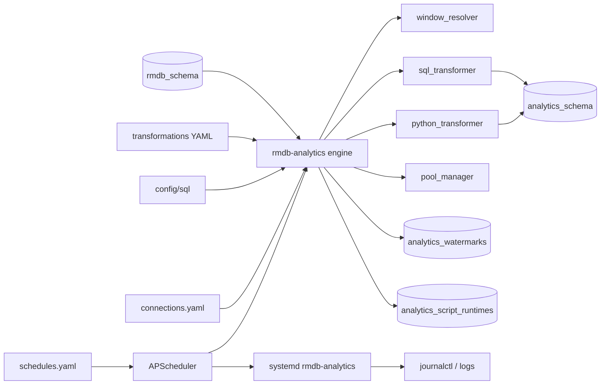

<!-- Synced from rmdb-analytics/docs/documentation.md. Edit there, then re-run scripts/sync-docs.sh -->

# RMDB Analytics Documentation

## 1. Project Overview

### Executive Summary

**rmdb-analytics** is the configuration-driven analytics layer for the Risk Management Data Warehouse (RMDB). It replaces the legacy Java **RMDB_Analytics** application with a Python service that runs on a schedule, reads operational data already landed in `**rmdb_schema`** (primarily by **[rmdb-etl](https://github.com/uvindu-perera/rmdb-etl)**), and maintains aggregate and derived tables in `**analytics_schema`** on the same PostgreSQL instance.

The service is intended for deployment on Ubuntu infrastructure at `**10.2.60.146**`, managed as a **systemd** unit (`rmdb-analytics`), so analytics tables are refreshed continuously and predictably. Those tables feed **risk management dashboards** and related reporting: the platform is designed so **new analytics tables can be added** and **existing definitions can change** as business requirements evolve, with changes expressed mainly through YAML and SQL rather than ad hoc scripts.

### Problem Statement

Risk dashboards depend on stable, timely aggregates (counts, rollups, penalties, HS summaries, container movement metrics, and similar). Before a dedicated analytics service, that logic often lived in legacy batch jobs or one-off extracts, which creates friction:

- **Operational split**: warehouse loads (ETL) and dashboard-ready aggregates are not clearly separated, making ownership and troubleshooting harder.
- **Legacy stack**: the prior Java analytics application is harder to extend and align with the modern ETL and Postgres-first RMDB model.
- **Change control**: adding or adjusting a metric without a repeatable pipeline increases the risk of inconsistent definitions across environments.
- **Recovery and audit**: without explicit watermarks and run history, catching up after downtime or validating “what ran when” is more difficult.

These gaps reduce confidence in dashboard figures and slow delivery when risk teams need new measures or revisions to existing tables.

### Core Objectives

**rmdb-analytics** is built to achieve the following objectives:

- **Decouple analytics from extraction**: keep **rmdb-etl** focused on landing standardized operational data in `**rmdb_schema`**, while this service owns **transformation into `analytics_schema`** for dashboard consumption.
- **Run reliably as a service**: support **scheduled** execution on `**10.2.60.146`** via **systemd**, with predictable logging and operational procedures similar to **rmdb-etl**.
- **Stay configuration-first**: define each job as **YAML** plus **SQL** (or a **Python handler** where multi-step logic is required), so new tables and cadence changes are manageable without sprawling custom scripts.
- **Support evolving requirements**: make it straightforward to **add new analytics tables** and to **change or replace** existing transformations as risk management and dashboard needs change, with version-controlled definitions and clear deployment steps.
- **Enable controlled windows and loads**: use declarative **window strategies** (for example previous day, rolling periods, lagged catch-up) and **load modes** (upsert, truncate-insert, replace, append) appropriate for each table.
- **Improve observability**: record **watermarks** and **script runtimes** in `**analytics_schema`** so operators can audit success, failures, and incremental progress.

## 2. Technical Architecture

**rmdb-analytics** follows a configuration-driven architecture: each scheduled job resolves a time **window**, runs either a **SQL-mode** transformation (server-side insert/select against Postgres) or a **Python-mode** handler, and writes results into `**analytics_schema`** on the same RMDB instance that holds `**rmdb_schema**`.

### System Diagram




### Technology Stack

**Language and runtime**

- Python 3.x
- Virtual environment (`venv`)

**Core application components**

- `src/main.py` — CLI entry to run a single transformation (including dry-run and explicit `--start` / `--end` overrides)
- `src/scheduler.py` — APScheduler-based orchestration driven by `config/schedules.yaml`
- `src/core/window_resolver.py` — maps each transformation’s **window strategy** to concrete `(start, end)` bounds
- `src/core/sql_transformer.py` — executes **SQL mode** jobs (`INSERT … SELECT` with configured load semantics against the target table)
- `src/core/python_transformer.py` — dispatches **Python mode** jobs to modules under `src/core/handlers/`
- `src/core/pool_manager.py` — SQLAlchemy-backed Postgres connection pooling
- `src/utils/monitoring.py` — persists run outcomes and watermark updates in `**analytics_schema`**

**Databases**

- **Source (read)**: PostgreSQL `**rmdb_schema`** on RMDB (same database connection as configured for the service)
- **Target (write)**: PostgreSQL `**analytics_schema`** on RMDB (per-transformation tables plus metadata tables below)

**Orchestration and operations**

- APScheduler (cron-style schedules; default timezone `Asia/Colombo`, overridable via `RMDB_SCHEDULER_TZ`)
- systemd unit `**rmdb-analytics`** (see `deployment/rmdb-analytics.service` and `deployment/install_service.sh`)
- Ubuntu CLI operations on deployment hosts (e.g. `**10.2.60.146**`)

**Configuration and secrets**

- YAML in `config/` (`connections.yaml`, `schedules.yaml`, `config/transformations/*.yaml`)
- Secrets and host-specific values via `**.env`** with variable substitution in YAML (committed template: `.env.example`)

### Database Schema (Application Metadata Tables)

Scheduling is **file-based** (`config/schedules.yaml`), not driven by a schedule table in the database. Application metadata for analytics runs is stored in `**analytics_schema`** alongside the dashboard-facing tables.

#### `analytics_watermarks`

Tracks incremental progress **per transformation** (one row per transformation name).


| Column                 | Description                                                                                            |
| ---------------------- | ------------------------------------------------------------------------------------------------------ |
| `transformation_name`  | Primary key; matches the transformation `name` in YAML                                                 |
| `last_extracted_value` | Watermark cursor (typically end of last successful window), used by strategies such as lagged catch-up |
| `last_run_time`        | Timestamp of the last execution attempt                                                                |
| `last_run_status`      | Short status / result summary for the last run                                                         |
| `records_updated`      | Row count reported for the last successful load where applicable                                       |
| `error_message`        | Error detail when the last run failed                                                                  |


**Purpose**

- Resume-safe incremental and lagged windows after missed runs or downtime
- Watermarks advance only on **successful** completion so failed windows can be retried

#### `analytics_script_runtimes`

Append-only style **execution history** for observability and troubleshooting.


| Column            | Description                                     |
| ----------------- | ----------------------------------------------- |
| `id`              | Surrogate primary key (serial)                  |
| `script_name`     | Transformation name executed                    |
| `run_time`        | When the run started / was recorded             |
| `records_updated` | Rows affected where reported by the transformer |
| `run_result`      | Outcome summary                                 |
| `error_message`   | Error text on failure                           |
| `duration_ms`     | Elapsed time in milliseconds                    |
| `window_start`    | Resolved window start (if recorded)             |
| `window_end`      | Resolved window end (if recorded)               |


**Purpose**

- Operational audit trail and failure diagnostics
- Trend monitoring (duration, row counts) per transformation

Indexed by `script_name` and `run_time` for common reporting queries (see `deployment/create_schema.sql`).

## 3. Installation & Configuration

### Prerequisites

#### System requirements

- **Ubuntu Linux** server (CLI-based operations); production target host `**10.2.60.146`**
- **Network connectivity** from that host to the **PostgreSQL** instance hosting RMDB (same database must expose `**rmdb_schema`** for reads and allow writes to `**analytics_schema**`)
- **Git** access to the **rmdb-analytics** repository
- **Python virtual environment** support (`python3-venv` package on Ubuntu)
- `**psql`** (PostgreSQL client) available on the host or from an operator workstation used to apply `deployment/create_schema.sql`

#### Upstream data dependency

- `**rmdb_schema**` should already be populated and maintained (typically by **rmdb-etl**). Analytics jobs assume source tables exist; they do not extract from external operational databases.

#### Python version

- **Python 3.10+** recommended

Check:

```bash
python3 --version
```

#### Required libraries

Install from `requirements.txt` inside a virtual environment:

```bash
python3 -m venv venv
source venv/bin/activate
pip install -r requirements.txt
```

Important libraries include:

- `psycopg2-binary` — PostgreSQL driver used with SQLAlchemy
- `SQLAlchemy` — connection pooling and engine management
- `APScheduler` — scheduled transformation runs
- `PyYAML` — configuration loading
- `tzdata` — reliable timezone data for scheduler windows

#### Required environment variables

**Minimum (required):**

- `RMDB_PASSWORD` — password for the RMDB PostgreSQL user referenced in `config/connections.yaml` (default user name in repo config: `rmdb`)

**Optional:**

- `RMDB_SCHEDULER_TZ` — IANA timezone name for APScheduler (defaults to `**Asia/Colombo`** if unset; see `.env.example`)

#### Database configuration file

- `config/connections.yaml` — defines the `**rmdb**` connection (`host`, `port`, `user`, `database`, pool settings). On production, `**host**` and `**port**` must point at the real RMDB instance (not necessarily `localhost` if Postgres runs elsewhere).

### Environment Setup

#### 1) Clone and enter the project directory

Example production layout (adjust paths and ownership to your standard):

```bash
sudo git clone <repository-url> /opt/rmdb-analytics
sudo chown -R <deploy-user>:<deploy-user> /opt/rmdb-analytics
cd /opt/rmdb-analytics
```

Alternatively clone into your home directory or another approved path; `**WorkingDirectory**` in systemd must match that location.

#### 2) Create the virtual environment and install dependencies

```bash
cd /opt/rmdb-analytics
python3 -m venv venv
source venv/bin/activate
pip install --upgrade pip
pip install -r requirements.txt
```

#### 3) Create and populate `.env`

```bash
cp .env.example .env
${EDITOR:-vi} .env
```

Set at least `**RMDB_PASSWORD**`. Set `**RMDB_SCHEDULER_TZ**` if the default timezone is not correct for operations.

#### 4) Align `config/connections.yaml` with production

Edit `**host**`, `**port**`, `**user**`, and `**database**` if they differ from the repository defaults. Passwords must remain as `**${RMDB_PASSWORD}**` placeholders so secrets stay in `.env` (or in a systemd `EnvironmentFile`), not in Git.

#### 5) Create target schema and tables (one-time or after DDL changes)

From a host that can reach Postgres:

```bash
psql -h <rmdb-host> -p <port> -U rmdb -d rmdb -f deployment/create_schema.sql
```

This creates `**analytics_schema**`, all per-transformation target tables shipped with the repo, and the metadata tables `**analytics_watermarks**` and `**analytics_script_runtimes**`.

#### 6) Optional: load variables into the current shell (manual CLI testing)

```bash
cd /opt/rmdb-analytics
set -a && source .env && set +a
source venv/bin/activate
python src/main.py --list
python src/main.py dat_individual_connections --dry-run
```

### Deployment Guide (Production)

The production service runs `**src/scheduler.py**` under **systemd** as `**rmdb-analytics`**, continuously executing transformations per `**config/schedules.yaml**`.

#### Schedule alignment with rmdb-etl (important)

**rmdb-analytics** reads from `**rmdb_schema`**, which is populated by **rmdb-etl**. If analytics jobs run **before** the relevant ETL extractions have finished for the same business day or window, transformations may see **stale or empty** source data, produce incomplete aggregates, or advance watermarks incorrectly.

When deploying or changing production schedules in `**config/schedules.yaml`**, align them **practically** with **rmdb-etl** (`config/schedules.yaml` on the ETL host, typically the same `**10.2.60.146`** deployment):

- Run each analytics transformation **after** the ETL jobs that supply its upstream tables have completed (allow **buffer time** for long extracts and database commit visibility).
- Stagger analytics start times **later** than ETL for the same logical “day” or window where both use daily windows.
- After any ETL schedule change, **revisit** analytics cron expressions so the ordering assumption still holds.

Treat this as part of production cutover and ongoing change control—not only a systemd concern.

#### 1) Pull the latest code

```bash
cd /opt/rmdb-analytics
git pull origin main
```

#### 2) Refresh Python dependencies

```bash
source /opt/rmdb-analytics/venv/bin/activate
pip install -r requirements.txt
```

#### 3) Apply any new database DDL

If `deployment/create_schema.sql` changed (new tables or columns), re-run it against RMDB (idempotent `IF NOT EXISTS` where applicable). For **breaking** primary-key or column changes, plan a separate DBA migration; the shipped script is the baseline contract.

#### 4) Install or refresh the systemd unit

The repository ships `**deployment/rmdb-analytics.service`** and `**deployment/install_service.sh**`. The committed unit file may contain **development paths** (for example a user home directory). On `**10.2.60.146`**, install the unit, then **edit** it for production:

```bash
sudo bash deployment/install_service.sh
sudo systemctl edit --full rmdb-analytics.service
```

Set production-specific values under `**[Service]**`, including:

- `**User**` / `**Group**` — unprivileged account that owns the repo and `venv`
- `**WorkingDirectory**` — e.g. `/opt/rmdb-analytics`
- `**ExecStart**` — e.g. `/opt/rmdb-analytics/venv/bin/python src/scheduler.py`
- `**Environment**` / `**EnvironmentFile**` — point to a root-owned env file if you do not want secrets in the project directory (recommended pattern below)

Adjust `**After=**` if PostgreSQL is remote (local `postgresql.service` may not apply).

#### 5) Recommended: central environment file for systemd

Instead of relying on `.env` inside the project tree, many teams use a root-only file:

```bash
sudo tee /etc/rmdb-analytics.env >/dev/null <<'EOF'
RMDB_PASSWORD=...
RMDB_SCHEDULER_TZ=Asia/Colombo
EOF

sudo chmod 600 /etc/rmdb-analytics.env
sudo chown root:root /etc/rmdb-analytics.env
```

Then set in the unit:

```ini
EnvironmentFile=/etc/rmdb-analytics.env
```

Remove or avoid duplicating `EnvironmentFile=-.../.env` if you standardize on `/etc/rmdb-analytics.env`.

#### 6) Start, enable, and validate

```bash
sudo systemctl daemon-reload
sudo systemctl enable rmdb-analytics
sudo systemctl restart rmdb-analytics
sudo systemctl status rmdb-analytics --no-pager
sudo journalctl -u rmdb-analytics -n 100 --no-pager
```

Confirm schedules are firing, transformations complete successfully, and `**analytics_watermarks**` / `**analytics_script_runtimes**` update as expected after the first windows.

#### 7) Ongoing operations

- **Deploy config changes**: edit YAML/SQL under `config/`, then `sudo systemctl restart rmdb-analytics` if schedule or transformation lists changed materially (or wait for the next process restart per your change window).
- **Logs**: application logs under `logs/` when configured; **journald** via `journalctl -u rmdb-analytics` for the service stdout/stderr.

## 4. Functional Modules

This project is a **CLI and scheduler-driven analytics application**, not an HTTP REST service. The “API” is the **command-line interface** and the **scheduled job** entry points described below.

### Logical component map


| Area                      | Path / entry                                                                        | Role                                                                                                                                                          |
| ------------------------- | ----------------------------------------------------------------------------------- | ------------------------------------------------------------------------------------------------------------------------------------------------------------- |
| **Configuration**         | `config/connections.yaml`, `config/transformations/*.yaml`, `config/schedules.yaml` | Defines the RMDB connection, each transformation (mode, target table, window, load semantics), and cron schedules                                             |
| **SQL assets**            | `config/sql/*.sql`                                                                  | `SELECT` bodies for `**mode: sql`** jobs; typically use `**:startdate**` / `**:enddate**` parameters bound from the resolved window                           |
| **Config loading**        | `src/utils/config_loader.py`                                                        | Loads YAML, lists transformations, reads SQL files from disk                                                                                                  |
| **Window resolution**     | `src/core/window_resolver.py`                                                       | Turns each transformation’s **window strategy** (and optional CLI overrides / watermarks) into concrete `(start, end)` bounds                                 |
| **SQL execution path**    | `src/core/sql_transformer.py`                                                       | Wraps the file SQL into a single server-side `**INSERT … SELECT`** (plus **load mode**: upsert, truncate-insert, replace, append) into `**analytics_schema`** |
| **Python execution path** | `src/core/python_transformer.py`, `src/core/handlers/*.py`                          | `**mode: python`**: dispatches to a handler for multi-step or non-SQL logic                                                                                   |
| **Connections**           | `src/core/pool_manager.py`                                                          | SQLAlchemy engine / pooled connections to Postgres using the `**rmdb`** (or named) connection from `connections.yaml`                                         |
| **Manual runs**           | `src/main.py`                                                                       | CLI: run one transformation, optional **dry-run**, optional explicit window                                                                                   |
| **Scheduling**            | `src/scheduler.py`                                                                  | APScheduler: reads `config/schedules.yaml`, registers one cron job per transformation, each calling `**run_transformation`** from `main.py`                   |
| **Observability**         | `src/utils/monitoring.py`, `src/utils/logger.py`                                    | Watermarks, run metrics, file / journal logging                                                                                                               |


### Data ingestion and transformation (how the app reads and writes)

All work is performed **inside PostgreSQL RMDB**: the service does not pull bulk rows into the application for SQL-mode jobs. It issues **set-based** statements against `**rmdb_schema`** (sources in the `SELECT`) and writes results into `**analytics_schema**` (targets named in YAML).

End-to-end flow for a **scheduled or manual** run:

1. **Load transformation YAML**
  `main.py` / `scheduler.py` loads `config/transformations/<name>.yaml` (unwraps a top-level `transformation:` key if present) and validates `**mode`**, `**target**`, and required fields for that mode.
2. **Load connections**
  `connections.yaml` is read; values such as `**${RMDB_PASSWORD}`** are resolved from the process environment.
3. **Resolve the processing window**
  `resolve_window` applies the transformation’s `**window`** block (strategies such as previous day, rolling periods, lagged catch-up, full refresh, etc.). Optional `**--start**` / `**--end**` on the CLI override the configured strategy for ad hoc and backfill-style runs. Lagged strategies may consult `**analytics_watermarks**` for the last successful position.
4. **Execute by mode**
  - `**mode: sql`**: read the referenced `**sql_file**`, bind `**:startdate**` / `**:enddate**` (and any other named parameters after translation), then `sql_transformer` builds and runs the appropriate `**INSERT … SELECT**` (or truncate + insert, window delete + insert, etc.) in a transaction according to `**target.load_mode**`.  
  - `**mode: python**`: `python_transformer` invokes the configured handler module under `src/core/handlers/`, which can run multiple SQL steps or custom logic while still using the pooled RMDB connection.
5. **Dry-run path**
  With `**--dry-run`**, SQL-mode transformations typically validate the `**SELECT**` by running a `**COUNT(*)**` over the same query shape **without** performing the `**INSERT`** into the target table. Python-mode handlers follow their own dry-run behavior as implemented per handler.
6. **Post-run bookkeeping**
  On success, `**monitoring.update_watermark`** may advance `**analytics_watermarks**` (depending on strategy and `**watermark.advance_to**`). `**analytics_script_runtimes**` records duration, row counts, window bounds, and status. Failures log errors and avoid advancing the watermark where configured so the same window can be retried.

### API documentation

There is **no HTTP REST API**. Integrations should use `**main.py`** for on-demand runs, `**scheduler.py**` under **systemd** for continuous operation, or external orchestration that wraps the same commands.

#### `src/main.py` — run a single transformation


| Argument         | Required              | Description                                                                           |
| ---------------- | --------------------- | ------------------------------------------------------------------------------------- |
| `transformation` | Yes (unless `--list`) | Name of the YAML file under `config/transformations/` **without** `.yaml`             |
| `--dry-run`      | No                    | Validate / execute without committing writes to the target table (per implementation) |
| `--start`        | No                    | Manual window start (`YYYY-MM-DD` or ISO datetime string)                             |
| `--end`          | No                    | Manual window end (`YYYY-MM-DD` or ISO datetime string)                               |
| `--list`         | No                    | Print all transformation names discovered under `config/transformations/` and exit    |


Examples:

```bash
cd /opt/rmdb-analytics
source venv/bin/activate
set -a && source .env && set +a

python src/main.py --list
python src/main.py dat_individual_connections
python src/main.py dat_individual_connections --dry-run
python src/main.py dat_fcl_imports_status_daily --start 2026-05-05 --end 2026-05-06
```

#### `src/scheduler.py` — long-running scheduler daemon


| Item              | Description                                                                                                                        |
| ----------------- | ---------------------------------------------------------------------------------------------------------------------------------- |
| **CLI arguments** | None; behavior is driven by `**config/schedules.yaml`** and environment variables                                                  |
| **Timezone**      | `**RMDB_SCHEDULER_TZ`** (default `**Asia/Colombo**` if unset)                                                                      |
| **Job behavior**  | One cron trigger per schedule entry; each job calls `**run_transformation(<name>)`** in-process (same code path as the CLI)        |
| **Concurrency**   | Jobs use `**max_instances=1`** so a transformation does not overlap itself; `**coalesce=True**` merges missed fires after downtime |


Typical production invocation (via systemd):

```text
/opt/rmdb-analytics/venv/bin/python src/scheduler.py
```

For operational alignment with extraction, schedule definitions should follow the guidance in **§3 — Schedule alignment with rmdb-etl**.

## 5. Security & Compliance

### Secrets and configuration hygiene

- **No plaintext passwords in git**: `config/connections.yaml` uses `**${VAR_NAME}`** placeholders (for example `**${RMDB_PASSWORD}**`) resolved at runtime from the process environment. Never commit real passwords, API keys, or connection strings.
- **Local development**: use `**.env`** (not committed; see `**.gitignore**`) and `set -a && source .env && set +a` before running CLI commands, or rely on your shell’s equivalent.
- **Production**: prefer a **root-owned** `EnvironmentFile` (for example `**/etc/rmdb-analytics.env`**) referenced from the **systemd** unit, with `**chmod 600`** and ownership restricted to `**root**` (see **§3**).
- **Rotation**: if credentials are exposed, rotate the **PostgreSQL** role password (or replace the secret), update the env file, and `**systemctl restart rmdb-analytics`** so the process picks up new values.
- **Least privilege**: the RMDB database role used by this service should have only what transformations require—typically `**SELECT`** (and any function execute rights) on objects in `**rmdb_schema**`, and `**INSERT` / `UPDATE` / `DELETE` / `TRUNCATE**` as needed on `**analytics_schema**` target tables and metadata tables (`**analytics_watermarks**`, `**analytics_script_runtimes**`). Avoid superuser or broad `ALL` on unrelated schemas.
- **SQL and YAML in git**: transformation SQL encodes **business rules**; treat the repository like application source—restrict access, branch protections, and code review where policy requires. Do not embed secrets inside `**config/sql/*.sql`** or YAML.

### Audit logs

**rmdb-analytics** provides **operational audit** (which transformation ran, when, outcome, row counts, and resolved windows). It does **not** implement an interactive **user identity** model (no login, no per-operator user id in application tables). **Who** initiated a run must be inferred from the execution environment.


| Context                  | How to attribute “who”                                                                                                                                   |
| ------------------------ | -------------------------------------------------------------------------------------------------------------------------------------------------------- |
| **systemd service**      | `**journalctl -u rmdb-analytics`** records timestamps, service user, and process output; correlate with change tickets and image deploy times.           |
| **Manual SSH / CLI**     | OS-level authentication logs (for example `**auth.log`** on Ubuntu, centralized syslog, or enterprise SIEM) and shell history on the deployment account. |
| **Git / change control** | Commits and reviews for `**config/transformations/`**, `**config/sql/**`, and `**config/schedules.yaml**`.                                               |


#### Database audit trail (RMDB)

Metadata and dashboard aggregates for this service live in `**analytics_schema**`.

**1) `analytics_schema.analytics_script_runtimes`**

Each run logs a row via `**log_run_metrics()**` in `src/utils/monitoring.py` (success, dry-run, failure paths as implemented):


| Field                         | Meaning                                                           |
| ----------------------------- | ----------------------------------------------------------------- |
| `script_name`                 | Transformation name (same as YAML basename)                       |
| `run_time`                    | Timestamp when the row was recorded                               |
| `records_updated`             | Rows reported for that run (aggregated where multiple slices ran) |
| `run_result`                  | Outcome label (success, dry-run, failure snippet, etc.)           |
| `error_message`               | Error text on failure                                             |
| `duration_ms`                 | Wall-clock duration                                               |
| `window_start` / `window_end` | Resolved processing window when recorded                          |


Purpose: **append-oriented run history** for support, capacity review, and evidence of job execution.

**2) `analytics_schema.analytics_watermarks`**

Updated through `**update_watermark()**` for incremental / lagged strategies and failure recording:


| Field                  | Meaning                                                            |
| ---------------------- | ------------------------------------------------------------------ |
| `transformation_name`  | Primary key; transformation identifier                             |
| `last_extracted_value` | Watermark cursor after successful advancement (strategy-dependent) |
| `last_run_time`        | Last update time                                                   |
| `last_run_status`      | Status string (e.g. success vs failed)                             |
| `records_updated`      | Rows touched in the last relevant update                           |
| `error_message`        | Error detail when applicable                                       |


Purpose: **per-transformation incremental state** and last-known status—not a full immutable log of every SQL statement executed.

#### File and platform logs

- Per-transformation or application log files may be written under `**logs/`** when enabled (see `src/utils/logger.py`); ensure log rotation and disk monitoring in production.
- **systemd**: `**journalctl -u rmdb-analytics`** captures **stdout/stderr** for the scheduler process.

### Compliance gaps and optional hardening

If internal policy requires **stronger non-repudiation** (binding every analytics load to an identifiable individual) or **warehouse-level proof** of who changed analytical data:

- Add **enterprise controls outside this repository**: SSO bastion, signed deployment pipeline, mandatory change ticket references in commits, or a thin **wrapper script** that records `**SUDO_USER`**, `**SSH_CLIENT**`, or pipeline identity into a dedicated audit table before invoking `**main.py**`.
- Consider **PostgreSQL extensions** (for example `**pgaudit`**) or **triggers** on sensitive `**analytics_schema`** business tables if dashboards must prove row-level provenance beyond job-level metadata.
- If **PCI**, **SOX**, or other **sector-specific frameworks** apply, map `**analytics_script_runtimes`** / `**analytics_watermarks**` and OS logs to your control matrix; you may need **log retention**, **tamper-evident storage**, and **periodic access reviews** of the deployment account and DB role.

This section should be reviewed with **security and compliance owners** to align **rmdb-analytics** artifacts with your organization’s control framework.

## 6. Maintenance and troubleshooting

### Routine maintenance


| Task                      | Suggested approach                                                                                                                                                               |
| ------------------------- | -------------------------------------------------------------------------------------------------------------------------------------------------------------------------------- |
| **Deploy config changes** | Commit YAML/SQL, `git pull` on `**10.2.60.146`** (or the deployment host), then `**sudo systemctl restart rmdb-analytics**` so schedules and in-memory config reload.            |
| **Schema / DDL updates**  | When `deployment/create_schema.sql` adds tables or columns, apply it with `**psql`**; coordinate **breaking** PK or column renames with a DBA migration and a **backfill** plan. |
| **Dependency updates**    | `source venv/bin/activate` → `pip install -r requirements.txt` → restart the service.                                                                                            |
| **Disk space**            | Monitor `**logs/`** growth; rotate or archive old `*_YYYYMMDD.log` files; ensure `**journald**` retention meets policy.                                                          |
| **DB account health**     | Periodically verify the Postgres `**rmdb`** (or configured) role password, lock status, and object privileges on `**rmdb_schema**` / `**analytics_schema**`.                     |
| **Verify schedules**      | After edits to `**config/schedules.yaml`**, confirm jobs in startup logs or `**journalctl**`; re-check **§3 — Schedule alignment with rmdb-etl**.                                |
| **Post-ETL verification** | If dashboard figures look thin, confirm **rmdb-etl** completed for the same window before blaming analytics SQL.                                                                 |


### Common errors

There is **no HTTP API**; timeouts and failures are almost always **PostgreSQL**, **network**, **SQL**, or **configuration** related.

#### PostgreSQL (RMDB — single connection for read and write)


| Symptom                                        | Typical cause                                                                                        | What to do                                                                                                          |
| ---------------------------------------------- | ---------------------------------------------------------------------------------------------------- | ------------------------------------------------------------------------------------------------------------------- |
| `**password authentication failed`**           | `**RMDB_PASSWORD**` does not match the server role, or env not loaded in **systemd**                 | Fix role password; confirm `**EnvironmentFile`**; `**systemctl restart rmdb-analytics**`                            |
| `**connection refused` / could not connect**   | Wrong `**host`** / `**port**`, Postgres down, firewall                                               | Check `**config/connections.yaml**`, `**pg_hba.conf**`, `**listen_addresses**`, network path from `**10.2.60.146**` |
| `**relation "…" does not exist**`              | Typo in SQL, wrong `**search_path**`, or **rmdb-etl** has not created the source object yet          | Verify object exists in `**rmdb_schema`**; fix SQL or deployment order                                              |
| `**ON CONFLICT` / unique violation**           | YAML `**primary_key`** does not match a **PRIMARY KEY** or **UNIQUE** constraint on the target table | Align `**config/transformations/*.yaml`** with `**deployment/create_schema.sql**` / live DDL                        |
| `**permission denied for schema` / table**     | DB role lacks **SELECT** on sources or **INSERT/UPDATE/…** on targets                                | Grant least-privilege on `**rmdb_schema`** and `**analytics_schema**`                                               |
| **Long-running or blocking `INSERT … SELECT`** | Heavy aggregate, missing index on source, or contention                                              | Review query plan (`EXPLAIN`); index source columns used in filters/joins; schedule after ETL quiet period          |
| **Empty or stale results**                     | Analytics ran **before** ETL loaded the day’s data                                                   | Adjust cron per **§3**; re-run `**main.py`** with `**--start` / `--end**` for the affected window                   |


#### Application / config


| Symptom                                           | Typical cause                                                                   | What to do                                                                       |
| ------------------------------------------------- | ------------------------------------------------------------------------------- | -------------------------------------------------------------------------------- |
| `**transformation.name does not match filename**` | YAML `**name:**` differs from `**config/transformations/<file>.yaml**` basename | Rename file or fix `**name**` to match                                           |
| `**mode must be 'sql' or 'python'**`              | Invalid `**mode**` in YAML                                                      | Correct `**mode**`; use `**python**` only with an implemented handler            |
| `**sql_file` missing**                            | `**mode: sql`** without `**sql_file**`                                          | Set `**sql_file**` to the path under `**config/sql/**`                           |
| **Job “missed” in logs**                          | Host was down or scheduler overloaded                                           | `**journalctl`**; APScheduler **coalesce** merges fires—validate business impact |


#### Git on server


| Symptom                             | Typical cause                                         | What to do                                     |
| ----------------------------------- | ----------------------------------------------------- | ---------------------------------------------- |
| `**would be overwritten by merge`** | Untracked or local edits conflict with `**git pull**` | Stash/commit/move local files, then pull again |


### Updating rules

Most day-to-day changes are **configuration and SQL only** (no Python release required):

1. **Transformation definition** — edit `**config/transformations/<name>.yaml`**:
  - `**target**`: `**schema**`, `**table**`, `**columns**`, `**load_mode**`, `**primary_key**`, optional `**window_column**` for replace mode  
  - `**window**`: strategy, lags, `**seed_start**`, watermark `**advance_to**`  
  - `**mode**`: `**sql**` vs `**python**`; for SQL, set `**sql_file**`
2. **Query logic** — edit `**config/sql/<name>.sql`** (bound parameters such as `**:startdate**` / `**:enddate**` must match what the transformer supplies).
3. **Schedule** — edit `**config/schedules.yaml`** (`cron` per transformation `**name**`).
4. **Connection** — edit `**config/connections.yaml`** (keep passwords as `**${ENV}**` placeholders).

Then: **commit**, **push**, `**git pull`** on the server, `**sudo systemctl restart rmdb-analytics**`.

You need **Python code changes** when adding a **new window strategy**, a **new load mode**, a **new `python` handler**, or cross-cutting engine behavior (`src/core/*.py`, `src/utils/*.py`). For a **new transformation** that fits existing modes, adding YAML + SQL is usually enough.

### Logging

#### On-disk application logs

Configured in `**src/utils/logger.py`**:

- **Directory:** `<repo_root>/logs/` (same level as `**src/`** and `**config/**`, e.g. `**/opt/rmdb-analytics/logs**` on the server).
- **File naming:** `**<logger_name>_<YYYYMMDD>.log`**  
Examples:
  - `**logs/scheduler_YYYYMMDD.log**` — scheduler process
  - `**logs/<transformation>_YYYYMMDD.log**` — per-transformation logger when that name is used

#### Log format

- **File handler:** plain text lines: `**asctime | levelname | name | message`** (DEBUG level on file).
- **Console / stdout:** human-readable lines (INFO and above); under **systemd**, this stream is captured by **journald**.

#### systemd journal (production scheduler)

```bash
sudo journalctl -u rmdb-analytics -f
sudo journalctl -u rmdb-analytics --since today --no-pager
```

Use **journald** for **service lifecycle**, crashes, and console output; use `**logs/*.log`** for **per-logger file history** and support bundles. Configure **logrotate** or equivalent if long retention on disk is required.

---

## Attribution

*Administrative context — separate from the operational sections above.*

> **Developer** — **Uvindu Perera**, Superintendent of Customs, **Risk Management Directorate**.
>
> **Modernization context** — **rmdb-analytics** is part of a broader program to retire legacy **Java** components built for the **Automated Risk Management System (ARMS)** in favor of **service-oriented Python** applications. This service transforms warehouse data into dashboard-ready analytical datasets in **RMDB** (**`analytics_schema`** on PostgreSQL), with **scheduled and on-demand** runs on institutional production hosts (for example **`10.2.60.146`**, under **systemd** as **`rmdb-analytics`**), replacing legacy batch logic and aligning risk dashboard analytics with modern, maintainable tooling.

