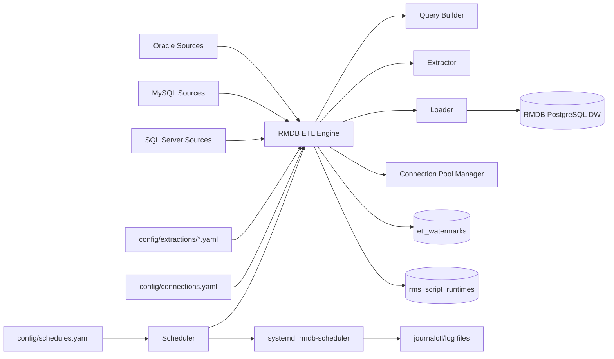

<!-- Synced from rmdb-etl/rmdb-etl/docs/documentation.md. Edit there, then re-run scripts/sync-docs.sh -->

# RMDB ETL Documentation

This document captures the first set of formal project documentation sections. Additional sections can be appended later.

## 1. Project Overview

### Executive Summary

RMDB ETL is the centralized ETL platform for Risk Management data integration. It serves as the single framework used to connect to multiple source databases, extract and transform operational data, and load standardized datasets into the Risk Management Data Warehouse (RMDB).

Deployed on Ubuntu CLI infrastructure (server `10.2.60.146`), the platform supports scheduled, on-demand, and historical backfill operations. By replacing one-off scripts with a configuration-driven framework, RMDB ETL improves reliability, maintainability, and operational transparency across data pipelines.

### Problem Statement

Before centralization, ETL operations are typically fragmented across multiple scripts and teams, leading to inconsistent logic, duplicated effort, and higher operational risk. Common challenges include:

- Inconsistent extraction behavior across source systems
- Difficult troubleshooting due to scattered logs and runtime context
- Increased risk of missed or duplicate loads during outages or delays
- Manual, error-prone recovery and backfill processes
- Weak governance around credentials and deployment consistency

These issues reduce trust in data timeliness and quality, and increase support overhead for Risk Management reporting and analysis.

### Core Objectives

RMDB ETL is built to achieve the following objectives:

- Standardize ETL execution through one framework for all supported source systems
- Enable reliable ingestion with scheduled jobs, controlled overlap handling, and repeatable runs
- Support resilient incremental loading using rolling windows, watermark options, and upsert-safe loads
- Provide operational control via centralized logging, systemd service management, and clear CLI workflows
- Improve recovery capability with chunked historical backfill and resume-friendly execution
- Strengthen governance by externalizing secrets and enforcing environment-based configuration
- Scale onboarding of new tables and extractions via YAML configuration rather than custom scripts

## 2. Technical Architecture

RMDB ETL follows a configuration-driven, modular architecture designed for reliable batch and incremental data integration into RMDB.

### System Diagram



### Technology Stack

**Language and runtime**
- Python 3.x
- Virtual environment (`venv`)

**Core ETL components**
- `src/main.py` for manual and one-off extractions
- `src/scheduler.py` for APScheduler-based orchestration
- `src/backfill.py` for historical chunked backfills
- `src/core/extractor.py` for source extraction logic
- `src/core/query_builder.py` for dynamic SQL construction
- `src/core/loader.py` for target upsert/insert operations
- `src/core/pool_manager.py` for connection pooling

**Databases**
- Source: Oracle, MySQL, SQL Server
- Target: PostgreSQL (RMDB)

**Orchestration and operations**
- APScheduler
- systemd service (`rmdb-scheduler`)
- Ubuntu CLI operations

**Configuration and secrets**
- YAML config files in `config/`
- Environment variable substitution for sensitive values

### Database Schema (Application Metadata Tables)

RMDB ETL scheduling is currently file-based (`config/schedules.yaml`) rather than database-driven. The application metadata is persisted in RMDB tables:

#### `etl_watermarks`
Tracks incremental progress per extraction.

Typical fields:
- `extraction_name` (PK)
- `last_extracted_value`
- `last_run_time`
- `last_run_status`

Purpose:
- Resume-safe incremental extraction
- Better continuity after missed runs or downtime

#### `rms_script_runtimes`
Tracks execution history and outcomes.

Typical fields:
- `id`
- `script_name`
- `run_time`
- `records_updated`
- `run_result`
- `error_message`

Purpose:
- Operational observability
- Failure diagnostics and trend monitoring

## 3. Installation & Configuration

### Prerequisites

#### System requirements
- Ubuntu Linux server (CLI-based operations)
- Network connectivity to all configured source DBs and RMDB
- Git access to the repository
- Python virtual environment support (`python3-venv`)

#### Python version
- Python 3.10+ recommended

Check:

```bash
python3 --version
```

#### Required libraries

Install dependencies from `requirements.txt`:

```bash
python3 -m venv venv
source venv/bin/activate
pip install -r requirements.txt
```

Important libraries include:
- `oracledb`
- `pymysql`
- `psycopg2-binary`
- `pyodbc` (for SQL Server workflows)
- `APScheduler`
- `PyYAML`
- `SQLAlchemy`

#### Required environment variables

Minimum required:
- `RMDB_PASSWORD`
- `ORACLE_ASYCUDA_PASSWORD`
- `ORACLE_ASYCUDA_REPORT_SERVER_PASSWORD`
- `EREG_PASSWORD`
- `ECCR_PASSWORD`

Optional:
- `RMDB_SCHEDULER_TZ`

### Environment Setup

#### 1) Initialize runtime

```bash
cd /opt/rmdb-etl
python3 -m venv venv
source venv/bin/activate
pip install -r requirements.txt
```

#### 2) Create `.env`

```bash
cp .env.example .env
```

Populate `.env` with actual credential values.

#### 3) Load variables into current shell

```bash
set -a && source .env && set +a
```

### Deployment Guide (Production)

#### 1) Pull latest code

```bash
cd /opt/rmdb-etl
git pull origin main
```

#### 2) Ensure dependencies are current

```bash
source /opt/rmdb-etl/venv/bin/activate
pip install -r requirements.txt
```

#### 3) Configure systemd service

Install and customize:

```bash
sudo cp deployment/rmdb-scheduler.service /etc/systemd/system/rmdb-scheduler.service
sudo systemctl edit --full rmdb-scheduler.service
```

Set production-specific values under `[Service]`:
- `User`
- `Group`
- `WorkingDirectory`
- `ExecStart`
- `EnvironmentFile`

#### 4) Create environment file for service

```bash
sudo tee /etc/rmdb-etl.env >/dev/null <<'EOF'
RMDB_PASSWORD=...
ORACLE_ASYCUDA_PASSWORD=...
ORACLE_ASYCUDA_REPORT_SERVER_PASSWORD=...
EREG_PASSWORD=...
ECCR_PASSWORD=...
RMDB_SCHEDULER_TZ=Asia/Colombo
EOF

sudo chmod 600 /etc/rmdb-etl.env
sudo chown root:root /etc/rmdb-etl.env
```

#### 5) Start and validate service

```bash
sudo systemctl daemon-reload
sudo systemctl enable rmdb-scheduler
sudo systemctl restart rmdb-scheduler
sudo systemctl status rmdb-scheduler
sudo journalctl -u rmdb-scheduler -n 100 --no-pager
```

#### 6) eCCR legacy TLS workaround (only if required)

If SQL Server connectivity fails with OpenSSL/ODBC errors such as `SSL routines::unsupported protocol`, run eCCR jobs via:

```bash
bash deployment/run_with_legacy_tls.sh ./venv/bin/python src/main.py eccr_suspect_information --dry-run
```

To make scheduler runs use the same compatibility mode, add a systemd drop-in:

```bash
sudo systemctl edit rmdb-scheduler
```

```ini
[Service]
Environment="OPENSSL_CONF=/opt/rmdb-etl/config/openssl_legacy.cnf"
Environment="OPENSSL_MODULES=/usr/lib/x86_64-linux-gnu/ossl-modules"
```

Then reload and restart:

```bash
sudo systemctl daemon-reload
sudo systemctl restart rmdb-scheduler
sudo systemctl show rmdb-scheduler --property=Environment
```

## 4. Functional Modules

This project is a **CLI and scheduler-driven ETL application**, not an HTTP REST service. The “API” is the command-line interface and the scheduled job entry points described below.

### 4.1 Logical component map

| Area | Path / entry | Role |
|------|----------------|------|
| **Configuration** | `config/connections.yaml`, `config/extractions/*.yaml`, `config/schedules.yaml` | Defines sources, targets, SQL shape, incremental rules, and cron schedules |
| **Config loading** | `src/utils/config_loader.py` | Loads YAML and resolves `${ENV}` placeholders in connection config |
| **Extraction engine** | `src/core/extractor.py` | Opens source connections, builds queries, runs extraction, returns row sets and metadata |
| **SQL construction** | `src/core/query_builder.py` | Builds SELECT SQL from table config (joins, EXISTS, `raw_query`, incremental filters) |
| **Load engine** | `src/core/loader.py` | Writes rows to RMDB (PostgreSQL upsert / insert-ignore, batched) |
| **Connections** | `src/core/db_factory.py`, `src/core/pool_manager.py` | Creates pooled connections by name from `connections.yaml` |
| **Manual runs** | `src/main.py` | CLI: run one extraction, optional dry-run, list extractions |
| **Scheduling** | `src/scheduler.py` | APScheduler: loads `schedules.yaml`, fires jobs that call `run_extraction` |
| **Backfill** | `src/backfill.py` | Date-range chunked loads for historical catch-up |
| **Observability** | `src/utils/monitoring.py`, `src/utils/logger.py` | Run metrics, watermarks, logging |

### 4.2 Data ingestion (how the app pulls data)

End-to-end flow for a **scheduled or manual** extraction:

1. **Load extraction YAML**  
   `main.py` / `scheduler.py` loads `config/extractions/<name>.yaml` (and normalizes the `extraction` wrapper if present).

2. **Load connections**  
   `connections.yaml` is read; passwords and other values are substituted from the process environment.

3. **Acquire source connection**  
   `DataExtractor` uses `DatabaseFactory.get_connection_by_name(...)` (via pool manager) for the `source.connection` named in the extraction.

4. **Build SQL**  
   `QueryBuilder` produces the SELECT for each table definition: plain table, joins, `EXISTS` subqueries, or templated `raw_query` with `@@start_timestamp` / `@@end_timestamp` where applicable.

5. **Apply incremental window**  
   `DataExtractor._get_incremental_date` chooses the lower bound from `incremental_type` (`yesterday`, `last_7_days`, `watermark`, etc.). How that bound is applied depends on whether the incremental column lives on the main query or inside an EXISTS/raw template.

6. **Execute and fetch**  
   Rows are fetched into memory; Oracle LOBs are normalized when needed.

7. **Load to RMDB**  
   `DataLoader` uses per-table `load_mode` and `primary_key` to build PostgreSQL `INSERT ... ON CONFLICT` upserts (or insert-ignore) in batches.

8. **Post-run bookkeeping**  
   On the scheduler path, watermark updates and run metrics apply when configured (`main.py` + `monitoring.py`). Backfill path does not advance watermarks the same way as incremental scheduler runs.

### 4.3 API documentation (command-line interface)

All commands assume repository root (e.g. `/opt/rmdb-etl`) and an activated venv with environment variables set.

#### `src/main.py` — run a single extraction

| Argument | Required | Description |
|----------|----------|-------------|
| `extraction` | Yes (unless `--list`) | Name of the YAML file under `config/extractions/` without `.yaml` |
| `--dry-run` | No | Extract only; do not load into RMDB |
| `--list` | No | Print all extraction names and exit |

Examples:

```bash
python src/main.py --list
python src/main.py asycuda_live
python src/main.py asycuda_live --dry-run
```

#### `src/backfill.py` — historical chunked load

| Argument | Required | Description |
|----------|----------|-------------|
| `extraction` | Yes in single mode | Extraction name (no `.yaml`) |
| `--bulk` | No | Run all eligible extractions in bulk mode |
| `--start` | Yes in single mode; optional in bulk (default `2023-01-01`) | Start date `YYYY-MM-DD` |
| `--end` | Yes in single mode; optional in bulk (default `2025-01-01`) | End date `YYYY-MM-DD` |
| `--days` | No | Chunk size in days (default `30`) |
| `--connections` | No | Path to connections YAML (default `config/connections.yaml`) |
| `--dry-run` | No | Show chunks/queries without loading |

Examples:

```bash
python src/backfill.py sad_item --start 2023-01-01 --end 2026-04-20 --days 15 --dry-run
python src/backfill.py sad_item --start 2023-01-01 --end 2026-04-20 --days 15
python src/backfill.py --bulk --start 2023-01-01 --end 2026-04-20 --days 15
```

#### `src/scheduler.py` — long-running scheduler daemon

No CLI arguments; behavior is entirely driven by `config/schedules.yaml` and environment:

- Timezone: `RMDB_SCHEDULER_TZ` (default `Asia/Colombo` in code)  
- Each job calls `run_extraction(<job name>)` from `main.py`

Typical production invocation (via systemd):

```text
/opt/rmdb-etl/venv/bin/python src/scheduler.py
```

There is **no separate HTTP API** for extractions; integrations should invoke `main.py` / `backfill.py` or rely on the scheduler service.

## 5. Security & Compliance

### 5.1 Secrets and configuration hygiene

- **No plaintext passwords in git**: `config/connections.yaml` uses `${VAR_NAME}` placeholders resolved at runtime from the process environment.
- **Local development**: use `.env` (not committed) and `set -a && source .env && set +a` before running CLI commands.
- **Production**: prefer a root-owned `EnvironmentFile` (e.g. `/etc/rmdb-etl.env`) referenced from the systemd unit, with `chmod 600`.
- **Manual production CLI runs**: interactive shells do not automatically inherit systemd `EnvironmentFile` variables. Before running `src/main.py` or `src/backfill.py` manually, load env vars explicitly:

```bash
cd /opt/rmdb-etl
source venv/bin/activate
set -a
source /etc/rmdb-etl.env
set +a
```

- **Rotation**: if credentials are exposed, rotate them at the database and update the env file; redeploy/restart the scheduler.
- **Least privilege**: database users should have only the object privileges required for read (sources) and write (RMDB targets).

### 5.2 Audit logs — what the application records

RMDB ETL implements **operational audit** (what job ran, when, and whether it succeeded). It does **not** implement a built-in “human user” identity model (no login, no per-operator user id stored in these tables). **Who** triggered a run must be inferred from the execution context:

| Context | How to attribute “who” |
|---------|-------------------------|
| **systemd scheduler** | `journalctl -u rmdb-scheduler` includes the service user and timestamps; correlate with deployment change tickets. |
| **Manual SSH / CLI** | OS-level audit (`/var/log/auth.log` on Ubuntu, centralized syslog, or enterprise SIEM) plus shell history on the server account. |
| **Git / change control** | Commit and deploy records for `config/extractions/` and `config/schedules.yaml`. |

#### Database audit trail (RMDB)

Writes go to schema **`rmdb_schema`** (search path is set before writes).

**1) `rmdb_schema.rms_script_runtimes`**

Each extraction run (via `main.py` path) inserts a row through `log_run_metrics()` in `src/utils/monitoring.py`:

| Field | Meaning |
|-------|---------|
| `script_name` | Extraction name (same as YAML basename) |
| `run_time` | Timestamp when the row was logged |
| `records_updated` | Row count reported for that run |
| `run_result` | Outcome label (e.g. Success, Failed variants) |
| `error_message` | Truncated error text on failure |

Purpose: historical run log for support and compliance reporting on **job outcomes**.

**2) `rmdb_schema.etl_watermarks`**

Updated through `update_watermark()` for watermark-driven extractions and failure recording:

| Field | Meaning |
|-------|---------|
| `extraction_name` | Primary key; extraction identifier |
| `last_extracted_value` | Watermark cursor (incremental progress) when successful |
| `last_run_time` | Last update time |
| `last_run_status` | Status string (e.g. SUCCESS / Failed) |
| `records_updated` | Rows touched in last relevant update |
| `error_message` | Error detail when applicable |

Purpose: **incremental state** and last-known status per extraction (not a full append-only audit log of every SQL statement).

#### File and platform logs

- Application loggers write under normal Python logging configuration (see `src/utils/logger.py` and per-run usage).
- **systemd**: `journalctl -u rmdb-scheduler` captures stdout/stderr for the scheduler process.

### 5.3 Compliance gaps and optional hardening

If policy requires **non-repudiation** (binding every load to an individual person):

- Add enterprise controls outside this repo: SSO bastion, signed deployment pipeline, mandatory ticket id in commit messages, or a thin wrapper script that logs `SUDO_USER` / `SSH_CLIENT` into a dedicated audit table before calling `main.py`.
- Consider **PostgreSQL audit extensions** or triggers on sensitive RMDB tables if the warehouse must prove who changed analytical data (separate from ETL runtime metadata).

### 5.4 Legacy TLS compatibility risk note (eCCR)

`deployment/run_with_legacy_tls.sh` uses `config/openssl_legacy.cnf` to allow connecting to legacy SQL Server TLS endpoints by lowering OpenSSL policy (`MinProtocol=TLSv1`, `DEFAULT@SECLEVEL=0`).

Important implications:
- This is a **security downgrade** and should be treated as a temporary compatibility control.
- Keep it **process-scoped** (wrapper or specific systemd service env), not system-wide.
- Restrict usage to required eCCR workflows and hosts.
- Track this as technical debt and remove once SQL Server supports modern TLS policy.

This section should be reviewed with your security and compliance owners to map RMDB ETL artifacts to your internal control framework.

## 6. Maintenance & Troubleshooting

### 6.1 Routine maintenance

| Task | Suggested approach |
|------|--------------------|
| **Deploy config changes** | Commit YAML, `git pull` on server, `sudo systemctl restart rmdb-scheduler` |
| **Dependency updates** | Activate venv, `pip install -r requirements.txt`, restart service |
| **Disk space** | Monitor `logs/` growth; rotate or archive old `*.log` files |
| **DB account health** | Periodically verify Oracle/MySQL/SQL Server accounts are unlocked and passwords current |
| **Verify schedules** | After edits to `config/schedules.yaml`, confirm cron lines in startup logs or `journalctl` |

### 6.2 Common errors

RMDB ETL does not expose an HTTP API; “timeouts” in operations are usually **database driver / network** timeouts or long-running queries, not REST client timeouts.

#### Oracle (`oracledb`)

| Symptom / code | Typical cause | What to do |
|----------------|---------------|------------|
| **ORA-01017** | Invalid username/password or env var not loaded in the running process | Fix credentials; ensure systemd `EnvironmentFile` is set and service restarted; verify `connections.yaml` placeholder names match env vars |
| **ORA-28000** | Account locked | DBA unlocks/resets password; update env file if password changed |
| **ORA-01089** | Immediate shutdown or database unavailable | Wait for DB availability; resume backfill from failed chunk |
| **ORA-12170 / TNS** timeout-style messages | Network, firewall, listener, or heavy load | Check connectivity from ETL host to DSN host/port; DBA/network review |
| **General connection failures** | Wrong DSN, service down, VPN | Validate `dsn` in `connections.yaml`; test with `sqlplus` or a minimal Python connect script |

#### PostgreSQL (RMDB target)

| Symptom | Typical cause | What to do |
|---------|---------------|------------|
| **password authentication failed** | `RMDB_PASSWORD` mismatch vs server role | Align `ALTER USER` / role password with env |
| **connection refused** | Postgres not listening on expected host/port | Check `listen_addresses`, `pg_hba.conf`, firewall |
| **ON CONFLICT errors** | Upsert `primary_key` does not match a unique constraint on target table | Align YAML `primary_key` with RMDB DDL |

#### MySQL (eReg)

| Symptom | Typical cause | What to do |
|---------|---------------|------------|
| **Access denied** | Wrong user/password/host | Verify `EREG_PASSWORD` and params in `connections.yaml` |
| **Lost connection** | Idle timeout / network | Retry; tune server or pool if recurrent |

#### SQL Server (eCCR)

| Symptom | Typical cause | What to do |
|---------|---------------|------------|
| **Import / driver errors** | `pyodbc` or ODBC driver not installed on host | Install `pyodbc` + Microsoft ODBC Driver for SQL Server (Linux) |
| **`SSL routines::unsupported protocol`** | Legacy SQL Server TLS settings incompatible with host OpenSSL defaults | Use `deployment/run_with_legacy_tls.sh` for manual runs and set `OPENSSL_CONF`/`OPENSSL_MODULES` in `rmdb-scheduler` service env |
| **`Login failed for user ... (18456)`** | SQL authentication issue after network/TLS succeeds | Validate `ECCR_PASSWORD` in runtime environment (`set -a && source .env && set +a` for manual tests), verify SQL login permissions |

#### Git on server

| Symptom | Typical cause | What to do |
|---------|---------------|------------|
| **untracked working tree files would be overwritten by merge** | Local file blocks pull (e.g. stray `*.sql` on server) | Move/rename or remove conflicting file, then `git pull` |

### 6.3 Updating rules (change behavior without core code)

Most operational changes are **YAML-only**:

1. **Extraction logic** — edit `config/extractions/<name>.yaml`:
   - `columns`, `join`, `exists`, `raw_query`
   - `incremental_column`, `incremental_type`, `watermark_source`
   - `load_mode`, `primary_key`, `conditions`
2. **Schedule** — edit `config/schedules.yaml` (`cron` per extraction name).
3. **Connections** — edit `config/connections.yaml` (prefer env placeholders, not literals).

Then: commit, push, pull on server, restart `rmdb-scheduler`.

You only need Python changes when adding a **new** incremental type, a new database dialect behavior, or new cross-cutting features (see `src/core/extractor.py`, `query_builder.py`, `loader.py`).

#### Design note: `dat_cusdecs` — `UN_ASYBRK_TRACK` binder scope

The **`dat_cusdecs`** extraction (`config/extractions/dat_cusdecs.yaml`) loads CusDec-level rows into **`analytics_schema.dat_cusdecs`**. Incremental detection uses an **`EXISTS`** on **`UN_ASYBRK_TRACK`** filtered to **`e.BINDER_ID = 'B_asysad'`** (CusDec / SAD binder), so a CusDec is included in the daily slice when **that** tracking stream has **`OP_DATE_TIME`** in the window.

The same query also brings in **inspection-act** aggregates (fraud sums from **`INSP_ACT_TAB`** / **`INS_FRD_TAB`**) and **lifecycle timestamps** built from **`UN_ASYBRK_TRACK`** without restricting those aggregates to `B_asysad`. The same physical track table can hold **other binder IDs** for related processes.

**Open design question (untested):** should the pipeline treat **any** relevant `UN_ASYBRK_TRACK` change (including non–`B_asysad` rows) as a reason to re-upsert the CusDec row, or is **`B_asysad`–only** incremental filtering sufficient? The working assumption is that meaningful inspection-side updates still surface through CusDec tracking as well, but **exceptions are possible** and have **not** been validated with data or reprocessing.

If analysts observe **stale** fraud or lifecycle fields while the CusDec itself did not change in the `B_asysad` stream, revisit the **`EXISTS`** predicate (and possibly align the lifecycle subquery with the same binder rules), then **backfill / reprocess** as needed. The extraction YAML header repeats this note for operators reading the SQL.

### 6.4 Logging

#### On-disk application logs

Configured in `src/utils/logger.py`:

- **Directory:** `<repo_root>/logs/` (same directory level as `src/` and `config/`, i.e. typically `/opt/rmdb-etl/logs` on the server).
- **File naming:** `<logger_name>_<YYYYMMDD>.log`  
  Examples:
  - `logs/scheduler_20260422.log` — scheduler process
  - `logs/asycuda_live_20260422.log` — extraction named `asycuda_live`
  - `logs/backfill_20260422.log` — backfill CLI

#### Log format

- **File handler:** JSON lines (`pythonjsonlogger`) — good for grep, jq, or log shippers.
- **Console / journal:** human-readable lines when stdout is attached (e.g. manual run or systemd capturing output).

Fields commonly present in JSON lines include `asctime`, `name`, `levelname`, `message` (and optional extras depending on log calls).

#### systemd journal (production scheduler)

```bash
sudo journalctl -u rmdb-scheduler -f
sudo journalctl -u rmdb-scheduler --since today --no-pager
```

Use journal for **service lifecycle** and console-emitted lines; use `logs/*.log` for **per-logger JSON** files.

#### Interpreting logs quickly

1. Search for `ERROR` or `EXTRACTION FAILED` in the extraction log file or journal.
2. Note the **extraction name** and the **exception message** (often includes Oracle ORA code).
3. Cross-check `rmdb_schema.rms_script_runtimes` and `rmdb_schema.etl_watermarks` for the same window.
4. If failure is auth-related, verify env vars visible to **systemd** (not only your interactive shell).

## 7. Standalone migration: `migrate_insp_act_to_ins_frd`

### 7.1 Purpose and background

Customs introduced **new fraud code values** (effective **August 2025**). Historical inspection data still stores fraud information on `INSP_ACT_TAB` in the legacy shape: up to **six** columns (`frd_fr1_cod` … `frd_fr6_cod`). The modern warehouse model stores fraud lines on **`INS_FRD_TAB`**: one row per fraud code (with type, value, and the new code in `frd_nfr`).

`src/migrate_insp_act_to_ins_frd.py` is a **standalone, one-off migration** that:

1. Reads an **Excel or ODS** mapping file of **old → new** fraud codes (`FRD_NFR_OLD` → `FRD_NFR`).
2. Selects qualifying `INSP_ACT_TAB` rows in RMDB (joined to `SAD_GENERAL_SEGMENT` for registration date, with penalty / A&E and fraud-code filters as implemented in the script).
3. Expands each legacy row into one or more `INS_FRD_TAB` rows using business rules (Penalty vs A/E amounts, `key_frd_nbr` sequencing).
4. Upserts into `rmdb_schema.ins_frd_tab` using `ON CONFLICT (instance_id, key_frd_nbr) DO UPDATE` so reruns are idempotent.

This script is **not** part of the normal scheduler YAML extractions; operators run it explicitly when migrating historical fraud data after the code change.

### 7.2 Prerequisites

- Run from the **repository root** (e.g. `/opt/rmdb-etl`) so paths like `config/connections.yaml` resolve correctly.
- **Environment variables** for RMDB must be set (`RMDB_PASSWORD`, etc.), same as other CLI tools.
- **Python packages** (in addition to the main `requirements.txt` set):
  - `pandas` (required to read the mapping file)
  - `odfpy` (recommended for `.ods`; script may try other engines for `.xlsx`)
- A mapping file at the path you pass (default name resolved under project root): see **7.4**.

**Note:** The CLI accepts `--connections`, but the shared pool layer loads `config/connections.yaml` from the standard repo-relative path. Use the default layout on the server unless you extend the script to pass a custom path into the pool.

### 7.3 How to run

Always start with a **dry run** on a narrow date range, then widen.

```bash
cd /opt/rmdb-etl
source venv/bin/activate
set -a && source .env && set +a

# Dry run: prints sample rows, no INSERT
python src/migrate_insp_act_to_ins_frd.py \
  --excel "Fraud Codes.ods" \
  --start 2023-01-01 \
  --end 2025-08-01 \
  --dry-run

# Live run: upserts into rmdb_schema.ins_frd_tab
python src/migrate_insp_act_to_ins_frd.py \
  --excel "Fraud Codes.ods" \
  --start 2023-01-01 \
  --end 2025-08-01
```

### 7.4 CLI arguments

| Argument | Default | Description |
|----------|---------|-------------|
| `--excel` | `Fraud Codes.ods` | Mapping file path **relative to project root** (resolved to `<repo>/<path>`). |
| `--start` | `2023-01-01` | Inclusive lower bound on `sad_general_segment.ide_reg_dat` (see script SQL). |
| `--end` | `2025-07-01` | Upper bound on the same column (see script SQL). |
| `--connections` | `config/connections.yaml` | Passed through for compatibility; pool uses standard config path unless customized in code. |
| `--dry-run` | off | If set, computes rows and logs samples but does **not** commit inserts. |

### 7.5 Mapping file format

The spreadsheet must contain exactly these column headers:

- `FRD_NFR_OLD` — legacy code as stored on `INSP_ACT_TAB`
- `FRD_NFR` — new code used on `INS_FRD_TAB.frd_nfr`

Rows with missing new codes are logged as warnings; instances with **no** successful mapping are skipped.

### 7.6 Logging output

The script uses logger name `migrate_insp_act`, so on-disk logs follow the standard pattern:

- `logs/migrate_insp_act_<YYYYMMDD>.log`

Review warnings for unmapped old codes before large production runs.

### 7.7 Operational guidance

- Treat this as a **controlled data migration**: take an RMDB backup or snapshot if policy requires it before large `--end` windows.
- Prefer **smaller date slices** if memory or runtime is a concern (the script loads matched `INSP_ACT_TAB` rows into memory).
- After migration, validate row counts and spot-check `INS_FRD_TAB` against source inspection records for sample `instance_id` values.
- If new fraud code versions change again, update the mapping file and re-run only the needed date range (upsert behavior overwrites conflicting keys).

---

## Attribution

*Administrative context — separate from the operational sections above.*

> **Developer** — **Uvindu Perera**, Superintendent of Customs, **Risk Management Directorate**.
>
> **Modernization context** — **rmdb-etl** is part of a broader program to retire legacy **Java** components built for the **Automated Risk Management System (ARMS)** in favor of **service-oriented Python** applications. This service centralizes extraction from operational sources into **RMDB** (**`rmdb_schema`** on PostgreSQL), with **scheduled and on-demand** runs on institutional production hosts (for example **`10.2.60.146`**, under **systemd** as **`rmdb-scheduler`**), replacing fragmented scripts and aligning the data warehouse layer with modern, maintainable tooling for risk management and downstream analytics.
