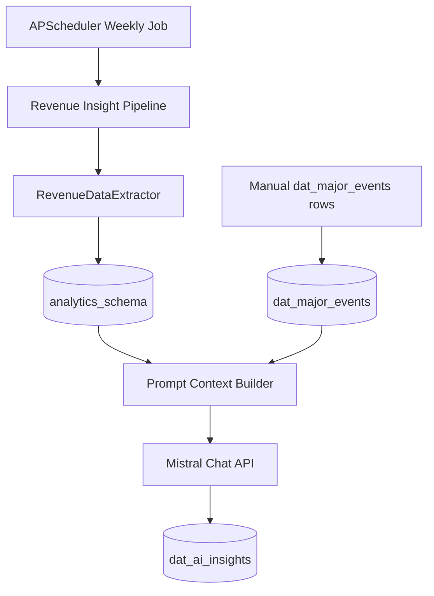

<!-- Synced from rms-ai-insights/docs/documentation.md. Edit there, then re-run scripts/sync-docs.sh -->

# RMS AI Insights Documentation

## 1. Project Overview

### Executive Summary

**rms-ai-insights** is an analytics insight service for the RMDB modernization ecosystem. It reads structured revenue data from `analytics_schema`, enriches prompts with **manually maintained** major events from `dat_major_events`, and uses the **Mistral API** to produce compact HTML insights for analysts.

The first implemented insight set is **Revenue Data**. It analyzes daily revenue collections, estimates, actuals, historical comparisons, and holidays from `analytics_schema`, then stores a high-level HTML summary in `analytics_schema.dat_ai_insights`.

Production follows the same deployment pattern as the other RMS services:

- Production host: `10.2.60.146` (application services and PostgreSQL)
- Project path: `/opt/rms-ai-insights`
- systemd unit: `rms-ai-insights-scheduler`

### Problem Statement

Revenue data is available in warehouse tables after `rms-revenue-extract`, but decision makers need a short analytical summary that combines:

- recent collection performance,
- current estimates and prior-year patterns,
- holiday-adjusted daily trends,
- year-to-date status,
- relevant local/global incidents that may affect import duties, taxes, levies, and customs revenue.

`rms-ai-insights` automates this weekly analysis and stores it as HTML suitable for small dashboard cards.

### Core Objectives

- Extract revenue datasets from `analytics_schema` on a weekly schedule.
- Include major events from `dat_major_events` (maintained manually; automated Tavily/Mistral discovery is disabled by default).
- Generate concise 600px by 200px HTML analysis with Mistral (`mistral-large-latest` by default).
- Store final insights in `analytics_schema.dat_ai_insights`.
- Keep credentials out of git and use `.env` like other RMS services.

## 2. Technical Architecture



### Technology Stack

- Python 3.10+
- PostgreSQL (`psycopg2-binary`)
- APScheduler
- Mistral Chat Completions API (`mistral-large-latest`)
- Optional (disabled by default): Tavily Search API for automated event discovery
- YAML + `.env` configuration

## 3. Database Schema

### `analytics_schema.dat_major_events`

Stores local/global incidents that may affect customs revenue (maintained manually).

Important columns:

- `event_date`
- `event_rank`
- `event_description`
- `event_hash` (optional; unique when set — used only by automated discovery)
- `source` (e.g. `manual`)
- `created_at`

### `analytics_schema.dat_ai_insights`

Stores final HTML analysis fragments.

Important columns:

- `ref_date`
- `insight_type` (`revenue_weekly`)
- `ai_analysis`
- `model_name`
- `created_at`

Primary key: `(ref_date, insight_type)`.

## 4. Revenue Insight Workflow

### Step 1 - Revenue Dataset Extraction

`core/revenue_extractor.py` extracts:

- Last 31 days of `dat_daily_revenue`.
- Historical daily windows for the same month/day span in prior years.
- Current-year YTD revenue up to the latest date and prior-year YTD equivalents.
- Current-month estimate, prior-year same-month estimates, and current-year monthly estimates from `dat_estimated_revenue` (warehouse values are in **millions**; the service multiplies by `estimated_revenue_scale`, default **1000**, to align with daily revenue in LKR).
- Completed current-year actual months and prior-year same-month actuals from `dat_actual_revenue`.
- Holidays from `dat_holidays` for comparison windows and YTD periods.

### Step 2 - Major Events (manual)

By default `revenue.event_discovery_enabled` is `false` in `config/settings.yaml`. The pipeline **does not** call Tavily. It loads rows from `dat_major_events` for the last three months (`event_dedup_months`) and passes them to Mistral with the revenue dataset.

Add or update events before each run:

```sql
INSERT INTO analytics_schema.dat_major_events (
    event_date, event_rank, event_description, source
) VALUES (
    '2026-05-20', 1,
    'Brief description of the incident or policy change.',
    'manual'
);
```

`event_hash` may be omitted for manual rows. On existing databases, apply `deployment/alter_dat_major_events_null_hash.sql` once if the column was created `NOT NULL`.

To re-enable automated discovery (experimental), set `event_discovery_enabled: true` and configure `TAVILY_API_KEY` and `MISTRAL_API_KEY` in `.env`.

### Step 3 - Mistral Insight

`core/revenue_metrics.py` builds `computed_analyst_context`: LKR display strings, working-day logic, period-over-period week and 30-day blocks vs the immediate prior period, consecutive year-on-year growth rates (up to 3 prior years), and **monthly estimates for the current year only** (prior years use actuals).

`core/revenue_insight_generator.py` renders a **900px** card:

- **Left (700px)** — four sections (`<h4>` + statement + max 3 bullets). First heading is the analysed week range (e.g. `24th of May to 30th of May, 2026`). Line breaks only between sections.
- **Right (200px)** — three cards: centered heading, highlighted value, 1–2 sentence explanation (estimate completion, outlook, remaining working days with collection averages).

The combined HTML stored in `dat_ai_insights` is capped at **7500 characters** (Power BI text field limit). The generator reserves space for the sidebar and wrapper, tells Mistral the left-column budget, and truncates safely if needed.

No daily revenue targets.

### Step 4 - Store Insight

`database/repositories.py` upserts the HTML into `dat_ai_insights` using `(ref_date, insight_type)`.

## 5. Configuration

### `.env`

Required:

```bash
RMDB_PASSWORD=
MISTRAL_API_KEY=
```

Common defaults:

```bash
RMDB_HOST=10.2.60.146
RMDB_PORT=5432
RMDB_USER=rmdb
RMDB_DATABASE=rmdb
RMS_AI_INSIGHTS_TZ=Asia/Colombo
MISTRAL_MODEL=mistral-large-latest
MISTRAL_TIMEOUT_SECONDS=180
MISTRAL_INSIGHT_MAX_TOKENS=4096
```

Optional testing (larger Mistral input/output):

```bash
REVENUE_PROMPT_MODE=metrics_plus_extract
REVENUE_HTML_MAX_CHARS=7500
MISTRAL_INSIGHT_MAX_TOKENS=8192
```

`metrics_plus_extract` attaches the full warehouse extract JSON in addition to `computed_analyst_context` (still well below Mistral Large’s ~256k input limit for typical revenue history).

Optional (only if `event_discovery_enabled: true`):

```bash
TAVILY_API_KEY=
```

### `config/schedules.yaml`

Default job:

- `revenue_weekly_insight`
- Cron: `15 6 * * 1`
- Timezone: `RMS_AI_INSIGHTS_TZ` (default `Asia/Colombo`)

## 6. Installation and Deployment

```bash
cd /opt
sudo mkdir -p /opt/rms-ai-insights
sudo chown rmd:rmd /opt/rms-ai-insights
cd /opt/rms-ai-insights
git clone https://github.com/uvindu-perera/rms-ai-insights.git .

python3 -m venv venv
./venv/bin/pip install -r requirements.txt
cp .env.example .env
nano .env

./venv/bin/python main.py setup
./venv/bin/python main.py revenue
./deployment/install_service.sh
```

Do not use `sudo git clone` for private GitHub repos when `gh auth login` was performed as `rmd`.

## 7. Operations

### Manual Commands

```bash
python main.py setup
python main.py revenue
python main.py revenue --as-of YYYY-MM-DD
python main.py worker
```

### Logs

```bash
sudo journalctl -u rms-ai-insights-scheduler -f
```

### Common Errors

| Symptom | Cause | Fix |
|---------|-------|-----|
| `connection ... 10.2.60.146 ... timeout` | Running outside RMDB network | Run on `10.2.60.146` |
| `TAVILY_API_KEY is not configured` | Discovery enabled without Tavily key | Set key or set `event_discovery_enabled: false` |
| `MISTRAL_API_KEY is not configured` | Discovery enabled without Mistral key | Set key or set `event_discovery_enabled: false` |
| `null value in column "event_hash"` | Manual insert on old DDL | Run `deployment/alter_dat_major_events_null_hash.sql` |
| `MISTRAL_API_KEY is not configured` | Missing Mistral key | Set `MISTRAL_API_KEY` in `.env` |
| Mistral request failed / timeout | API or network issue | Check key, outbound HTTPS, increase `MISTRAL_TIMEOUT_SECONDS` |

## Attribution

*Administrative context — separate from the operational sections above.*

> **Developer** — **Uvindu Perera**, Superintendent of Customs, **Risk Management Directorate**.
>
> **Modernization context** — **rms-ai-insights** extends the RMDB/RMS Python services with AI-assisted analytical summaries as part of the program to retire legacy **ARMS** components in favor of service-oriented Python applications. It is designed for scheduled and on-demand execution on institutional production hosts (for example **`10.2.60.146`**) and writes outputs to **`analytics_schema`** on RMDB PostgreSQL.
