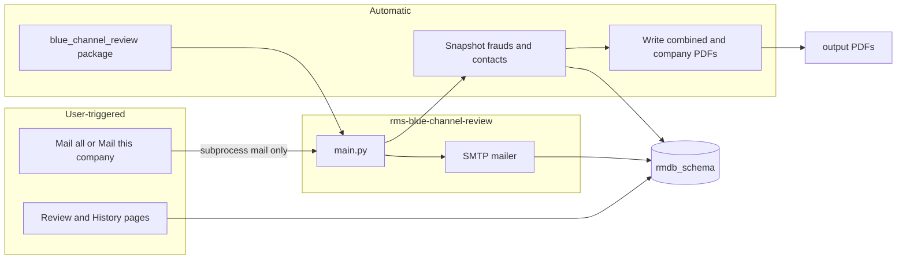

<!-- Synced from rms-blue-channel-review/docs/documentation.md. Edit there, then re-run scripts/sync-docs.sh -->

# rms-blue-channel-review Documentation

## 1. Purpose

`rms-blue-channel-review` prepares a **Blue Channel Post Clearance Audit (PCA)
review** for Sri Lanka Customs. It selects fraud lines recorded against CusDecs
cleared under Blue Channel, attaches connected individuals for each consignee
company, and writes print-friendly PDFs.

Reviews run **automatically** (quarterly package, or an explicit `run` for a
custom period). **Sending email is never automatic.** A dashboard user with Full
access must click Mail. The CLI `mail` command exists for the dashboard
subprocess and for a deliberate operator send; it is not used by the package.

The service does not change ASYCUDA or warehouse source tables. It writes a
point-in-time snapshot under `rmdb_schema.bcr_*` plus PDF files on disk.

## 2. High-Level Architecture



Central command does not import this application's Python. The dashboard reads
`bcr_*` tables through its own RMDB connection and launches `main.py` as a
subprocess (same pattern as the Simulator).

## 3. Repository Layout

```text
rms-blue-channel-review/
├── main.py
├── config/
│   ├── config_loader.py
│   ├── connections.yaml
│   ├── settings.yaml
│   └── templates/cover_letter.txt.jinja
├── core/
│   ├── period.py
│   ├── processor.py
│   ├── pdf.py
│   └── mailer.py
├── database/
├── deployment/
├── docs/
├── fonts/                 # DejaVu Sans (Unicode)
└── tests/
```

## 4. Selection Rules

The fraud query is the operational PCA extract, parameterized on registration
date:

- `sad_general_segment.pty_col_dsc = 'Blue'`
- `ide_reg_dat` inclusive between `--from-date` and `--to-date`
- `ins_frd_tab.frd_nfr != 'NOF-PCA'`
- `ins_frd_tab.frd_ubr = 'BLUE_CHANNEL'`
- join `insp_act_tab` on `sad_sid` / `instance_id`
- `unnfrtab` via `DISTINCT ON (nfr_cod)` taking the latest `valid_from`

Grouped by consignee, declarant, CusDec reference, NFR code, fraud type, and
remark; `frd_val` is summed.

Company key for individuals is the **first 9 digits** of `cmp_con_cod`, matching
`rms-individuals` `company_id`. Contacts come from `individual_connector`, the
latest `individual_names.name`, and every `individual_contacts` row with
`type_ = 'Email'`. People without email still appear on the printed report.

Default period when dates are omitted: **previous calendar quarter** in
`Asia/Colombo`. Example: a 1 April run covers 1 January–31 March.

## 5. CLI

| Command | Behaviour |
|---|---|
| `setup` | Create `rmdb_schema.bcr_*` |
| `run` | Snapshot + write all PDFs. Never mails. |
| `pdf --run-id N` | Regenerate PDFs for a snapshot. Never mails. |
| `mail --run-id N [--company-id X]` | Email packs; skip companies with no address |

There is no `--mail` flag on `run`.

```bash
python main.py run
python main.py run --from-date 2026-05-01 --to-date 2026-07-31
python main.py mail --run-id 12
```

## 6. PDFs and email

Each run writes under `output/<run_id>/`:

- `combined_report.pdf` — internal period report (summary then one section per company)
- `<company_id>/cover_letter.pdf`
- `<company_id>/report.pdf`

Cover letter wording is Jinja2 in `config/templates/cover_letter.txt.jinja`
(company, period, finding count, total value, signatory from `settings.yaml`).

Email (click only):

- subject: `Blue Channel PCA review — {company} — {period}`
- body: rendered cover letter
- attachment: that company's findings PDF only
- recipients: every unique Email contact for connected individuals of that company

SMTP uses the same Mailgun variables as central-command (`SMTP_MG_*`). One
failed company does not abort the rest; status is stored per pack.

## 7. Warehouse tables

| Table | Role |
|---|---|
| `bcr_runs` | Period, status (`running` / `generated` / `mailed` / `failed`), counts, combined PDF path |
| `bcr_fraud_rows` | Snapshotted PCA lines |
| `bcr_contacts` | Snapshotted connected people and emails |
| `bcr_company_packs` | Per-company PDF paths and mail status |

## 8. Dashboard (rms-central-command)

Product group **Blue Channel Review**:

- **Review** — latest completed run (or `?run_id=`), batch switcher, company table, downloads, Mail all / Mail this company, optional custom-period `run`, delete this batch
- **History** — all processed batches, combined PDF, remake mail, delete one or several

View access reads snapshots. Full access on Review is required to mail, start a
custom period, or delete the open batch. Full access on History is required to
delete from the batch list. Custom period still does not mail. Delete removes
`bcr_*` rows (cascade) and `output/<run_id>/`; it never sends email. A batch
still marked `running` cannot be deleted.

## 9. Scheduling

Package `blue_channel_review`: cron `0 8 1 1,4,7,10 *` (08:00 on 1 Jan / Apr /
Jul / Oct). Step: `argv: ["run", "--trigger", "schedule", "--created-by", "schedule"]`.

## 10. Deployment

See [deployment/DEPLOYMENT.md](../deployment/DEPLOYMENT.md).
