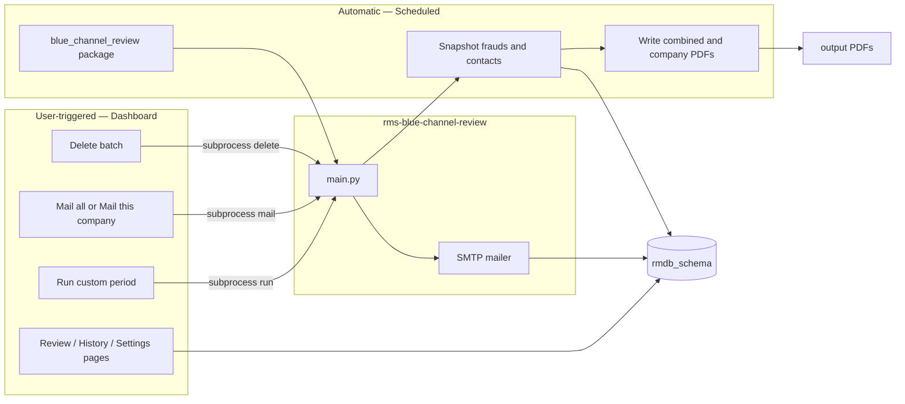

<!-- Synced from rms-blue-channel-review/docs/documentation.md. Edit there, then re-run scripts/sync-docs.sh -->

# Blue Channel Review — Technical Documentation

**Service:** `rms-blue-channel-review`
**Dashboard:** `rms-central-command` → Blue Channel Review
**Owner:** Risk Management Directorate, Sri Lanka Customs

---

## 1. Purpose

`rms-blue-channel-review` automates the **Blue Channel Post Clearance Audit (PCA)
review** for Sri Lanka Customs. It:

1. Selects fraud lines recorded against CusDecs cleared under Blue Channel.
2. Attaches connected individuals (directors, partners, owners) for each consignee company.
3. Generates print-friendly PDF reports and cover letters.
4. Sends company-specific email packs **only when a user explicitly clicks Mail**.

The service is **read-only** on ASYCUDA and warehouse source tables. It writes a
point-in-time snapshot under `rmdb_schema.bcr_*` plus PDF files on disk.

---

## 2. High-Level Architecture



Central command does not import this application's Python. The dashboard reads
`bcr_*` tables through its own RMDB connection and launches `main.py` as a
subprocess (same pattern as the Simulator).

---

## 3. Repository Layout

```text
rms-blue-channel-review/
├── main.py                          # CLI entry point
├── config/
│   ├── config_loader.py             # Environment + settings loading
│   ├── connections.yaml             # Database connection strings
│   ├── settings.yaml                # Runtime configuration (see §6)
│   └── templates/
│       ├── cover_letter_print.txt.jinja   # Printed cover letter body
│       ├── cover_letter_email.txt.jinja   # Email body (full header)
│       └── report_body.txt.jinja          # Report narrative paragraphs
├── core/
│   ├── period.py                    # Period calculation (quarters, custom)
│   ├── processor.py                 # Orchestration: snapshot → PDF → mail
│   ├── pdf.py                       # PDF generation (fpdf2)
│   ├── pdf_text.py                  # Address/name cleaning and formatting
│   └── mailer.py                    # SMTP sending
├── database/
│   ├── connection.py                # psycopg2 connection wrapper
│   ├── queries.py                   # All SQL statements
│   └── schema.py                    # Table creation
├── deployment/
│   ├── create_tables.sql            # DDL for bcr_* tables
│   └── DEPLOYMENT.md                # Ops guide
├── docs/
│   └── documentation.md             # This file
├── fonts/                           # DejaVu Sans (Unicode)
└── tests/
```

---

## 4. Selection Rules

### 4.1 Fraud Extract

The fraud query is the operational PCA extract, parameterized on registration date:

| Filter | Value |
|--------|-------|
| Channel | `sad_general_segment.pty_col_dsc = 'Blue'` |
| Registration date | `ide_reg_dat` inclusive between `--from-date` and `--to-date` |
| NFR | `ins_frd_tab.frd_nfr != 'NOF-PCA'` |
| Business rule | `ins_frd_tab.frd_ubr = 'BLUE_CHANNEL'` |
| Inspection link | join `insp_act_tab` on `sad_sid` / `instance_id` |
| NFR description | `unnfrtab` via `DISTINCT ON (nfr_cod)` taking the latest `valid_from` |

Results are grouped by consignee, declarant, CusDec reference, NFR code, fraud
type, and remark; `frd_val` is summed.

### 4.2 Company and Contact Resolution

- **Company key:** first 9 digits of `cmp_con_cod`, matched to the first 9 digits of trimmed `ereg_cmp_tab.bas_tvp_tin`.
- **Master data:** `uncmptab` provides the canonical company name and address (latest `valid_from`).
- **AEO status:** `analytics_schema.aeo_tier1` provides AEO tier (12-digit VAT normalized to 9 digits).
- **Contacts:** `ereg_cmp_tab` → `ereg_own_tab` via `instance_id`:
  - `own_nam` → name
  - `own_is_dir` / `own_is_ptr` / `own_is_sol` → designation (Director / Partner / Sole Proprietor)
  - `own_tin` (if text) → fallback designation
  - `own_adr_eml` → email address

People without email still appear on the printed report. The printed cover
letter is addressed to the first owner; each email is addressed to that
recipient personally.

### 4.3 Default Period

When dates are omitted, the service uses the **previous calendar quarter** in
`Asia/Colombo`. Example: a run on 1 April covers 1 January–31 March.

---

## 5. Command-Line Interface

| Command | Behaviour |
|---------|-----------|
| `setup` | Create `rmdb_schema.bcr_*` tables (idempotent) |
| `run` | Snapshot + write all PDFs. **Never mails.** |
| `pdf --run-id N` | Regenerate PDFs for an existing snapshot. **Never mails.** |
| `mail --run-id N [--company-id X] [--test]` | Email packs; skip companies with no address. |
| `delete --run-id N` | Remove snapshot rows (cascade) and `output/<run_id>/` PDFs. |

There is no `--mail` flag on `run`. Mailing is always a separate, explicit step.

### Examples

```bash
# Snapshot the previous quarter and write PDFs
python main.py run

# Snapshot a custom period
python main.py run --from-date 2026-05-01 --to-date 2026-07-31

# Regenerate PDFs for run 12
python main.py pdf --run-id 12

# Mail all companies in run 12
python main.py mail --run-id 12

# Mail only one company
python main.py mail --run-id 12 --company-id 114410284

# Test mail (redirects to email.test_email, does not mark packs as mailed)
python main.py mail --run-id 12 --test

# Delete run 12 and all associated data
python main.py delete --run-id 12
```

---

## 6. Configuration

### 6.1 `config/settings.yaml`

```yaml
blue_channel_review:
  timezone: ${RMS_BCR_TZ:Asia/Colombo}
  output_dir: output
  organisation: Sri Lanka Customs
  letter_from_office: Risk Management Directorate
  signatory_name: ${RMS_BCR_SIGNATORY_NAME:Uvindu Perera}
  signatory_title: ${RMS_BCR_SIGNATORY_TITLE:Director of Customs — Risk Management Directorate}
  pca_officer_name: ${RMS_BCR_PCA_OFFICER_NAME:Mr. Piyamal Jayaweera}
  pca_officer_title: ${RMS_BCR_PCA_OFFICER_TITLE:Deputy Director of Customs}
  pca_officer_phone: ${RMS_BCR_PCA_OFFICER_PHONE:0715329026}
  pca_officer_email: ${RMS_BCR_PCA_OFFICER_EMAIL:piyamalj@gmail.com}
  letterhead:
    date_y: 44.5        # mm from top edge
    content_top: 62.5   # mm from top edge
  email:
    subject_prefix: Blue Channel PCA review
    test_email: uvindu@gmail.com
    smtp:
      host: ${SMTP_MG_HOST:smtp.mailgun.org}
      port: ${SMTP_MG_PORT:587}
      user: ${SMTP_MG_USER:}
      password: ${SMTP_MG_PASSWORD:}
      from_email: ${SMTP_MG_FROM_EMAIL:}
      from_name: ${SMTP_MG_FROM_NAME:Sri Lanka Customs — Risk Management Directorate}
      use_ssl: ${SMTP_MG_USE_SSL:false}
```

**Environment overrides** follow the pattern `${VARIABLE:default}`.

### 6.2 Dashboard Settings Editor

The dashboard **Settings** tab (`/blue-channel/settings`) provides a web UI for:

- **Organisation & Signatory:** organisation, letter_from_office, signatory_name, signatory_title
- **PCA Officer Contact:** name, title, phone, email
- **Letterhead Positioning:** date_y, content_top (mm)
- **Email:** subject_prefix, test_email

It also allows editing the three Jinja2 templates directly:

- `cover_letter_print.txt.jinja`
- `cover_letter_email.txt.jinja`
- `report_body.txt.jinja`

Only whitelisted keys are written back to `settings.yaml`; SMTP credentials are
never exposed or editable through the dashboard.

---

## 7. Templates and PDF Generation

### 7.1 Cover Letter Templates

| Template | Used for | Variables |
|----------|----------|-----------|
| `cover_letter_print.txt.jinja` | Printed cover letter PDF | `organisation`, `letter_from_office`, `letter_date`, `company_name`, `company_code`, `period_label`, `from_date`, `to_date`, `pca_officer_*`, `signatory_*`, `recipient_name`, `recipient_post`, `is_aeo` |
| `cover_letter_email.txt.jinja` | Email body | Same as print, plus full header block |

Both templates contain conditional logic for **AEO** vs **non-AEO** companies.

### 7.2 Report Body Template

`report_body.txt.jinja` controls the narrative paragraphs in the company report
PDF (the text around the fixed tables). The table structure remains in code for
layout stability.

### 7.3 PDF Output Files

Each run writes under `output/<run_id>/`:

| File | Contents |
|------|----------|
| `combined_report.pdf` | Internal period report (summary then one section per company) |
| `combined_cover_letters.pdf` | All company cover letters in one file for printing |
| `<company_id>/cover_letter.pdf` | Company-specific cover letter |
| `<company_id>/report.pdf` | Company-specific findings report |

### 7.4 Email Format

- **Subject:** `Blue Channel PCA review — {company name} - {period}`
- **Body:** Rendered cover letter (plain text, no letterhead graphics)
- **Attachment:** That company's findings PDF only
- **Recipients:** Every unique email contact for connected individuals of that company

**Test mode** (`--test` or dashboard **Test Email** tick):
- Redirects all messages to `email.test_email` (default `uvindu@gmail.com`, overridable with `RMS_BCR_TEST_EMAIL`).
- Prefixes subject with `[TEST]`.
- Does **not** update pack mail status.

SMTP uses the same Mailgun variables as central-command (`SMTP_MG_*`). One
failed company does not abort the rest; status is stored per pack.

---

## 8. Warehouse Tables

| Table | Role |
|-------|------|
| `bcr_runs` | Period, status (`running` / `generated` / `mailed` / `failed`), counts, combined PDF paths, created_by, trigger, timestamps |
| `bcr_fraud_rows` | Snapshotted PCA lines (company, CusDec, declarant, NFR, type, remark, value, registration date) |
| `bcr_contacts` | Snapshotted connected people and emails (per company) |
| `bcr_company_packs` | Per-company PDF paths, contact counts, mail status, mail recipients, mailed_at |

All tables are in `rmdb_schema`. Deletes cascade from `bcr_runs`.

---

## 9. Dashboard (rms-central-command)

Product group **Blue Channel Review** has three tabs:

| Tab | Access | Features |
|-----|--------|----------|
| **Review** | view | Latest completed run (or `?run_id=`), batch switcher, company table, downloads (Combined Reports, Combined Cover Letters), Mail all / Mail this company, custom-period run, delete this batch |
| **History** | view | All processed batches, combined PDF download, remake mail, delete one or several batches |
| **Settings** | view | Edit `settings.yaml` fields and Jinja2 templates (full access required to save) |

- **View access** reads snapshots and downloads PDFs.
- **Full access** on Review is required to mail, start a custom period, or delete the open batch.
- **Full access** on History is required to delete from the batch list.
- **Full access** on Settings is required to save changes.

Custom period still does not mail. Delete removes `bcr_*` rows (cascade) and
`output/<run_id>/`; it never sends email. Interrupted batches that remain marked
`running` can be deleted from History or with `python main.py delete --run-id N`.

### 9.1 Live Status Bar

While a run is executing, the Review page shows a live status bar that polls
`/blue-channel/status` every 4 seconds. It displays:

- Job kind (`run`, `pdf`, `mail`) and label
- Elapsed time
- Current counts (companies, fraud rows, CusDecs)
- A "Refresh results" button when the job finishes

The status bar does not trigger full page reloads while the user is typing in
form fields.

### 9.2 Mail Confirmation Dialog

Clicking **Mail all** or **Mail this company** opens a confirmation dialog with:

- The action being performed
- A **Test Email** checkbox (sends only to the configured test address)
- A hint showing the current test email address

---

## 10. Scheduling

Package `blue_channel_review` runs on a quarterly schedule:

| Schedule | Cron | Step |
|----------|------|------|
| 08:00 on 1 Jan / Apr / Jul / Oct | `0 8 1 1,4,7,10 *` | `argv: ["run", "--trigger", "schedule", "--created-by", "schedule"]` |

---

## 11. Deployment

See [deployment/DEPLOYMENT.md](../deployment/DEPLOYMENT.md) for:

- Database prerequisites (RMDB PostgreSQL with `sad_general_segment`, `insp_act_tab`, `ins_frd_tab`, `unnfrtab`, `undectab`, `uncmptab`, `ereg_cmp_tab`, `ereg_own_tab`, `analytics_schema.aeo_tier1`)
- Environment variables
- Package registration in central-command
- Cron / systemd setup

---

## 12. Troubleshooting

| Symptom | Likely cause | Fix |
|---------|-------------|-----|
| `ModuleNotFoundError: fpdf` | `fpdf2` not installed in venv | `pip install fpdf2` |
| `ModuleNotFoundError: psycopg2` | Database driver missing | `pip install psycopg2-binary` |
| `{"detail":"Not Found"}` on delete | Dashboard not restarted after route change | Restart `rms-central-command` |
| `aggregate functions are not allowed in GROUP BY` | SQL `GROUP BY` positional mismatch | Verify `queries.py` `GROUP BY` excludes aggregate columns |
| AEO status not appearing | 12-digit VAT vs 9-digit company code mismatch | Already handled by normalization in `SELECT_AEO_STATUS` |
| Status bar flashing / disappearing | Stale `running` DB entry or client-side timer conflict | Refresh page; stale entries auto-expire after 45 minutes |
| Combined Cover Letters `{"detail":"Not Found"}` | Route not registered | Restart `rms-central-command` |
| Overlapping labels in combined report | Fixed label width too small | Already fixed: `ReviewPDF.kv()` now sizes dynamically |

---

*Last updated: 2026-08-20*
