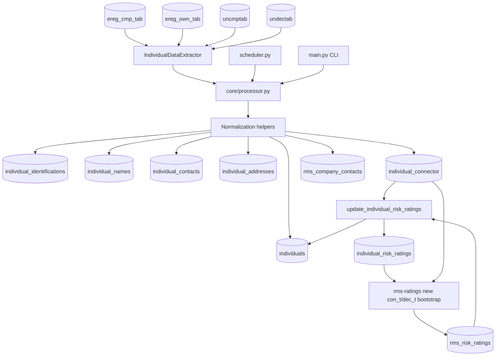
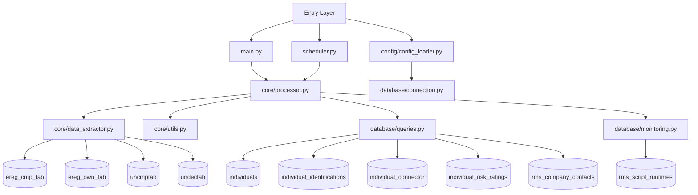

<!-- Synced from rms-individuals/docs/documentation.md. Edit there, then re-run scripts/sync-docs.sh -->

# RMS Individuals Documentation

## 1. Project Overview

### Executive Summary

**rms-individuals** is the individual identity and risk propagation service for the Automated Risk Management System (ARMS) modernization program for **Sri Lanka Customs**.

The service builds and maintains a normalized view of people connected to companies and declarants in RMDB. It reads registration and ownership data, creates stable individual records, links those individuals to company identifiers, stores contact/address/identification details, and attaches risk ratings to those individuals based on the risk ratings of the companies they are connected to.

This project works alongside services such as **rms-ratings**, **rmdb-etl**, **rms-suppliers**, and **rmdb-analytics**. The expected production deployment model is the same service-host pattern used by the rest of the RMDB/RMS Python applications, on the approved Sri Lanka Customs production server environment.

The key business purpose is continuity of risk across people, not just companies. When high-risk individuals close one entity and later register or operate through another entity, their risk history must remain visible. This is a crucial control against **Phoenix companies**: companies that are abandoned, renamed, or replaced to escape accumulated compliance risk while the same controlling people continue trading through new entities.

### Problem Statement

Company-level risk ratings are necessary but incomplete. A company can change ownership, be dissolved, go inactive, or be replaced by a newly registered entity. If the risk model only follows company identifiers, risk intelligence can be lost whenever the legal entity changes.

In customs risk management, this creates several operational gaps:

- A high-risk operator can form or use a new company with a clean starting profile.
- Declarants, consignees, owners, and related individuals can move between entities without their accumulated risk context moving with them.
- New company profiles may start at a neutral rating even when linked individuals have known risk exposure.
- Analysts and downstream systems lack a normalized individual layer for relationship-based investigation.

`rms-individuals` addresses this by creating individual records from registration owner data and linking those people to normalized company identifiers. It then derives individual risk from connected company/declarant risk ratings and stores those values for reuse by `rms-ratings` when new company/declarant risk records are created.

### Core Objectives

- Build stable individual identities from available owner registration attributes.
- Normalize and persist personal identifiers such as NIC and passport numbers.
- Link individuals to companies using normalized 9-digit company identifiers.
- Store names, addresses, phones, emails, and SMS company contacts in structured tables.
- Maintain `individuals.risk_factor` as a single overall score for each person.
- Maintain `individual_risk_ratings` as category-level individual risk values.
- Provide full, incremental, pre-date bootstrap, and risk-refresh workflows.
- Support historical backfill where individual risk must move forward day by day.
- Preserve risk continuity when the same individuals register or operate new entities.
- Reduce Phoenix-company risk by allowing new companies/declarants to inherit risk context from linked individuals.

## 2. Technical Architecture

### System Diagram



### Technology Stack

- **Language**: Python 3
- **Database**: PostgreSQL, using RMDB schema `rmdb_schema`
- **Database driver**: `psycopg2`
- **Scheduler**: APScheduler with cron expressions from YAML
- **Configuration**: YAML files in `config/`
- **Deployment**: systemd service, matching the deployment style used by `rms-ratings` and other RMDB services
- **Runtime metrics**: `rmdb_schema.rms_script_runtimes`
- **Source data**: RMDB registration and change tracking tables

### Database Schema (Application Metadata Tables)

All application-owned tables live in `rmdb_schema`.

#### `individuals`

Primary individual master table.

Important columns:

- `individual_id`: generated surrogate key.
- `record_date`: timestamp when the individual record was created.
- `risk_factor`: single overall individual risk score, default `50`.
- `active`: active flag, default `TRUE`.

#### `individual_identifications`

Stores normalized personal identifiers for an individual.

Important columns:

- `individual_id`
- `personal_id`
- `type_`: currently used for values such as `NIC` and `PPN`.
- `record_date`

Primary key: `(individual_id, personal_id)`.

This table is central to identity resolution. During processing, if an incoming owner row has a known personal ID, the service searches this table and reuses the existing `individual_id`.

#### `individual_names`

Stores normalized names observed for an individual.

Important columns:

- `individual_id`
- `name`
- `record_date`

Primary key: `(individual_id, name)`.

Names are stored lower-cased for deduplication.

#### `individual_contacts`

Stores phone, mobile, and email contacts.

Important columns:

- `individual_id`
- `type_`: examples include `Mobile`, `Telephone`, `Email`.
- `contact`: original sanitized contact.
- `cleaned_contact`: normalized/cleaned representation.
- `suspicious_record`: flag for contacts that fail basic Sri Lanka phone validation.

Primary key: `(individual_id, type_, contact)`.

#### `individual_addresses`

Stores address components for an individual.

Important columns:

- `individual_id`
- `add_01`
- `add_02`
- `add_03`
- `add_04`

Primary key: `(individual_id, add_01, add_02, add_03, add_04)`.

#### `individual_connector`

Links individuals to normalized companies.

Important columns:

- `company_id`: first 9 digits of the company TIN-like identifier.
- `individual_id`
- `record_date`
- `post`: sanitized owner TIN/post field where available.

Primary key: `(company_id, individual_id)`.

This table is the bridge between `rms-individuals` and `rms-ratings`. `rms-individuals` uses it to derive individual risk from company ratings. `rms-ratings` uses it to find linked individual risk when creating a new `con_t` or `dec_t` rating record.

#### `individual_risk_ratings`

Stores category-level individual risk ratings.

Important columns:

- `individual_id`
- `valuation_risk`
- `declaration_risk`
- `examination_risk`
- `social_risk`
- `compliance_risk`
- `origin_risk`
- `contraband_risk`
- `audit_risk`
- `last_update`

Each category defaults to `50.000`. Updates are derived from linked `rms_risk_ratings` entries of type `con_t` and `dec_t`.

#### `rms_company_contacts`

Stores selected company-level contact details discovered during individual processing.

Important columns:

- `company_id`
- `contact_type`
- `contact_category`
- `contact`

The current processor stores declaration SMS numbers as `mobile` / `sms_contact`.

#### `rms_script_runtimes`

Shared runtime log table used to record execution status.

Important columns:

- `script_name`
- `run_time`
- `records_updated`
- `run_result`
- `error_message`

`rms-individuals` records runs such as:

- `rms_individuals_full`
- `rms_individuals_incremental`
- `rms_individuals_pre_date`

## 3. Installation & Configuration

### Prerequisites

- Python virtual environment configured for the project.
- PostgreSQL connectivity to RMDB.
- Database user with read access to source registration/change tables and write access to `rmdb_schema` application tables.
- Source tables available:
  - `ereg_cmp_tab`
  - `ereg_own_tab`
  - `uncmptab`
  - `undectab`
- `rms-ratings` tables available when running risk update workflows:
  - `rmdb_schema.rms_risk_ratings`

### Environment Setup

From the project root:

```bash
cd /home/slc/Dropbox/Cursor/rms-individuals
python3 -m venv venv
source venv/bin/activate
pip install -r requirements.txt
```

Create or verify database tables:

```bash
python main.py setup
python main.py migrate
```

Create local runtime environment file (recommended in production):

```text
/opt/rms-individuals/.env
```

Use local connection config:

```text
config/connections.yaml
```

`rms-individuals` loads `.env` from project root by default and resolves `${ENV_VAR}` placeholders in `config/connections.yaml`.

Optional overrides:

- `RMS_INDIVIDUALS_ENV_FILE` - custom path to env file.
- `RMS_INDIVIDUALS_CONNECTIONS_FILE` - custom path to connections yaml.

#### `config/settings.yaml`

Current application setting:

```yaml
individual_risk:
  lookback_years: 3
```

`lookback_years` controls how far back `rms-individuals` looks when deriving individual risk from company/declarant risk records in `rms_risk_ratings`. The window is anchored to the risk update process date (`update-risk --date YYYY-MM-DD`, or today by default) and uses `rms_risk_ratings.rating_effective_date`, not the system write timestamp.

#### `config/schedules.yaml`

Current scheduler jobs:

- `daily_incremental`
  - Cron: `01 10 * * *`
  - Job type: `incremental`
  - Enabled: `false` (production default when orchestrator timer is used)
- `full_run`
  - Cron: `0 3 * * 0`
  - Job type: `full`
  - Enabled: `false`

The scheduler uses UTC unless the runtime environment or scheduler configuration is changed.
In production, keep both repos' scheduler YAML jobs disabled to avoid double-running,
and use the shared orchestrator timer from `rms-ratings/deployment`.

### Deployment Guide (Production)

The production deployment model is intended to match the other RMDB services deployed for the Automated Risk Management System on the approved Sri Lanka Customs server environment.

#### 1. Prepare application directory

Place the project in the approved deployment location, for example:

```bash
/opt/rms-individuals
```

Ensure:

- Python virtual environment exists.
- Dependencies are installed.
- Configuration files are production-ready.
- The service user can read config files and connect to RMDB.
- The service user can write logs if file logging is later added.

#### 2. Initialize database objects

From the project root with the virtual environment active:

```bash
python main.py setup
python main.py migrate
```

#### 3. Install orchestrator timer (recommended)

Production should use the orchestrator artifacts from `rms-ratings`:

```bash
sudo cp /opt/rms-ratings/deployment/rms-daily-orchestrator.service /etc/systemd/system/
sudo cp /opt/rms-ratings/deployment/rms-daily-orchestrator.timer /etc/systemd/system/
sudo systemctl daemon-reload
sudo systemctl enable --now rms-daily-orchestrator.timer
```

Disable independent schedulers to avoid overlap:

```bash
sudo systemctl disable --now rms-individuals-scheduler || true
sudo systemctl disable --now rms-ratings-scheduler || true
```

with working directory:

```text
{{PROJECT_ROOT}}
```

#### 4. Validate deployment

```bash
sudo systemctl status rms-individuals-scheduler
sudo journalctl -u rms-individuals-scheduler -f
```

Run a manual smoke test:

```bash
python main.py incremental
```

## 4. Functional Modules

### Logical Component Map



Module responsibilities:

- `main.py`: command-line entry point for setup, migrations, full/incremental/pre-date processing, and risk refresh.
- `scheduler.py`: long-running APScheduler process that executes configured jobs from `config/schedules.yaml`.
- `core/data_extractor.py`: source extraction for full, daily incremental, and pre-date bootstrap modes.
- `core/processor.py`: orchestration layer for row processing, upserts, identity matching, connector updates, and risk refresh.
- `core/utils.py`: normalization and validation helpers for names, personal IDs, company IDs, and phone contacts.
- `database/queries.py`: SQL constants for source extraction, upserts, and risk updates.
- `database/schema.py`: DDL and migrations for application-managed tables.
- `database/connection.py`: PostgreSQL connection pool and query helpers.
- `database/monitoring.py`: runtime audit logging into `rms_script_runtimes`.
- `config/config_loader.py`: YAML loading, local `.env` loading, environment substitution, and scheduler/settings access.

### Data Ingestion (How the app pulls data)

#### Full processing

Command:

```bash
python main.py full
```

Full processing reads all available owner/company rows:

- `ereg_cmp_tab`
- `ereg_own_tab`

The join is based on `instance_id`, and rows must have `bas_tvp_tin`.

This mode upserts:

- individuals
- identifications
- names
- contacts
- addresses
- company connectors
- company SMS contacts

It then refreshes risk ratings for affected individuals.

Use `--truncate` only for a clean reload of all individual-side tables:

```bash
python main.py full --truncate
```

This truncates:

- `individual_connector`
- `individual_addresses`
- `individual_contacts`
- `individual_names`
- `individual_identifications`
- `individual_risk_ratings`
- `individuals`
- `rms_company_contacts`

#### Daily incremental processing

Command:

```bash
python main.py incremental --date YYYY-MM-DD
```

`--date` is the scheduler execution date. The extraction window is the previous calendar day:

```text
[date - 1 day 00:00:00, date 00:00:00)
```

The incremental mode reads changed company/declarant IDs from:

- `uncmptab.modify_time`
- `undectab.modify_time`

It then fetches the matching current owner/company rows from:

- `ereg_cmp_tab`
- `ereg_own_tab`

After upserting the affected rows, it refreshes risk ratings only for affected individuals.

Example:

```bash
python main.py incremental --date 2020-01-02
```

This processes changes from `2020-01-01`.

#### Pre-date bootstrap processing

Command:

```bash
python main.py before-date --before-date YYYY-MM-DD
```

This mode processes all company/declarant IDs whose change-table `modify_time` is before the cutoff date:

```text
modify_time < YYYY-MM-DD 00:00:00
```

It is designed for historical replay preparation. For a replay beginning at `2020-01-01`, run:

```bash
python main.py before-date --before-date 2020-01-01
```

This builds the initial individual/company connector baseline before the first replay day.

#### Risk update processing

Command:

```bash
python main.py update-risk --date YYYY-MM-DD
```

This command refreshes all individual risk ratings from current company/declarant risk data. If `--date` is omitted, the process date defaults to today.

It reads:

- `individuals`
- `individual_connector`
- `rms_risk_ratings`

It updates:

- `individuals.risk_factor`
- `individual_risk_ratings`

The logic considers `rms_risk_ratings` rows where:

- `risk_type IN ('con_t', 'dec_t')`
- `rating_effective_date` is within the configured lookback period relative to `process_date`
- `rating_effective_date <= process_date`

For the single `risk_factor`, it selects the highest linked company/declarant overall risk rating per individual. For category ratings, it stores the maximum linked category values per individual.

### API Documentation (Command-Line Interface)

`rms-individuals` exposes a CLI via:

```bash
python main.py <command> [options]
```

#### Command index

- `setup` - create application tables and indexes.
- `migrate` - apply schema migrations to an existing database.
- `full [--truncate] [--no-progress]` - process all owner/company source rows.
- `incremental [--date YYYY-MM-DD]` - process changed companies/declarants for the previous day relative to `--date`.
- `before-date --before-date YYYY-MM-DD` - process all changed companies/declarants before a cutoff date.
- `update-risk [--date YYYY-MM-DD]` - refresh all individual risk ratings from current company/declarant ratings, anchoring lookback to the supplied process date.

#### Common usage examples

```bash
python main.py setup
python main.py migrate

python main.py full
python main.py full --truncate
python main.py incremental --date 2026-04-30
python main.py before-date --before-date 2020-01-01
python main.py update-risk --date 2026-04-30
```

#### Scheduler usage

Start scheduler manually:

```bash
python scheduler.py
```

Production should use systemd:

```bash
sudo systemctl status rms-daily-orchestrator.timer
sudo systemctl list-timers | rg rms-daily-orchestrator
sudo journalctl -u rms-daily-orchestrator.service -f
```

To re-enable standalone APScheduler mode later:
1. Set required jobs to `enabled: true` in both `config/schedules.yaml` files.
2. Disable orchestrator timer:
   - `sudo systemctl disable --now rms-daily-orchestrator.timer`
3. Re-enable scheduler services:
   - `sudo systemctl enable --now rms-individuals-scheduler`
   - `sudo systemctl enable --now rms-ratings-scheduler`

### Historical Rating Reset / Backfill Workflow

When rebuilding risk ratings from a previous date, individual mappings and individual risk propagation must be included in the timeline.

The strict chronological process is:

1. Bootstrap individual/company links before the replay start date.
2. For each day `D`, process individual mapping changes for day `D`.
3. Process `rms-ratings` for day `D`.
4. Refresh individual risk after day `D` company/declarant risk updates.

For a replay beginning on `2020-01-01`:

```bash
# One-time individual baseline before the replay start date
cd /home/slc/Dropbox/Cursor/rms-individuals
python main.py before-date --before-date 2020-01-01
```

Then run the daily loop:

```bash
START_DATE="2020-01-01"
END_DATE="$(date +%F)"

current="$START_DATE"
while [ "$current" != "$(date -I -d "$END_DATE + 1 day")" ]; do
  next="$(date -I -d "$current + 1 day")"

  cd /home/slc/Dropbox/Cursor/rms-individuals
  python3 main.py incremental --date "$next"

  cd /home/slc/Dropbox/Cursor/rms-ratings
  python3 main.py daily --date "$current"

  cd /home/slc/Dropbox/Cursor/rms-individuals
  python3 main.py update-risk --date "$current"

  current="$next"
done
```

Why the third step matters:

- `rms-individuals incremental` refreshes risk for individuals affected by mapping changes.
- `rms-ratings daily` can change company/declarant ratings for many companies.
- `rms-individuals update-risk --date D` pushes those company/declarant rating changes back onto all linked individuals using `D` as the lookback anchor.

That final refresh ensures the next replay day starts with current individual risk.

### Individual Risk and Phoenix Company Detection

This service is an important anti-evasion control.

When a company accumulates risk and the same people later register or operate a new company, that new entity should not necessarily start from a neutral risk profile. The individual layer provides continuity:

- `rms-individuals` links people to companies through `individual_connector`.
- It assigns risk to individuals from linked `con_t` and `dec_t` ratings.
- `rms-ratings` uses those individual ratings when creating a new `con_t` or `dec_t`.
- New company/declarant entities inherit the maximum per-category risk from linked individuals as their starting context.

This helps combat Phoenix companies because the risk signal follows the operators, not only the registered company identifier.

Operationally, this means `rms-individuals update-risk` is not optional during historical replay. If individual risk is stale, the next newly registered company/declarant can be initialized with stale or neutral risk.

## 5. Security & Compliance

### Secrets and Configuration Hygiene

Configuration is YAML-based. Database credentials are loaded from local `config/connections.yaml` with environment values sourced from local `.env` (or override path via `RMS_INDIVIDUALS_ENV_FILE`).

Security-relevant files:

- `config/connections.yaml`
- `config/settings.yaml`
- `config/schedules.yaml`
- `deployment/rms-individuals-scheduler.service`

Current protections:

- Configuration loader supports exact `${ENV_VAR}` substitutions.
- DB search path is set through connection options.
- Production can run under a dedicated systemd service user.
- Runtime status is recorded in database audit logs.

Recommended production hygiene:

- Keep credentials out of git-tracked files.
- Prefer environment-backed secrets or protected systemd environment files.
- Restrict file permissions for deployment configs.
- Use a least-privilege DB role for runtime processing.
- Separate migration/setup privileges from normal scheduler privileges where possible.
- Review contact and personal identifier handling under applicable privacy rules.

### Compliance Gaps and Optional Hardening

Known gaps:

- Plain YAML credentials may exist in local or production worktrees unless operationally restricted.
- There is no built-in encryption or masking of personal identifiers at the application table layer.
- The service stores personal IDs, names, contacts, and addresses, which require careful access control.
- Runtime logs can include operational counts and exception details.
- Data retention policy for individual records and contacts is not encoded in the application.
- No automated duplicate-identity adjudication workflow exists beyond personal ID matching.

Optional hardening roadmap:

- Move production secrets to protected environment files or a vault.
- Add DB role separation for setup/migration/runtime.
- Add data retention rules and archival/deactivation policy for stale individual details.
- Add audit queries/dashboards for suspicious contact records and duplicate identifiers.
- Add automated data quality reporting for missing NIC/passport values, invalid phone numbers, and connector churn.
- Consider field-level masking or restricted views for personal data access.
- Add CI secret scanning and lint checks.

## 6. Maintenance & Troubleshooting

### Routine Maintenance

Daily checks:

- Confirm scheduler status:
  - `sudo systemctl status rms-individuals-scheduler`
- Review latest logs:
  - `sudo journalctl -u rms-individuals-scheduler -n 200`
- Check recent runtime rows:
  - `rms_script_runtimes` where `script_name` starts with `rms_individuals`
- Confirm daily incremental did not unexpectedly process zero rows for long periods.
- Confirm `rms-ratings` completed before relying on a post-rating `update-risk` refresh.

Weekly checks:

- Review row growth in:
  - `individuals`
  - `individual_identifications`
  - `individual_connector`
  - `individual_risk_ratings`
  - `rms_company_contacts`
- Review suspicious contact counts in `individual_contacts`.
- Confirm indexes remain healthy.
- Confirm source table availability and modification timestamps are continuing to move.

Before historical replay:

- Confirm backups exist for rating and individual tables.
- Run `rms-individuals before-date` for the replay start date.
- Ensure `rms-ratings` setup/migrations/config sync have been run.
- Disable normal schedulers if they would conflict with manual backfill.
- Run the chronological daily loop.
- Re-enable schedulers only after catch-up completes.

### Common Errors

- **Database not initialized**
  - Cause: command path did not call `_initialize_database()` or an import path issue occurred.
  - Fix: run through `main.py` commands, verify project root and virtual environment.

- **Database connection config not found**
  - Cause: missing local `config/connections.yaml`, or override path in `RMS_INDIVIDUALS_CONNECTIONS_FILE` is invalid.
  - Fix: provide local config file or correct the override path.

- **Missing DB config fields**
  - Cause: connection does not include `host`, `port`, `user`, `password`, or `database`.
  - Fix: correct the selected `rmdb` connection in YAML.

- **Incremental processes zero rows**
  - Possible cause: no `uncmptab` / `undectab` modifications in the window.
  - Possible cause: wrong `--date`; remember it processes the previous day.
  - Possible cause: source change tables are not populated by ETL.

- **Risk update changes zero individuals**
  - Possible cause: no matching `individual_connector.company_id` to `rms_risk_ratings.risk_entity`.
  - Possible cause: `rms_risk_ratings.rating_effective_date` is outside `lookback_years` for the supplied `--date`.
  - Possible cause: `rms-ratings` has not run yet.

- **Too many new individuals**
  - Possible cause: weak or missing personal IDs in source data prevent matching to existing individuals.
  - Possible cause: source identifiers contain inconsistent formatting not handled by current normalizers.

- **Suspicious contact rate is high**
  - Cause: phone numbers do not match expected Sri Lanka local/international formats.
  - Fix: review source quality and `clean_phone_sri_lanka()` assumptions before changing validation.

### Updating Rules (Change Behavior Without Core Code)

Behavior controlled by configuration:

- Scheduler cadence:
  - edit `config/schedules.yaml`
  - restart `rms-individuals-scheduler`
- Individual risk lookback:
  - edit `config/settings.yaml`
  - update `individual_risk.lookback_years`
  - rerun `python main.py update-risk --date YYYY-MM-DD`

Behavior controlled by source SQL:

- Full extraction logic is in `FULL_SOURCE_QUERY`.
- Incremental changed-company detection is in `CHANGED_COMPANY_IDS_QUERY` and `CHANGED_DECLARANT_IDS_QUERY`.
- Pre-date bootstrap detection is in `CHANGED_COMPANY_IDS_BEFORE_QUERY` and `CHANGED_DECLARANT_IDS_BEFORE_QUERY`.
- Risk derivation logic is in `UPDATE_INDIVIDUAL_RISK_*` and `UPSERT_INDIVIDUAL_RISK_RATINGS_*`.

Behavior controlled by Python normalization:

- `normalize_alnum()` and `normalize_digits()` define personal ID cleanup.
- `company_id_from_tin()` defines company connector keys.
- `has_distinct_characters()` filters low-quality/dummy values.
- `clean_phone_sri_lanka()` validates Sri Lanka phone formats.

Change these carefully. Normalization changes can merge or split identities and therefore affect risk propagation.

### Logging

CLI commands log to stdout using Python logging.

Scheduler logs are available through systemd:

```bash
sudo journalctl -u rms-individuals-scheduler -f
```

Runtime metadata is written to:

```text
rmdb_schema.rms_script_runtimes
```

Important fields:

- `script_name`
- `run_time`
- `records_updated`
- `run_result`
- `error_message`

Useful script names:

- `rms_individuals_full`
- `rms_individuals_incremental`
- `rms_individuals_pre_date`

## Attribution

*Administrative context — separate from the operational sections above.*

> **Developer** — **Uvindu Perera**, Superintendent of Customs, **Risk Management Directorate**.
>
> **Modernization context** — **rms-individuals** is part of a broader program to retire legacy **Java** components built for the **Automated Risk Management System (ARMS)** in favor of **service-oriented Python** applications. This service computes and maintains the individual identity and risk-continuity layer for RMDB, including individual profiles, personal identifiers, company links, contact details, and individual risk ratings used by profiling workflows and by `rms-ratings` when new company or declarant entities are created. It is designed for scheduled and on-demand runs on institutional production hosts (for example **`10.2.60.146`**, under **systemd** as **`rms-individuals-scheduler`**), replacing legacy batch logic and aligning individual-risk operations with modern, maintainable tooling.
