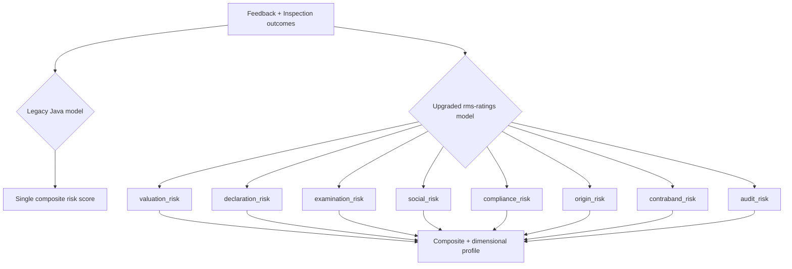
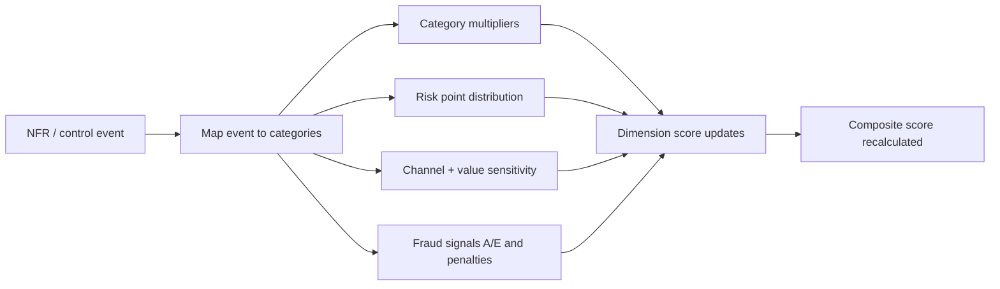
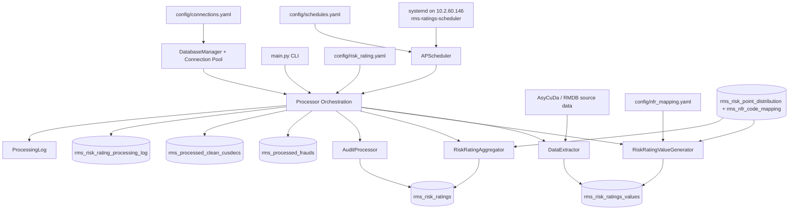
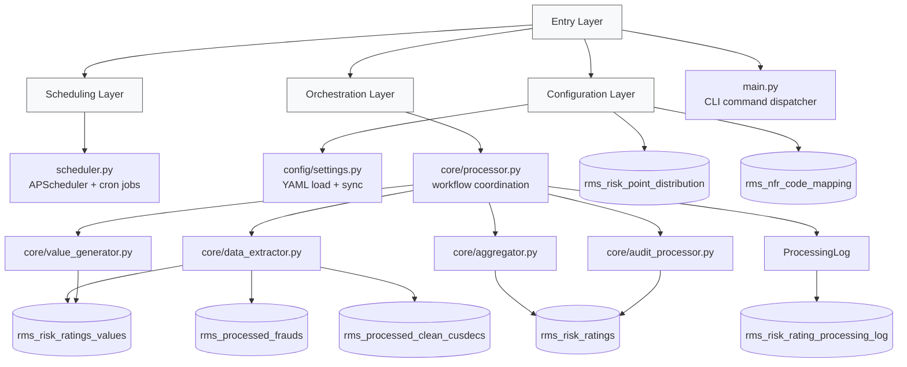

<!-- Synced from rms-ratings/docs/documentation.md. Edit there, then re-run scripts/sync-docs.sh -->

# RMS Ratings Documentation

## 1. Project Overview

### Executive Summary

**rms-ratings** is the risk rating engine for the Risk Management ecosystem. It replaces the legacy Java rating application with a Python, configuration-driven service while keeping the same deployment and service architecture used by the current platform.

Unlike the older one-dimensional approach that produced a single broad risk signal, the upgraded engine computes a multidimensional view of risk. It leverages richer feedback data now available through the AsyCuDa World upgrade (Inspection Act enhancement with the Frauds tab), allowing ratings to identify *which* risk areas are driving concern rather than only indicating that risk exists.

The outcome is a rating model that is more explainable, operationally useful, and aligned with modern analytics needs: officers can see category-level risk patterns, supervisors can prioritize interventions by risk type, and analysts can track changes in risk behavior over time.

Operationally, this service is intended to run on the same Ubuntu server environment used by the other RMDB services, with deployment targeting `10.2.60.146` under systemd supervision.

At a business level, the model now works with multiple risk dimensions (currently eight configured category ratings) plus a composite rating that summarizes the total profile for decision support.

### Problem Statement

The existing risk rating model is one dimensional. It provides a limited, aggregate signal that does not sufficiently describe the nature of risk behind a trader, declaration, or transaction profile.

With the expanded and more detailed data captured by the feedback control process in AsyCuDa World (including the upgraded Inspection Act with Frauds tab), the current model no longer makes full use of available intelligence. This creates practical gaps:

- High risk entities can be identified, but the **specific risk area** (for example valuation, classification, origin, fraud indicators, or compliance behavior) is not clearly separated.
- Similar final scores can mask **very different underlying patterns**, making interventions less targeted.
- Trend analysis is weaker because one composite signal cannot reliably show **which risk dimensions are improving or deteriorating**.
- Operational teams have less confidence in prioritization when they cannot trace ratings back to explicit risk drivers.

In short, the business now has richer data, but the current one-dimensional rating logic cannot fully convert that data into actionable risk insight.

### Core Objectives

The upgraded **rms-ratings** service is designed to achieve the following:

- Move from a one-dimensional score to a **multidimensional risk profile** that highlights major risk areas.
- Preserve compatibility with existing server and service operations while modernizing only the **rating logic layer**.
- Improve explainability by linking rating outcomes to concrete, auditable risk factors derived from feedback control data.
- Enable better analytics and governance by exposing risk dimensions that can be monitored independently over time.
- Support configurable evolution of rating rules so model refinements can be introduced without reworking the full application stack.
- Improve operational decision quality by making it easier to map each case to the most relevant control response.

### Risk Rating Dimensions (Configured)

The current implementation tracks the following category ratings, then produces a composite score:

- `valuation_risk` - value declaration and valuation-related concerns
- `declaration_risk` - declaration quality and document declaration consistency
- `examination_risk` - findings from inspection and examination outcomes
- `social_risk` - social and OGA-related risk patterns captured through controls
- `compliance_risk` - broader compliance behavior and recurring governance issues
- `origin_risk` - country-of-origin and origin-document related concerns
- `contraband_risk` - high-impact contraband signals and related fraud indicators
- `audit_risk` - ECCR/audit workflow outcomes (penalty and A/E based logic)
- **Composite rating** - consolidated rating used for prioritization, while preserving dimension-level visibility

These dimensions are intentionally separated so risk officers can distinguish between different root causes instead of relying on a single opaque score.

### Conceptual Shift (Legacy to Upgraded Model)



### How a Dimension Changes (Conceptual)

Each category rating changes based on configured logic that combines:

- source context (entity type, channel, transaction/value context),
- risk event mapping (for example NFR code to one or more risk categories),
- weighted increase/decrease behavior per category,
- additional fraud signals such as A/E and penalty-related values where configured.

This design allows one event to affect one or multiple categories, and allows high-severity events to impact selected categories more strongly than routine events.



### Illustrative Examples

- **Legacy output**: Trader X = 78 (high risk), but no clear indication of why.
- **Upgraded output**: Trader X = 78 overall, with a profile such as:
  - valuation_risk: High
  - declaration_risk: Medium
  - compliance_risk: Low
  - contraband_risk: High
  - other dimensions: Moderate/Low

This allows teams to move from generic high-risk treatment to targeted interventions based on the dominant risk dimensions.

Additional examples:

- **Example A: Same composite, different treatment**
  - Entity A composite: 72, driven mainly by `origin_risk` + `declaration_risk`.
  - Entity B composite: 71, driven mainly by `audit_risk` + `contraband_risk`.
  - Operationally, both are high priority, but follow-up actions should differ because the dominant risks differ.

- **Example B: Improvement tracking**
  - Composite score remains near-stable over a period.
  - `compliance_risk` decreases due to cleaner behavior, while `examination_risk` increases from recent findings.
  - Management can detect offsetting trends that would be invisible in a one-dimensional model.

- **Example C: Event-to-multi-risk propagation**
  - A single mapped event affects both `valuation_risk` and `declaration_risk`.
  - This reflects real-world overlap where one issue can indicate multiple control concerns.

## 2. Technical Architecture

The **rms-ratings** service uses a configuration-driven processing pipeline. Scheduled or manual runs resolve a processing window, extract fraud and clean-cusdec signals, generate rating deltas, aggregate category ratings, run dedicated audit scoring, and persist updated dimensional + composite ratings in `rmdb_schema`.

The runtime topology is the same operational model used by `rmdb-etl` and `rmdb-analytics`: Ubuntu-hosted Python service, systemd-managed scheduler process, and PostgreSQL-backed state/config tables. For production, this document assumes deployment on `10.2.60.146`.

### System Diagram



### Technology Stack

**Language and runtime**

- Python 3.x
- Virtual environment (`venv`)

**Core application components**

- `main.py` - CLI entry for setup, migration, daily, incremental, range, recalculation, config sync, and audit retry flows.
- `scheduler.py` - APScheduler-based cron orchestration reading `config/schedules.yaml`.
- `core/processor.py` - end-to-end orchestration (extract -> value generation -> aggregation -> audit processing -> persistence/logging).
- `core/data_extractor.py` - extracts fraud and clean-cusdec windows and marks processed records.
- `core/value_generator.py` - converts extracted events to rating deltas per entity/risk category.
- `core/aggregator.py` - computes updated dimensional ratings and composite risk rating.
- `core/audit_processor.py` - dedicated ECCR audit risk workflow (`audit_risk`) with window + backlog handling.
- `config/settings.py` - loads YAML configuration and syncs point-distribution config to DB.
- `database/connection.py` - PostgreSQL access with pooled connections via `psycopg2`.
- `database/schema.py` - DDL and migration definitions for RMS rating tables.

**Databases**

- PostgreSQL RMDB (`rmdb_schema`) as both:
  - **Source** for operational/control data used during extraction
  - **Target** for RMS rating outputs, config materialization tables, and processing metadata

**Orchestration and operations**

- APScheduler (`BlockingScheduler` + cron triggers)
- Deployment target: Ubuntu server `10.2.60.146`
- systemd service: `rms-ratings-scheduler` (long-running scheduler process on `10.2.60.146`)
- File and journal-based observability (`logs/risk_rating.log`, `journalctl`)
- Service behavior aligned with the existing RMDB service pattern used for ETL and Analytics

**Configuration and secrets**

- YAML configuration in `config/`:
  - `risk_rating.yaml`
  - `nfr_mapping.yaml`
  - `schedules.yaml`
  - `connections.yaml`
- Runtime reload/sync support so rule and weight changes can be propagated without redesigning code paths.

### Database Schema

Scheduling is file-driven (`config/schedules.yaml`) while processing state, dimensional ratings, and configuration materialization are stored in PostgreSQL tables under `rmdb_schema`.

#### Core ratings tables

#### `rms_risk_ratings`

Stores current rating state per entity (`risk_type`, `risk_entity`), including:

- Composite rating (`risk_rating`)
- Category ratings: `valuation_risk`, `declaration_risk`, `examination_risk`, `social_risk`, `compliance_risk`, `origin_risk`, `contraband_risk`, `audit_risk`
- `rating_effective_date`, the latest business date contributing to the current aggregate rating
- Timestamps (`last_update`, `created_at`); `last_update` is the ETL/system write time

Purpose:

- Serves as the authoritative current risk profile for each tracked entity
- Preserves both multidimensional interpretation and composite prioritization
- Provides `rating_effective_date` for downstream as-of lookback calculations such as individual risk propagation

#### `rms_risk_ratings_values`

Stores generated, pre-aggregation rating deltas (increase/decrease events), including:

- `instance_id`, `update_date`, `entity_type`, `entity`, `point_type`
- Value drivers: `stat_value`, `frd_value_ae`, `frd_value_penalty`, `item_proportion`
- Mapped category set (`risk_categories`)
- Processing flag (`update_status`)

Purpose:

- Provides a traceable intermediate layer between extraction events and final ratings
- Supports deterministic aggregation and replay/recalculation workflows

#### Configuration materialization tables

#### `rms_risk_point_distribution`

Persists value/channel-based point configuration (`increase_points`, `decrease_points`, AE/penalty thresholds and maxima) by risk entity and channel.

Purpose:

- Keeps effective scoring parameters queryable/auditable in DB
- Enables YAML-to-DB synchronization for operational visibility

#### `rms_nfr_code_mapping`

Maps NFR codes to one or more risk categories and type (`0` no increase, `1` increase).

Purpose:

- Externalizes risk classification logic from code
- Supports category-specific scoring from inspection/fraud events

#### Processing and control tables

#### `rms_risk_rating_processing_log`

Run-level audit log for each processing execution, including start/end time, record counts, status, and error details.

#### `rms_processed_frauds`

Tracks fraud records already processed (`instance_id`, item/fraud keys), preventing duplicate risk updates and recording whether ratings were affected.

#### `rms_processed_clean_cusdecs`

Tracks clean cusdec records processed for decrease logic, preventing duplicate decrements.

#### `rms_starting_ratings`

Stores initial baseline ratings for selected entities to support controlled recalculation scenarios.

## 3. Installation & Configuration

### Prerequisites

#### System requirements

- Ubuntu Linux server environment (production target: `10.2.60.146`)
- Python 3.8+ (Python 3.10+ recommended)
- `python3-venv` and `pip`
- `systemd` (for scheduler service)
- PostgreSQL connectivity to RMDB instance used by the Risk Management platform
- Git access to this repository

#### Required Python dependencies

Install from `requirements.txt` inside a virtual environment:

```bash
python3 -m venv venv
source venv/bin/activate
pip install -r requirements.txt
```

Key runtime libraries include:

- `APScheduler` (cron-based scheduling)
- `psycopg2-binary` (PostgreSQL connectivity)
- `PyYAML` (configuration loading)

#### Required configuration files

Before running in any environment, ensure these files are populated correctly:

- `config/connections.yaml` - DB host, port, user, password, database, schema (`rmdb_schema`)
- `config/schedules.yaml` - schedule definitions and enabled/disabled state
- `config/risk_rating.yaml` - risk categories, multipliers, and scoring rules
- `config/nfr_mapping.yaml` - NFR code to risk-category mappings

#### Database prerequisites

- The service account in `config/connections.yaml` must have privileges to read and write in `rmdb_schema`.
- First-time setup must create RMS tables and seed required config tables.

### Environment Setup

#### 1) Clone and prepare the project

Example (adjust path/user to your server standards):

```bash
sudo git clone <repository-url> /opt/rms-ratings
sudo chown -R <deploy-user>:<deploy-user> /opt/rms-ratings
cd /opt/rms-ratings
```

#### 2) Create virtual environment and install dependencies

```bash
python3 -m venv venv
source venv/bin/activate
pip install -r requirements.txt
```

#### 3) Configure database and schedules

- Edit `config/connections.yaml` with production RMDB connection details.
- Edit `config/schedules.yaml` with required cron timings and `enabled` flags.
- Validate scoring configuration in `config/risk_rating.yaml` and mappings in `config/nfr_mapping.yaml`.

#### 4) Initialize schema and migrations

Run from project root:

```bash
source venv/bin/activate
python main.py setup
python main.py migrate
python main.py sync-config
```

Recommended verification:

```bash
python main.py daily --date 2026-01-15
```

This verifies extraction, value generation, aggregation, and DB persistence end to end before enabling scheduler automation.

### Deployment Guide (Production)

The production deployment model matches other RMDB services and is intended for `10.2.60.146` using systemd.

#### 1) Deploy on `10.2.60.146`

- Place the project in the approved path (for example `/opt/rms-ratings`).
- Ensure `venv` exists and dependencies are installed.
- Confirm all config files under `config/` are production-ready.

#### 2) Install and enable orchestrator timer (recommended)

From project root:

```bash
sudo cp deployment/run-rms-daily-orchestrator.sh /opt/rms-ratings/deployment/
sudo chmod +x /opt/rms-ratings/deployment/run-rms-daily-orchestrator.sh
sudo cp deployment/rms-daily-orchestrator.service /etc/systemd/system/
sudo cp deployment/rms-daily-orchestrator.timer /etc/systemd/system/
sudo systemctl daemon-reload
sudo systemctl enable --now rms-daily-orchestrator.timer
```

#### 3) Validate service health

```bash
sudo systemctl status rms-daily-orchestrator.timer
sudo systemctl list-timers | rg rms-daily-orchestrator
sudo journalctl -u rms-daily-orchestrator.service -f
```

#### 4) Day-2 operations

- **Apply configuration updates** (`risk_rating.yaml`, `nfr_mapping.yaml`, schedules):
  - If scoring config changed, run `python main.py sync-config` (with venv active).
  - Start one run manually: `sudo systemctl start rms-daily-orchestrator.service`.
- **Run ad hoc processing jobs** (manual recovery/backfill/recalculation):
  - `python main.py daily --date YYYY-MM-DD`
  - `python main.py incremental`
  - `python main.py recalculate --start YYYY-MM-DD --end YYYY-MM-DD`
- **Troubleshoot failures**:
  - Check service logs (`journalctl`) and app file logs (`logs/risk_rating.log`)
  - Verify DB reachability and credentials in `config/connections.yaml`
  - Confirm `rms-daily-orchestrator.timer` is enabled and next trigger is `06:15` server local time

#### 5) Restart and rollback posture

- Timer is persistent (`Persistent=true`), so missed runs while offline are triggered after boot.
- For urgent rollback of scoring behavior, restore prior YAML config versions and restart the service.
- For data-level rollback/rebuild, use controlled recalculation windows after config correction.

#### 6) Disable independent schedulers to avoid double-running

Keep APScheduler implementation available, but disable production overlap:

```bash
sudo systemctl disable --now rms-ratings-scheduler || true
sudo systemctl disable --now rms-individuals-scheduler || true
```

Set scheduler YAML jobs to disabled in both repos:
- `rms-ratings/config/schedules.yaml`
- `rms-individuals/config/schedules.yaml`

#### 7) Re-enable APScheduler later (optional)

1. Set required jobs back to `enabled: true` in both schedule YAML files.
2. Disable orchestrator timer:
   - `sudo systemctl disable --now rms-daily-orchestrator.timer`
3. Re-enable daemon schedulers:
   - `sudo systemctl enable --now rms-ratings-scheduler`
   - `sudo systemctl enable --now rms-individuals-scheduler`

## 4. Functional Modules

### Logical Component Map

The application is organized into orchestration, extraction, transformation, aggregation, audit enrichment, and persistence support modules.



Module responsibilities:

- `main.py`: command-line entry point for setup, migrations, run modes, recalculation, and config sync.
- `scheduler.py`: long-running cron scheduler for daily/incremental automated runs.
- `core/processor.py`: end-to-end pipeline orchestration and run statistics/logging.
- `core/data_extractor.py`: windowed extraction for fraud and clean-cusdec candidates, with duplicate protection via processed tables.
- `core/value_generator.py`: generates risk delta rows from extracted records based on configured scoring rules.
- `core/aggregator.py`: applies deltas to dimensional ratings and persists updated composite/category ratings.
- `core/audit_processor.py`: dedicated ECCR audit-risk pass (`audit_risk`) including backlog retry logic.
- `database/*`: SQL queries, connection pooling, schema DDL/migrations.

### Data Ingestion (How the app pulls data)

Data ingestion is window-driven and bound to Inspection Act activity (`binder_id = 'B_Inspection_Act'`) using operation timestamps from tracking tables.

#### Ingestion sources

Primary operational source tables:

- `rmdb_schema.INS_FRD_TAB` (fraud records and fraud values)
- `rmdb_schema.insp_act_tab` (inspection-act linkage)
- `rmdb_schema.SAD_GENERAL_SEGMENT` (CusDec-level declaration fields)
- `rmdb_schema.SAD_ITEM` (item-level fields and value basis)
- `rmdb_schema.un_asybrk_ied` and `rmdb_schema.un_asybrk_track` (window filtering by operation datetime)
- `rmdb_schema.rms_supplier_mapping` (supplier linkage where available)
- `rmdb_schema.eccr_recoveries` (audit workflow input for audit-risk processing)

#### Ingestion paths

- **Fraud increase path**
  - Extracts records where total fraud value is positive or NFR mapping indicates Type 1 risk.
  - Separates AE value and penalty value contributions.
  - Resolves mapped risk categories from DB mapping (`rms_nfr_code_mapping`) with YAML fallback.
  - Skips already-processed fraud keys using `rms_processed_frauds`.

- **Clean cusdec decrease path**
  - Extracts records with no fraud rows, or zero fraud value with only Type 0 mappings.
  - Uses a lookback window (configured `clean_cusdec_days`, default 60 in current config model).
  - Skips already-processed instance IDs using `rms_processed_clean_cusdecs`.

- **Audit-risk path**
  - Runs as a dedicated ECCR pass (window + backlog) through `core/audit_processor.py`.
  - Persists rating updates and marks processed recoveries to avoid reprocessing loops.

#### Load and persistence flow

- Extracted records are converted to delta rows and stored in `rms_risk_ratings_values`.
- Aggregation consumes pending deltas and updates current state in `rms_risk_ratings`.
- Process control tables capture processing boundaries and idempotency:
  - `rms_processed_frauds`
  - `rms_processed_clean_cusdecs`
  - `rms_risk_rating_processing_log`

### API Documentation (Command-Line Interface)

`rms-ratings` exposes a CLI interface via `python main.py <command> [options]`.

#### Command index

- `setup` - create RMS tables and seed defaults
- `migrate` - apply schema migrations for existing databases
- `daily --date YYYY-MM-DD` - run full daily pipeline for a specific date
- `incremental [--hours N]` - run recent-window fraud processing (default 24 hours)
- `audit-retry [--start-date YYYY-MM-DD] [--end-date YYYY-MM-DD]` - retry unmatched ECCR audits only
- `recalculate --start YYYY-MM-DD --end YYYY-MM-DD [--individuals-path PATH]` - rebuild ratings day-by-day from source data
- `sync-config` - sync YAML point distribution config to DB
- `test` - run algorithm verification routines
- `simulate` - run rating evolution simulation output

#### Common usage examples

```bash
python main.py setup
python main.py migrate
python main.py sync-config

python main.py daily --date 2026-04-01
python main.py incremental --hours 24
python main.py audit-retry --start-date 2026-01-01 --end-date 2026-02-01

python main.py recalculate --start 2026-01-01 --end 2026-03-31
```

#### Historical reboot / backfill workflow (chronological)

When rebuilding ratings from a historical start date (for example `2020-01-01`), preserve day-order dependencies between company ratings and individual ratings.

Recommended pattern:

1. **Bootstrap pre-start individual mappings once** (in `rms-individuals`):
   - `python main.py before-date --before-date 2020-01-01`
2. **Run daily replay loop from start date to end date**:
   - `rms-individuals incremental --date <D+1>` (captures source changes on day `D`)
   - `rms-ratings daily --date <D>`
   - `rms-individuals update-risk --date <D>` (global individual risk refresh after day `D` company updates)
3. **After backfill completes**, enable normal daily schedulers.

Example commands:

```bash
# 1) One-time bootstrap before replay start
cd /path/to/rms-individuals
python main.py before-date --before-date 2020-01-01

# 2) Daily loop (pseudo-steps; run for each D in date range)
python main.py incremental --date 2020-01-02
cd /path/to/rms-ratings
python main.py daily --date 2020-01-01
cd /path/to/rms-individuals
python main.py update-risk --date 2020-01-01
```

Note: `python main.py recalculate ...` in `rms-ratings` already performs a day-by-day replay and invokes `rms-individuals update-risk --date <D>` after each day. Use the explicit 3-step loop when you need tighter control over mapping bootstrap behavior.

#### How individual risk affects new company/declarant ratings

For existing entities, `rms-ratings` updates company/declarant ratings from fraud/clean/audit deltas.

For **newly seen** `con_t` / `dec_t` entities, the aggregator initializes starting category values by inheriting the **maximum per-category** ratings from linked individuals (`individual_connector` + `individual_risk_ratings`). The initialized overall `risk_rating` is then set to the max of those inherited categories.

Operational implication:

- If individual risk is stale, new `con_t` / `dec_t` starting ratings can be stale.
- Keeping `rms-individuals update-risk` in the daily sequence ensures new entities inherit current individual risk context.

#### Operational notes

- Run CLI commands from the project root with the project virtual environment active.
- `daily` includes clean-cusdec decrease logic; `incremental` focuses on recent fraud windows (plus audit pass).
- `audit-retry` does not perform fraud/clean extraction; it targets unresolved audit updates.
- After YAML scoring changes, run `sync-config` and restart `rms-ratings-scheduler` in production.

## 5. Security & Compliance

### Secrets and Configuration Hygiene

Current configuration model is YAML-first and loads values directly from files under `config/`.

Security-relevant configuration files:

- `config/connections.yaml` (database endpoint and credentials)
- `config/risk_rating.yaml` (business scoring logic and logging path)
- `config/nfr_mapping.yaml` (risk mapping definitions)
- `config/schedules.yaml` (execution cadence)

Current posture:

- DB credentials are consumed from `config/connections.yaml` via `config/config_loader.py`.
- Service-level isolation exists through systemd (`NoNewPrivileges=true`, dedicated service unit).
- Configuration is version-controlled and reviewable, improving change traceability.

Important hygiene note:

- The current loader does not apply environment-variable substitution by default; secrets stored directly in YAML are plaintext-at-rest in the repo/worktree unless operational controls are added.

Recommended production hygiene for `10.2.60.146`:

- Keep production credentials out of git-tracked files; inject via protected environment files or systemd `EnvironmentFile`.
- Restrict file permissions for runtime config and service files (`root`/service-user readable only where appropriate).
- Maintain separate config sets per environment (dev/test/prod) with strict promotion controls.
- Rotate DB credentials on a fixed cadence and after incident events.
- Add pre-commit or CI secret scanning to prevent accidental credential commits.

### Audit Logs — What the Application Records

The service records both application logs and structured processing metadata.

#### Application logs

- File log path is configured in `config/risk_rating.yaml` (current default: `logs/risk_rating.log`).
- Scheduler/service logs are available through systemd journal:
  - `journalctl -u rms-ratings-scheduler`
- Logged events include:
  - run starts/completions/failures,
  - processing window summaries,
  - record counts and update counts,
  - error stack traces for failed operations.

#### Database audit/processing records

- `rms_risk_rating_processing_log`
  - tracks run-level status (`RUNNING`, `COMPLETED`, `FAILED`), timing, record counters, and `error_message`.
- `rms_processed_frauds`
  - tracks processed fraud keys and whether ratings were affected.
- `rms_processed_clean_cusdecs`
  - tracks clean-cusdec instances already consumed for decrease logic.
- `rms_risk_ratings_values`
  - stores pending/processed delta entries with `update_status`, giving a replayable ledger between extraction and final aggregate ratings.

Audit value:

- Supports operational forensics (what ran, when, and with what outcome).
- Enables idempotency checks and duplicate-protection tracing.
- Improves accountability for scoring changes across processing windows.

### Compliance Gaps and Optional Hardening

The platform already provides good operational auditability, but there are identifiable compliance gaps for production-grade controls.

#### Known gaps (current-state)

- **Secret management gap**: credentials can be stored directly in YAML.
- **At-rest log sensitivity risk**: logs can contain operational metrics and error details that may be sensitive in aggregate.
- **Transport/security assumptions**: DB TLS mode and certificate policy are not explicitly documented in this guide.
- **Retention/governance controls**: explicit retention periods and archival policy for logs and processing tables are not yet documented.
- **RBAC granularity**: least-privilege DB role split (read source vs write target vs admin migration) is not explicitly enforced in documentation.

#### Optional hardening roadmap

- **Secrets**: migrate DB credentials to environment-backed secrets (systemd `EnvironmentFile`, vault, or equivalent), and keep `connections.yaml` non-sensitive.
- **Database access control**: use dedicated least-privilege service role; separate migration role from runtime role.
- **Encryption**: enforce TLS for DB connections and document certificate validation requirements.
- **Logging governance**: define retention, redaction rules, and access controls for `risk_rating.log` and journal exports.
- **Host hardening**: keep service user non-login where feasible, apply OS patching baseline, and lock down file ownership/permissions.
- **Change control**: require peer review for scoring/mapping config changes and keep release-tagged config snapshots.
- **Monitoring/alerting**: alert on repeated FAILED runs, audit backlog growth, and abnormal volume/latency spikes.

## 6. Maintenance & Troubleshooting

### Routine Maintenance

Routine operations for production on `10.2.60.146` should follow a predictable weekly/monthly cycle.

#### Daily / per-run checks

- Confirm scheduler health:
  - `sudo systemctl status rms-ratings-scheduler`
- Review latest run outcomes:
  - `sudo journalctl -u rms-ratings-scheduler -n 200`
  - check `logs/risk_rating.log` for latest `COMPLETED`/`FAILED` summaries
- Verify processing continuity:
  - no unusual spikes in unmatched audit counts,
  - no prolonged streak of zero updates when business volume is expected.

#### Weekly maintenance

- Validate schedule settings in `config/schedules.yaml` against operational needs.
- Review table growth and index health for:
  - `rms_risk_ratings_values`
  - `rms_processed_frauds`
  - `rms_processed_clean_cusdecs`
  - `rms_risk_rating_processing_log`
- Confirm backup/retention posture for both database and log artifacts.

#### Change-window maintenance

- For scoring or mapping changes:
  1. update YAML files in `config/`
  2. run `python main.py sync-config`
  3. restart service: `sudo systemctl restart rms-ratings-scheduler`
  4. validate first post-change run in logs
- For schema updates:
  - run `python main.py migrate` during approved maintenance windows.

### Common Errors

The table below lists frequent operational issues and first-response actions.

- **Service fails to start**
  - Check: `sudo journalctl -u rms-ratings-scheduler -n 100`
  - Usual causes: invalid venv path, missing dependency, wrong working directory, DB unreachable.
  - Fix: verify `deployment/rms-ratings-scheduler.service`, venv integrity, and `config/connections.yaml`.

- **Configuration change not reflected**
  - Symptom: scoring behavior unchanged after YAML edits.
  - Fix:
    1. run `python main.py sync-config`
    2. restart scheduler service
    3. re-run a controlled test date (`python main.py daily --date YYYY-MM-DD`).

- **Large range jobs causing memory pressure**
  - Symptom: slowdowns or process termination on wide date ranges.
  - Fix:
    - reduce `extraction_chunk_days` in `config/risk_rating.yaml`,
    - split runs into smaller date windows using range/recalculate strategies.

- **NFR mapping unavailable / fallback query path used**
  - Symptom: warnings indicating fallback to simple queries.
  - Fix:
    - validate `rms_nfr_code_mapping` existence/population,
    - run setup/migrate/sync path if environment is incomplete.

- **Database write or migration errors**
  - Symptom: failures during setup/migrate or processing-log updates.
  - Fix:
    - verify DB privileges for runtime user,
    - run migrations with appropriate role,
    - inspect exact SQL error in journal/file log and remediate before rerun.

### Updating Rules (Change Behavior Without Core Code)

`rms-ratings` is designed so most behavior changes can be made via configuration, not Python code edits.

#### Primary rule files

- `config/risk_rating.yaml`
  - risk categories
  - category multipliers (`risk_category_multipliers`)
  - point distribution and thresholds (`risk_point_distribution`)
  - processing windows (`clean_cusdec_days`, `extraction_chunk_days`)
  - audit processor thresholds
- `config/nfr_mapping.yaml`
  - NFR type classification and risk-category mapping
- `config/schedules.yaml`
  - cron timing and enable/disable of daily/incremental jobs

#### Safe rule-update workflow

1. Prepare YAML changes in version control with reviewer sign-off.
2. **For any newly introduced fraud/NFR code, add an explicit mapping in `config/nfr_mapping.yaml` to the correct risk category set (and type).** Unmapped new codes can lead to under-classified or missed risk attribution.
3. Validate syntax and key semantics in lower environment.
4. Apply in production and run:
   - `python main.py sync-config`
5. Restart scheduler:
   - `sudo systemctl restart rms-ratings-scheduler`
6. Verify effect using a controlled command and compare expected output:
   - `python main.py daily --date YYYY-MM-DD`
7. If behavior is incorrect, rollback YAML revision and restart service.

#### When code changes are required

Use code updates only when introducing new data sources, new persistence structures, or new algorithm types that cannot be expressed through current YAML/DB-driven rule fields.

### Logging

Logging is split between application file logs and systemd journal logs.

#### Log locations and commands

- Application log (configured): `logs/risk_rating.log`
- Service log stream:
  - `sudo journalctl -u rms-ratings-scheduler -f`
- Recent service events:
  - `sudo journalctl -u rms-ratings-scheduler -n 200`

#### What to look for during triage

- Run boundary messages (start/end per command/scheduled execution)
- Processing counters (`fraud_records`, `clean_records`, `values_generated`, `ratings_updated`)
- Audit pass counters (selected/matched/unmatched/invalid)
- Explicit `FAILED` statuses and stack traces

#### Logging good practices

- Keep log level at `INFO` for production baseline; use elevated verbosity only for short diagnostics windows.
- Rotate and retain logs according to policy so diagnostics remain available without uncontrolled growth.
- Correlate file logs with `rms_risk_rating_processing_log` rows for complete incident timelines.

---

## Attribution

*Administrative context — separate from the operational sections above.*

> **Developer** — **Uvindu Perera**, Superintendent of Customs, **Risk Management Directorate**.
>
> **Modernization context** — **rms-ratings** is part of a broader program to retire legacy **Java** components built for the **Automated Risk Management System (ARMS)** in favor of **service-oriented Python** applications. This service computes and maintains risk rating outcomes for profiling workflows in **RMDB** (including rating outputs and supporting processing/audit logs), with **scheduled and on-demand** runs on institutional production hosts (for example **`10.2.60.146`**, under **systemd** as **`rms-ratings-scheduler`**), replacing legacy batch logic and aligning risk scoring operations with modern, maintainable tooling.
