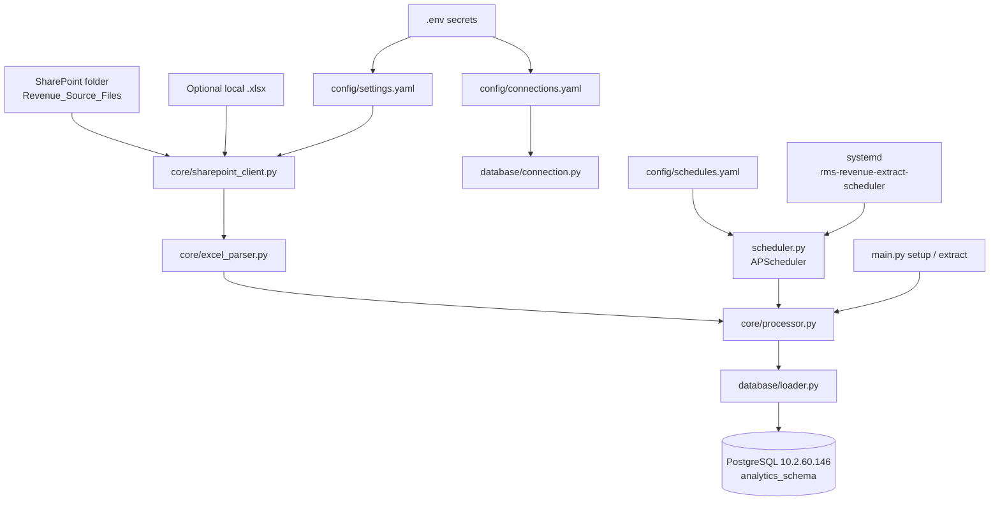
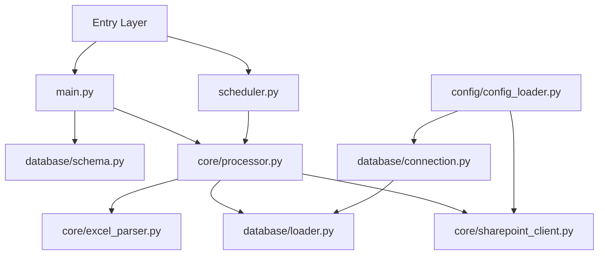

<!-- Synced from rms-revenue-extract/docs/documentation.md. Edit there, then re-run scripts/sync-docs.sh -->

# RMS Revenue Extract Documentation

## 1. Project Overview

### Executive Summary

**rms-revenue-extract** is the revenue dashboard ingestion service for the Automated Risk Management System (ARMS) modernization program for **Sri Lanka Customs**.

The service downloads the shared Excel workbook **Revenue Dashboard.xlsx** from a password-protected SharePoint folder (`Revenue_Source_Files`), parses four operational sheets, and loads the results into the RMDB data warehouse under **`analytics_schema`**. Each successful run **truncates and fully repopulates** the target tables so dashboard consumers always see the current workbook snapshot.

The service works alongside **rmdb-analytics**, **rmdb-etl**, **rms-ratings**, and other RMDB Python services. Production deployment follows the same pattern: host **`10.2.60.146`** (`rmd-app-prod`, application services and PostgreSQL), systemd-managed scheduler, and secrets in `/opt/rms-revenue-extract/.env`.

### Problem Statement

Revenue performance data for customs dashboards is maintained in a shared Excel workbook on SharePoint. Analysts and BI tools need that data in PostgreSQL (`analytics_schema`) on a predictable schedule, without manual copy-paste or ad hoc scripts.

Without an automated extract:

- Dashboard tables drift from the authoritative Excel source.
- Multiple manual reload steps increase operational risk and delay.
- Holiday calendars, daily collection figures, and annual actual/estimated revenue grids are not available reliably to SQL-based reporting.

`rms-revenue-extract` closes this gap by automating download, parse, and warehouse load in one transactional refresh per run.

### Core Objectives

- Download **Revenue Dashboard.xlsx** from SharePoint using the institutional guest sharing link and password.
- Parse **Holidays**, **Daily Revenue**, **Estimated Revenue**, and **Actual Revenue** sheets into normalized row sets.
- Truncate and reload four `analytics_schema` tables on each run (full refresh, not incremental merge).
- Run on a fixed intraday schedule aligned to business update times (09:00, 10:00, 11:00, 12:00, 17:00 Asia/Colombo).
- Support manual CLI runs for setup, smoke tests, and recovery.
- Allow local workbook override for development when the warehouse or SharePoint is unreachable from a workstation.

## 2. Technical Architecture

### System Diagram



### Technology Stack

- **Language**: Python 3.10+
- **Database**: PostgreSQL RMDB warehouse (`10.2.60.146`, database `rmdb`, schema `analytics_schema`)
- **Database driver**: `psycopg2-binary`
- **Excel parsing**: `pandas`, `openpyxl`
- **SharePoint access**: `requests`, `beautifulsoup4` (guest password form + REST `$value` download)
- **Scheduler**: APScheduler with cron from `config/schedules.yaml`
- **Configuration**: YAML in `config/` plus `.env` for secrets
- **Deployment**: systemd unit `rms-revenue-extract-scheduler` on `10.2.60.146`
- **Repository**: https://github.com/uvindu-perera/rms-revenue-extract (private)

### Data Flow (Single Extract Run)

1. Resolve workbook path: local file if `REVENUE_EXCEL_LOCAL_PATH` or `--local` is set; otherwise download from SharePoint.
2. Parse workbook into four in-memory datasets keyed by target table name.
3. Open a database connection with `search_path=analytics_schema`.
4. In one transaction: `TRUNCATE` each target table in order, then bulk `INSERT` parsed rows.
5. Log row counts and elapsed time; exit (scheduler repeats on cron).

### Database Schema (Target Tables)

All tables live in **`analytics_schema`** on the RMDB warehouse. DDL is in `deployment/create_tables.sql` and is also appended to `rmdb-analytics/deployment/create_schema.sql` for full analytics environment installs.

#### `dat_holidays`

Public and bank holidays used to contextualize daily revenue collection.

| Column | Type | Source (Excel) |
|--------|------|----------------|
| `ref_date` | `date` | Holidays → Date |
| `day` | `varchar(50)` | Holidays → Day |
| `holiday_name` | `varchar(200)` | Holidays → Holiday Name |
| `holiday_type` | `varchar(50)` | Holidays → Holiday Type |

Rows without a date or holiday name are skipped.

#### `dat_daily_revenue`

Daily revenue collection grid (calendar scaffold from 2020 through future dates in the workbook).

| Column | Type | Source (Excel) |
|--------|------|----------------|
| `ref_date` | `date` | Daily Revenue → Date |
| `cash_reverse` | `numeric` | Daily Revenue → Cash reveres *(workbook spelling)* |
| `vat_refund` | `numeric` | Vat Refund |
| `boc_7041607` | `numeric` | BOC 7041607 |
| `boc_7041608` | `numeric` | BOC 7041608 |
| `dst_2026450` | `numeric` | DST 2026450 |
| `pb_9026645` | `numeric` | PB 9026645 |
| `pb_59025247` | `numeric` | PB 59025247 |
| `dst_30110432` | `numeric` | DST 30110432 |
| `total_rev` | `numeric` | Total |

All rows with a valid date are loaded (including dates with null revenue columns). Cumulative target columns in Excel are not loaded.

#### `dat_estimated_revenue`

Annual estimated revenue by revenue code (values in workbook units per sheet instructions — LKR thousands for recent years).

| Column | Type | Notes |
|--------|------|--------|
| `ref_year` | `int4` | Year |
| `rev_code` | `varchar(20)` | Revenue Code |
| `rev_description` | `varchar(50)` | Description |
| `january` … `december` | `int4` | Monthly columns |
| `total` | `int8` | Total |

Rows require both `Year` and `Revenue Code`.

#### `dat_actual_revenue`

Annual actual revenue by revenue code (exact LKR figures per workbook instructions).

| Column | Type | Notes |
|--------|------|--------|
| `ref_year` | `int4` | Year |
| `rev_code` | `varchar(50)` | Revenue Code |
| `rev_description` | `varchar(50)` | Description |
| `january` … `december` | `int8` | Monthly columns |
| `total` | `int8` | Total |

Rows require both `Year` and `Revenue Code`.

#### Sheet not loaded

**Revenue Codes** is a lookup sheet for Excel formulas only; it is not persisted to the warehouse.

## 3. Installation & Configuration

### Prerequisites

#### System requirements

- Ubuntu Linux (production: `10.2.60.146` / `rmd-app-prod`)
- Python 3.10+ with `venv`
- Outbound HTTPS to `cslw-my.sharepoint.com` (SharePoint download)
- TCP connectivity from app server to PostgreSQL **`10.2.60.146:5432`**
- Git + GitHub CLI (`gh`) optional but recommended for HTTPS auth on the server

#### Python dependencies

```bash
python3 -m venv venv
source venv/bin/activate
pip install -r requirements.txt
```

Key packages: `psycopg2-binary`, `pandas`, `openpyxl`, `requests`, `beautifulsoup4`, `PyYAML`, `APScheduler`.

#### Network note (developers)

Workstations on the public internet typically **cannot** reach `10.2.60.146`. Run `setup` and `extract` on the production app server (or VPN). SharePoint download can be tested locally; warehouse load cannot.

### Environment Setup

#### 1) Clone and place the project

Production path (recommended):

```bash
sudo mkdir -p /opt/rms-revenue-extract
sudo chown rmd:rmd /opt/rms-revenue-extract
cd /opt/rms-revenue-extract
git clone https://github.com/uvindu-perera/rms-revenue-extract.git .
```

Use **`git clone` as user `rmd`**, not `sudo git clone`, so `gh auth login` credentials apply. If the directory must be created with sudo, `chown` it to the deploy user before cloning.

GitHub authentication on the server:

```bash
gh auth login
# GitHub.com → HTTPS → Login with a web browser (paste device code if no GUI)
```

#### 2) Virtual environment

```bash
cd /opt/rms-revenue-extract
python3 -m venv venv
./venv/bin/pip install -r requirements.txt
```

#### 3) Secrets and environment file

```bash
cp .env.example .env
nano .env
```

Recommended production `.env`:

```bash
RMDB_HOST=10.2.60.146
RMDB_PORT=5432
RMDB_USER=rmdb
RMDB_PASSWORD=<warehouse-password>
RMDB_DATABASE=rmdb
SHAREPOINT_PASSWORD=<sharepoint-folder-password>
RMS_REVENUE_EXTRACT_TZ=Asia/Colombo
```

Optional overrides:

- `SHAREPOINT_FOLDER_SHARE_URL` — overrides URL in `config/settings.yaml`
- `REVENUE_EXCEL_LOCAL_PATH` — skip SharePoint and read a local file
- `RMS_REVENUE_EXTRACT_ENV_FILE` — alternate path to env file
- `RMS_REVENUE_EXTRACT_CONNECTIONS_FILE` — alternate connections YAML

#### `config/connections.yaml`

PostgreSQL connection to the warehouse. Password uses `${RMDB_PASSWORD}` substitution. Defaults apply when env vars are unset:

| Setting | Default |
|---------|---------|
| Host | `10.2.60.146` |
| Port | `5432` |
| User | `rmdb` |
| Database | `rmdb` |
| Schema | `analytics_schema` |

#### `config/settings.yaml`

| Key | Purpose |
|-----|---------|
| `sharepoint.folder_share_url` | Guest sharing link to `Revenue_Source_Files` folder |
| `sharepoint.password` | `${SHAREPOINT_PASSWORD}` from `.env` |
| `sharepoint.workbook_filename` | `Revenue Dashboard.xlsx` |
| `excel.local_path` | Optional `${REVENUE_EXCEL_LOCAL_PATH}` |

#### `config/schedules.yaml`

| Job | Cron (Asia/Colombo) | Description |
|-----|---------------------|-------------|
| `revenue_extract_0900` | `0 9 * * *` | Morning refresh |
| `revenue_extract_1000` | `0 10 * * *` | Mid-morning refresh |
| `revenue_extract_1100` | `0 11 * * *` | Late morning refresh |
| `revenue_extract_1200` | `0 12 * * *` | Midday refresh |
| `revenue_extract_1700` | `0 17 * * *` | End-of-business refresh |

Timezone is controlled by `RMS_REVENUE_EXTRACT_TZ` (default `Asia/Colombo`).

### Deployment Guide (Production)

Target topology:

| Role | Host |
|------|------|
| Application, scheduler, PostgreSQL | `10.2.60.146` (`rmd-app-prod`) |

#### 1) Deploy application directory

```bash
# As deploy user (e.g. rmd), not root
cd /opt
# mkdir + chown if needed, then clone into /opt/rms-revenue-extract
```

#### 2) Initialize warehouse tables (once)

```bash
cd /opt/rms-revenue-extract
source venv/bin/activate
python main.py setup
```

Alternative:

```bash
PGPASSWORD=$RMDB_PASSWORD psql -h 10.2.60.146 -U rmdb -d rmdb \
  -f deployment/create_tables.sql
```

Verify:

```bash
psql -h 10.2.60.146 -U rmdb -d rmdb -c \
  "\dt analytics_schema.dat_*"
```

#### 3) Smoke test extract

```bash
python main.py extract
```

Expected stdout includes row counts for all four tables and `duration_ms`.

#### 4) Install systemd scheduler

```bash
chmod +x deployment/install_service.sh
./deployment/install_service.sh
```

The install script creates `/opt/rms-revenue-extract/venv` if missing, installs requirements, and registers `rms-revenue-extract-scheduler.service` with `EnvironmentFile=/opt/rms-revenue-extract/.env`.

#### 5) Validate service

```bash
sudo systemctl status rms-revenue-extract-scheduler
sudo journalctl -u rms-revenue-extract-scheduler -f
```

Confirm next cron fires at the configured Asia/Colombo times.

#### 6) Day-2 operations

- **Deploy code updates**: `git pull` in `/opt/rms-revenue-extract`, restart scheduler if needed:
  - `sudo systemctl restart rms-revenue-extract-scheduler`
- **Rotate SharePoint password**: update `.env` and restart service.
- **Manual recovery run**: `python main.py extract` from project root with venv active.
- **Re-run DDL only**: `python main.py setup` (idempotent `CREATE TABLE IF NOT EXISTS`).

## 4. Functional Modules

### Logical Component Map



Module responsibilities:

| Module | Responsibility |
|--------|----------------|
| `main.py` | CLI: `setup`, `extract`, optional `--local` workbook |
| `scheduler.py` | Long-running APScheduler; one job closure per cron entry |
| `core/sharepoint_client.py` | Guest password auth; list folder; download xlsx via REST `$value` |
| `core/excel_parser.py` | Sheet → row dicts; type coercion (dates, numeric, integers) |
| `core/processor.py` | Orchestrates download/parse/load |
| `database/connection.py` | Threaded connection pool; `search_path=analytics_schema` |
| `database/loader.py` | Truncate + bulk insert in single transaction |
| `database/schema.py` | Executes `deployment/create_tables.sql` for `setup` |
| `config/config_loader.py` | YAML load, `.env` load, `${VAR}` substitution |

### SharePoint Download

The service uses the institutional **guest access** flow:

1. `GET` `guestaccess.aspx?share=<token>` and parse the ASP.NET form.
2. `POST` folder password (`txtPassword`).
3. `GET` folder listing API to confirm session.
4. `GET` file `$value` endpoint for `Revenue Dashboard.xlsx`.

This mirrors browser access to the password-protected sharing link. No Microsoft Graph app registration is required.

### Extract Command

```bash
python main.py extract
python main.py extract --local "/path/to/Revenue Dashboard.xlsx"
```

Per run:

1. Truncate `dat_holidays`, `dat_daily_revenue`, `dat_estimated_revenue`, `dat_actual_revenue`.
2. Insert all parsed rows.
3. Commit or rollback as a unit.

There is **no incremental watermark**; the workbook is the single source of truth each time.

### Setup Command

```bash
python main.py setup
```

Runs `deployment/create_tables.sql` against the configured warehouse. Safe to re-run (`IF NOT EXISTS`).

## 5. Security & Data Handling

- **Secrets**: `RMDB_PASSWORD` and `SHAREPOINT_PASSWORD` must live only in `.env` on the server (never committed). `.env` is listed in `.gitignore`.
- **SharePoint**: Folder link password is required for every download; stored as environment variable.
- **Database**: Use a dedicated `rmdb` (or institutional) DB user with write access limited to `analytics_schema` where policy allows.
- **Git**: Repository is **private** under `uvindu-perera`. Clone with HTTPS + `gh auth login` or PAT; avoid `sudo git clone` so credentials are not requested as root.
- **Transport**: SharePoint and PostgreSQL connections should remain on institutional networks; warehouse is not exposed to the public internet.

Optional hardening:

- Restrict `.env` file permissions: `chmod 600 .env`
- Use read-only SharePoint credentials rotation policy
- Add row-count alerts if extract returns zero rows unexpectedly

## 6. Maintenance & Troubleshooting

### Routine Maintenance

Daily checks:

- `sudo systemctl status rms-revenue-extract-scheduler`
- `sudo journalctl -u rms-revenue-extract-scheduler -n 100 --no-pager`
- Confirm scheduled runs completed without traceback after 09:00 / 17:00

Weekly checks:

- Spot-check row counts in warehouse vs prior week (holiday count, daily row count stable unless workbook structure changes)
- Confirm SharePoint password still valid (failed auth shows in logs)

After workbook structure changes:

- Run manual `python main.py extract` and verify logs
- If new columns are required, update `core/excel_parser.py`, DDL, and `database/loader.py`

### Common Errors

| Symptom | Likely cause | Fix |
|---------|----------------|-----|
| `connection to server at 10.2.60.146 ... timeout` | Running from PC or wrong network | Run on `10.2.60.146`; test `psql -h 10.2.60.146` from app server |
| `SHAREPOINT_PASSWORD is not configured` | Missing or empty `.env` | Set `SHAREPOINT_PASSWORD` in `/opt/rms-revenue-extract/.env`; restart systemd |
| SharePoint auth OK, DB fails | Wrong `RMDB_PASSWORD` or DB down | Verify credentials; check warehouse service |
| `Permission denied` cloning to `/opt` | `/opt` owned by root | `sudo chown rmd:rmd /opt/rms-revenue-extract` then clone as `rmd` |
| `Username for https://github.com` during `sudo git clone` | Root has no `gh` credentials | Clone without sudo as deploy user |
| `Repository not found` (GitHub) | Repo not created or wrong account | Create private repo; use `uvindu-perera` login |
| Parse row counts dropped sharply | Workbook sheet renamed or restructured | Align sheet names in `excel_parser.py` |
| `does not look like an Excel file` | SharePoint returned HTML error page | Re-check password and sharing link |

### Logging

- CLI and scheduler log to **stdout** (INFO level).
- systemd captures output:

```bash
sudo journalctl -u rms-revenue-extract-scheduler -f
```

Typical success lines:

- `SharePoint guest session authenticated`
- `Downloaded Revenue Dashboard.xlsx (... bytes)`
- `Parsed workbook: holidays=... daily=... estimated=... actual=...`
- `Loaded dat_*: N rows`
- `Revenue extract completed: {...}`

### Updating Behavior

| Change | Where to edit |
|--------|----------------|
| Cron times | `config/schedules.yaml` → restart scheduler |
| Timezone | `RMS_REVENUE_EXTRACT_TZ` in `.env` → restart scheduler |
| SharePoint URL | `config/settings.yaml` or `SHAREPOINT_FOLDER_SHARE_URL` |
| Column mapping | `core/excel_parser.py`, `database/loader.py`, DDL |
| New table | `deployment/create_tables.sql`, loader, parser, processor |

## 7. CLI Quick Reference

```bash
python main.py setup              # Create analytics_schema tables on warehouse
python main.py extract            # SharePoint download + full reload
python main.py extract --local /path/to/Revenue\ Dashboard.xlsx
python scheduler.py               # Start APScheduler (production: use systemd)
```

## 8. File Structure

```text
rms-revenue-extract/
├── config/
│   ├── connections.yaml      # Warehouse connection
│   ├── settings.yaml         # SharePoint + optional local path
│   └── schedules.yaml        # Cron definitions
├── core/
│   ├── excel_parser.py
│   ├── processor.py
│   └── sharepoint_client.py
├── database/
│   ├── connection.py
│   ├── loader.py
│   └── schema.py
├── deployment/
│   ├── create_tables.sql
│   ├── DEPLOYMENT.md         # Short deploy checklist
│   ├── install_service.sh
│   └── rms-revenue-extract-scheduler.service
├── main.py
├── scheduler.py
├── requirements.txt
├── .env.example
├── README.md
└── documentation.md          # This document
```

## 9. Related Documentation

- Short deploy checklist: `deployment/DEPLOYMENT.md`
- Analytics schema (includes revenue tables): `rmdb-analytics/deployment/create_schema.sql`
- Sibling services: `rms-ratings/documentation.md`, `rms-individuals/documentation.md`, `rmdb-analytics/documentation.md`

## Attribution

*Administrative context — separate from the operational sections above.*

> **Developer** — **Uvindu Perera**, Superintendent of Customs, **Risk Management Directorate**.
>
> **Modernization context** — **rms-revenue-extract** is part of the program to retire legacy **ARMS** components in favor of **service-oriented Python** applications. This service loads the institutional Revenue Dashboard workbook into **`analytics_schema`** on RMDB PostgreSQL for dashboard and reporting consumers, with scheduled and on-demand runs on institutional production hosts (for example **`10.2.60.146`**, under **systemd** as **`rms-revenue-extract-scheduler`**), replacing legacy batch logic and aligning revenue reporting with modern, maintainable tooling.
