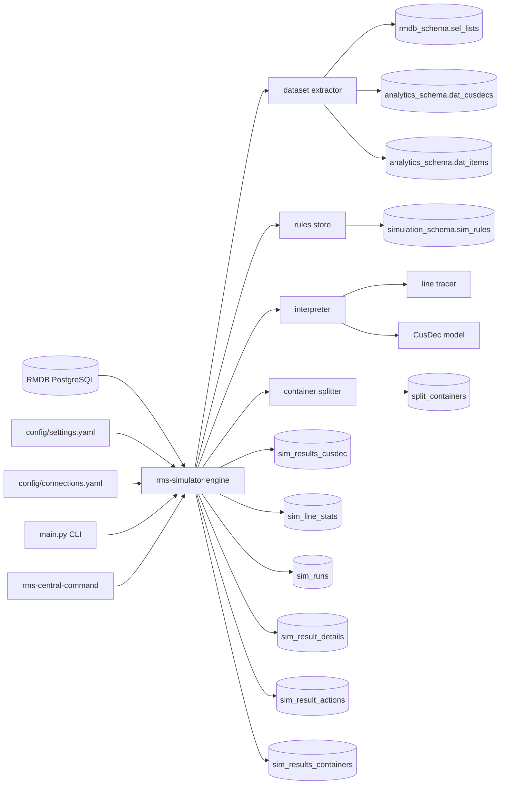

<!-- Synced from rms-simulator/docs/documentation.md. Edit there, then re-run scripts/sync-docs.sh -->

# RMS Simulator Documentation

## 1. Project Overview

### Executive Summary

**rms-simulator** is a Python-based selectivity rule simulation engine that applies ASYCUDA World pseudocode rules to the Risk Management Data Warehouse (RMDB) dataset. It replaces the legacy Java **RMS_Simulator** application with a modern, maintainable service that allows the Risk Management Division (RMD) to simulate the effect of selectivity criteria changes before deploying them to production.

The simulator loads customs declarations from `analytics_schema`, applies versioned pseudocode rules using a proper lexer/parser/AST interpreter, and writes detailed outcomes including per-declaration channel assignments, container destinations, assignment audit trails, section actions, and per-line execution statistics. All results are persisted to `simulation_schema` on the same PostgreSQL instance, enabling dashboard-driven analysis via **rms-central-command**.

### Problem Statement

Before a dedicated simulation service, testing selectivity rule changes required ad hoc approaches that introduced friction:

- **Legacy stack**: the prior Java simulator is harder to extend, debug, and align with the modern Python-based RMDB ecosystem.
- **Disconnected workflows**: rule editing, simulation execution, and result analysis lived in separate tools, making iterative testing slow.
- **Limited observability**: understanding which rule lines fired, how often, and with what outcomes required manual log parsing rather than structured heat maps.
- **Static rule management**: rules lived in filesystem-based `.txt` files with no versioning, making it difficult to track changes or roll back problematic modifications.
- **No dashboard integration**: simulation runs were command-line only, with no way for non-technical users to trigger runs or compare results.

These gaps reduce confidence in rule changes, slow the approval process for new selectivity criteria, and increase the risk of deploying rules that produce unintended channel assignments or container splits.

### Core Objectives

**rms-simulator** is built to achieve the following objectives:

- **Preserve legacy semantics**: execute the same ASYCUDA World pseudocode language as the Java simulator, with identical operator precedence, function behavior, and variable scoping so that simulation results match production expectations.
- **Enable dashboard-driven workflows**: integrate with **rms-central-command** so users can edit rules, trigger simulations, view heat maps, and compare runs without command-line access.
- **Provide structured observability**: record per-line execution statistics (executions, true/false evaluations, assignments) and per-variable assignment audits so rule authors can understand exactly how their logic behaves.
- **Support versioned rule management**: store rules in `simulation_schema.sim_rules` with version tracking, activation flags, and audit metadata so changes are traceable and reversible.
- **Maintain production fidelity**: refresh known-trader sets (importers, declarants, one-time consignees) as-of each declaration's registration date, mirroring the nightly production jobs that maintain these lists.
- **Enable controlled experimentation**: support dry-run mode, rule subsets, date-range filtering, and office-code filtering so users can test changes on representative data before full deployment.

## 2. Technical Architecture

**rms-simulator** follows a pipeline architecture: load selectivity lists and rules → extract CusDec dataset ordered by registration date → refresh known traders as each date is reached → interpret rules per declaration item → compute container splits → write structured results. Progress is reported through callbacks so the CLI and dashboard can track execution.

### System Diagram



### Technology Stack

**Language and runtime**

- Python 3.10+
- Virtual environment (`venv`)

**Core application components**

| File | Role |
| ---- | ---- |
| `main.py` | CLI entry point for setup, simulation, rule validation, legacy import, and listing commands |
| `core/simulator.py` | Orchestration layer (the legacy `conductor`): loads lists, loads rules, extracts dataset, applies rules, writes results with progress reporting |
| `core/dataset.py` | CusDec item extraction from `analytics_schema`, selectivity list loading from `rmdb_schema`, known-trader set computation |
| `core/rules_store.py` | DB-backed rule management: load active rules, upsert new versions, list/set-active operations |
| `core/parser.py` | Lexer + recursive-descent parser for ASYCUDA World pseudocode (line-oriented statements, arithmetic, comparisons, built-in functions) |
| `core/interpreter.py` | AST interpreter with per-line tracing: executes parsed rules against CusDec items, records heat-map statistics |
| `core/cusdec.py` | CusDec domain model: header fields, per-item lists, scratch registers, outcome state (channel/yard/flags), assignment audit, section actions |
| `core/functions.py` | Built-in pseudocode functions (`SubStrFnd`, `InList*`, `newImporter`, `newDeclarant`, `AddSectionColor`, `AssignSectionExaminer`) and selectivity lists |
| `core/split.py` | Container destination split logic: maps CusDec outcomes to per-container groups (examined/scanned/exempted) with RCT/GRAYLINE/release bucket algorithms and CONT_CONTROL overlays |
| `core/results.py` | Writes simulation outputs to `simulation_schema`: run record, per-CusDec results, per-container destinations, audit details, section actions, line stats |
| `core/ast_nodes.py` | AST node definitions (`Assign`, `If`, `BinOp`, `BoolOp`, `Compare`, `FuncCall`, `Literal`, `Var`, `ParsedRule`) |
| `database/schema.py` | Idempotent table creation for `simulation_schema` (executes `deployment/create_tables.sql`) |
| `database/connection.py` | PostgreSQL thread-safe connection pool with context-manager cursor support |
| `config/config_loader.py` | YAML and environment variable configuration loading with `${ENV_VAR}` substitution |

**Databases**

- **Source (read)**: PostgreSQL `analytics_schema` (`dat_cusdecs`, `dat_items`) and `rmdb_schema` (`sel_lists`, `sel_lists_cmp`, `sel_lists_dec`, `sel_lists_cty`, `sel_lists_tar`) on RMDB
- **Target (write)**: PostgreSQL `simulation_schema` (`sim_runs`, `sim_results_cusdec`, `sim_results_containers`, `sim_result_details`, `sim_result_actions`, `sim_line_stats`, `sim_rules`)

**Orchestration and operations**

- CLI-driven execution (no scheduler; simulations are triggered manually or via **rms-central-command** dashboard)
- Ubuntu CLI operations on deployment hosts

**Configuration and secrets**

- YAML in `config/` (`settings.yaml`, `connections.yaml`)
- Secrets and host-specific values via `.env` with variable substitution (committed template: `.env.example`)
- Configurable override paths via environment: `RMS_SIMULATOR_ENV_FILE`

### Database Schema (Application Tables)

All simulation tables live in `simulation_schema` on the RMDB PostgreSQL instance.

#### `sim_rules`

Versioned selectivity rule store.

| Column       | Description                                                                 |
| ------------ | --------------------------------------------------------------------------- |
| `rule_id`    | Surrogate primary key (serial)                                              |
| `rule_key`   | Stable business key (e.g., legacy rule filename or ID)                      |
| `name`       | Human-readable rule name                                                    |
| `office_code`| Customs office this rule applies to, or `'All'`                             |
| `pseudocode` | Full rule text in ASYCUDA World pseudocode                                  |
| `start_line` | Line number at which audit recording begins (legacy semantics)              |
| `active`     | Whether this rule is included in simulations (default `TRUE`)               |
| `version`    | Version number (incremented on each upsert)                                 |
| `notes`      | Free-text notes or change description                                       |
| `updated_at` | Timestamp of last modification                                              |
| `updated_by` | User or process that made the change                                        |

**Purpose**

- Replaces filesystem-based `.txt` rule files with DB-backed versioning
- Enables dashboard-driven rule editing via **rms-central-command**
- Unique constraint on `(rule_key, version)` ensures version history is preserved
- `DISTINCT ON (rule_key) ORDER BY version DESC` always returns the latest version

#### `sim_runs`

Simulation run metadata and progress tracking.

| Column            | Description                                                        |
| ----------------- | ------------------------------------------------------------------ |
| `run_id`          | Surrogate primary key (serial)                                     |
| `name`            | Simulation name (legacy `simulation_id`)                           |
| `status`          | `running` / `success` / `failed`                                   |
| `from_date`       | Start of registration-date range (inclusive)                       |
| `to_date`         | End of registration-date range (exclusive)                         |
| `office_code`     | Customs office simulated (default `CBHQ1`)                         |
| `rule_keys`       | Comma-separated subset of rules, or `''` for all active            |
| `cusdec_count`    | Number of declarations processed                                   |
| `error_message`   | Error detail when status is `failed`                               |
| `progress_stage`  | Current stage (`lists`, `rules`, `dataset`, `simulate`, `write`, `done`) |
| `progress_done`   | Items processed in current stage                                   |
| `progress_total`  | Total items in current stage                                       |
| `started_at`      | Timestamp when run began                                           |
| `finished_at`     | Timestamp when run completed or failed                             |

**Purpose**

- Tracks simulation execution history for audit and comparison
- Progress fields enable dashboard real-time updates during long runs
- The `sim_runs` row is created before expensive data loads so the dashboard shows the run immediately

#### `sim_results_cusdec`

Per-declaration simulation outcomes.

| Column               | Description                                                         |
| -------------------- | ------------------------------------------------------------------- |
| `record_id`          | Surrogate primary key (bigserial)                                   |
| `run_id`             | Foreign key to `sim_runs` (CASCADE delete)                          |
| `reg_no`             | Declaration registration number                                     |
| `reg_year`           | Registration year                                                   |
| `ser`                | Registration series                                                 |
| `office_code`        | Customs office                                                      |
| `container_count`    | Number of containers (`CAPRef`)                                     |
| `channel`            | Assigned channel: `Green` / `Blue` / `Yellow` / `Red` / `No Channel`|
| `is_split`           | Whether containers were split across destinations                   |
| `valuation`          | Whether `VALUATION` section fired                                   |
| `acknowledge`        | Whether `ACKNOWLEDGE` section fired                                 |
| `scan`               | Whether `SCAN` section fired                                        |
| `logic_issue`        | Rule-logic conflict (e.g., `SCAN` + `EXM_EXEMPTED` fired together)  |
| `cusdec_instance_id` | `dat_cusdecs.instanceid` for production verification                |

**Purpose**

- One row per declaration with high-level outcome flags
- Enables dashboard drill-down to compare simulation vs. production channel assignments

#### `sim_results_containers`

Per-container destination assignments.

| Column        | Description                                                         |
| ------------- | ------------------------------------------------------------------- |
| `record_id`   | Foreign key to `sim_results_cusdec` (CASCADE delete)                |
| `container_id`| 1-based container number within the declaration                     |
| `destination` | Physical destination: `RCT`, `GRAYLINE1`, `GRAYLINE2`, `OGAOUTPANEL`, `OUTPANEL`, `W/H RELEASE`, `RELEASE`, `EXEMPTED`, `Other`, `LCL` |
| `scan`        | Whether this container was scanned                                  |

**Purpose**

- Captures the container split logic: how many containers went to each yard, how many were scanned
- Destinations sum to `container_count` by construction
- `scan` is orthogonal to destination: `RELEASE`/`W/H RELEASE` intrinsically imply `scan=true` from the bucket algorithm; the CusDec-level `SCAN` section is OR'd onto every container as a final pass

#### `sim_result_details`

Per-variable assignment audit trail (legacy `result_details`).

| Column         | Description                                                         |
| -------------- | ------------------------------------------------------------------- |
| `detail_id`    | Surrogate primary key (bigserial)                                   |
| `record_id`    | Foreign key to `sim_results_cusdec` (CASCADE delete)                |
| `line_no`      | Pseudocode line number where assignment occurred                    |
| `variable_name`| Variable assigned (e.g., `Num01`, `Action`, `RedLane`)              |
| `value`        | Value assigned                                                      |
| `rule_key`     | Rule that made the assignment (format: `"<rule_key> - <simulation name>"`) |
| `item_no`      | 1-based item number within the declaration                          |

**Purpose**

- Enables rule authors to trace exactly which variables were set, when, and to what values
- Auditing begins at the rule's `start_line` (audit threshold) as in the legacy Java engine
- Critical for debugging unexpected channel assignments or container splits

#### `sim_result_actions`

Section color and examiner assignment actions (legacy `result_actions`).

| Column    | Description                                                         |
| --------- | ------------------------------------------------------------------- |
| `action_id`| Surrogate primary key (bigserial)                                  |
| `record_id`| Foreign key to `sim_results_cusdec` (CASCADE delete)               |
| `action_1` | Color or examiner section (e.g., `Red`, `VALUATION`)               |
| `action_2` | Section/point or examiner post (e.g., `VALUATION_POINT1`, `DETAIL/RED_GL1`) |
| `rule_key` | Rule that triggered the action                                      |

**Purpose**

- Captures `AddSectionColor` and `AssignSectionExaminer` function calls
- Actions are ZXZ-encoded in the `Action` variable and decoded at write time
- Enables dashboard visualization of which sections/examiners were assigned to each declaration

#### `sim_line_stats`

Per-line execution statistics for heat maps.

| Column       | Description                                                         |
| ------------ | ------------------------------------------------------------------- |
| `run_id`     | Foreign key to `sim_runs` (CASCADE delete)                          |
| `rule_key`   | Rule identifier                                                     |
| `line_no`    | Pseudocode line number                                              |
| `executions` | Times the line ran with run_switch ON (CusDec-unique)               |
| `eval_true`  | `If`-lines that evaluated `True` (CusDec-unique)                    |
| `eval_false` | `If`-lines that evaluated `False` (CusDec-unique)                   |
| `assignments`| Assignment statements executed (CusDec-unique)                      |

**Purpose**

- Feeds the dashboard heat map: which lines fire most often, which branches are taken
- Counts are **CusDec-unique**: each line/event is credited at most once per declaration, even though rules still execute once per item
- `Else`/`Endif` marker lines are also counted when control passes them
- Primary key on `(run_id, rule_key, line_no)` ensures one row per line per run

## 3. Installation & Configuration

### Prerequisites

#### System requirements

- **Ubuntu Linux** server (CLI-based operations); production target host typically `10.2.60.146` or similar
- **Network connectivity** from that host to the **PostgreSQL** instance hosting RMDB (must expose `analytics_schema` and `rmdb_schema` for reads, and allow writes to `simulation_schema`)
- **Git** access to the **rms-simulator** repository
- **Python virtual environment** support (`python3-venv` package on Ubuntu)
- `psql` (PostgreSQL client) available on the host or from an operator workstation used to apply `deployment/create_tables.sql`

#### Upstream data dependency

- `analytics_schema` should already be populated and maintained (typically by **rmdb-etl** and **rmdb-analytics**). The simulator assumes `dat_cusdecs` and `dat_items` exist; it does not extract from external operational databases.
- `rmdb_schema.sel_lists*` tables must be populated (typically by **rmdb-etl** from ASYCUDA World).

#### Python version

- **Python 3.10+** recommended

Check:

```bash
python3 --version
```

#### Required libraries

Install from `requirements.txt` inside a virtual environment:

```bash
python3 -m venv venv
source venv/bin/activate
pip install -r requirements.txt
```

Dependencies:

- `psycopg2-binary` — PostgreSQL driver with connection pooling and batch operations
- `PyYAML` — configuration loading with environment variable substitution

#### Required environment variables

**Minimum (required):**

- `RMDB_PASSWORD` — password for the RMDB PostgreSQL user referenced in `config/connections.yaml` (default user name in repo config: `rmdb`)

**Optional:**

- `RMS_SIMULATOR_ENV_FILE` — custom path to `.env` file (default: `<project_root>/.env`)

#### Database configuration file

- `config/connections.yaml` — defines the `rmdb` connection (`host`, `port`, `user`, `password`, `database`). On production, `host` and `port` must point at the real RMDB instance. All values support `${ENV_VAR}` substitution via the config loader and `.env` file.

### Environment Setup

#### 1) Clone and enter the project directory

Example production layout (adjust paths and ownership to your standard):

```bash
sudo git clone <repository-url> /opt/rms-simulator
sudo chown -R <deploy-user>:<deploy-user> /opt/rms-simulator
cd /opt/rms-simulator
```

#### 2) Create the virtual environment and install dependencies

```bash
cd /opt/rms-simulator
python3 -m venv venv
source venv/bin/activate
pip install --upgrade pip
pip install -r requirements.txt
```

#### 3) Create and populate `.env`

```bash
cp .env.example .env
${EDITOR:-vi} .env
```

Set `RMDB_PASSWORD`. This is the only required environment variable. The config loader reads `.env` from the project root (or the path in `RMS_SIMULATOR_ENV_FILE`), loading only keys that are not already set in the current environment.

#### 4) Align `config/connections.yaml` with production

```yaml
connections:
  rmdb:
    type: postgresql
    params:
      host: ${RMDB_HOST}
      port: ${RMDB_PORT}
      user: ${RMDB_USER}
      password: ${RMDB_PASSWORD}
      database: ${RMDB_DATABASE}
      schema: simulation_schema
```

Edit host, port, user, and database values in `.env` as needed. All values in `connections.yaml` support `${ENV_VAR}` placeholders, with fallback defaults defined in `config/config_loader.py`.

#### 5) Create target schema and tables (one-time or after DDL changes)

Two equivalent approaches:

```bash
# Option A: psql (from any host that can reach Postgres)
psql -h <rmdb-host> -p <port> -U rmdb -d rmdb -f deployment/create_tables.sql
```

```bash
# Option B: Python CLI (from the project directory)
python main.py setup
```

Both are idempotent (`IF NOT EXISTS` where applicable).

#### 6) Optional: load variables into the current shell (manual CLI testing)

```bash
cd /opt/rms-simulator
set -a && source .env && set +a
source venv/bin/activate
python main.py list-rules
python main.py simulate --from-date 2025-01-01 --to-date 2025-01-15 --name "Test run" --dry-run
```

### Deployment Guide (Production)

**rms-simulator** is not a long-running service; it is triggered manually or via **rms-central-command** dashboard. There is no systemd unit. Instead, the application is invoked as a CLI command or subcommand.

#### Integration with rms-central-command

The simulator is registered in **rms-central-command** `config/services.yaml` as a `subcommand` service. The dashboard provides:

- Rule editor with syntax validation
- Ad-hoc simulation triggers with date-range and rule-subset selection
- Run summaries with drill-down to per-declaration outcomes
- Side-by-side run comparison
- Per-line rule heat map

When a user triggers a simulation from the dashboard, **rms-central-command** invokes:

```bash
python main.py simulate --from-date <start> --to-date <end> --name "<name>" \
    [--office <code>] [--rules <keys>] --run-id <id>
```

The `--run-id` flag tells the simulator to use an existing `sim_runs` row (created by the dashboard) rather than creating a new one. This allows the dashboard to show the run before it begins.

#### Ongoing operations

- **Deploy config changes**: edit YAML under `config/`, then re-run simulations as needed. No restart required.
- **Apply DDL changes**: if `deployment/create_tables.sql` changes (new tables or columns), re-run `python main.py setup` (idempotent). Existing migration scripts in `deployment/` (such as `sim_results_split_containers.sql`, `sim_results_add_instance_id.sql`, `sim_runs_add_progress.sql`) document historical schema changes.
- **Import legacy rules**: use `python main.py import-legacy-rules --rules-dir <path> [--sel-rules-csv <file>]` to migrate `.txt` rule files from the legacy Java simulator into `sim_rules`.

## 4. Functional Modules

This project is a **CLI-driven simulation tool**, not an HTTP REST service or long-running daemon. The "API" is the **command-line interface** and the **rms-central-command** dashboard integration described below.

### Logical Component Map

| Component              | Role                                                                 |
| ---------------------- | -------------------------------------------------------------------- |
| `main.py`              | CLI entry point: parses arguments, dispatches to command handlers    |
| `core/simulator.py`    | Orchestration: loads lists → loads rules → extracts dataset → applies rules → writes results |
| `core/dataset.py`      | CusDec extraction from `analytics_schema`, selectivity list loading from `rmdb_schema` (bulk queries to avoid N+1), known-trader computation with date-based caching |
| `core/rules_store.py`  | DB-backed rule management: load latest active rules, upsert with auto-incrementing version, list all, toggle active |
| `core/parser.py`       | Lexer + recursive-descent parser for ASYCUDA World pseudocode with legacy surface-syntax tolerance |
| `core/interpreter.py`  | AST interpreter with per-line CusDec-unique tracing and step-cap safety |
| `core/cusdec.py`       | CusDec domain model: 30 scratch registers, header fields, per-item lists, outcome state with channel priority, audit trail, section action encoding |
| `core/functions.py`    | Built-in pseudocode functions with legacy-compatible semantics and selectivity list search |
| `core/split.py`        | Data-driven container destination split with bucket algorithms, RCT overlays, and SCAN short-circuit |
| `core/results.py`      | Batch writes simulation outputs to `simulation_schema` in a single transaction |
| `core/ast_nodes.py`    | AST node dataclass definitions (`Expr`, `Literal`, `Var`, `BinOp`, `BoolOp`, `Compare`, `FuncCall`, `Statement`, `Assign`, `If`, `ParsedRule`) |
| `database/schema.py`   | Reads and executes `deployment/create_tables.sql` for idempotent schema setup |
| `database/connection.py`| PostgreSQL thread-safe connection pool (`ThreadedConnectionPool`, min 1 / max 5) with context-manager cursor support, automatic commit/rollback |
| `config/config_loader.py`| Loads YAML config with `${ENV_VAR}` substitution, reads `.env` into `os.environ`, provides `get_database_config()` and `get_settings()` |

### CLI Commands

#### `setup`

Create `simulation_schema` and all `sim_*` tables (idempotent).

```bash
python main.py setup
```

**Purpose**

- One-time setup or after DDL changes
- Reads `deployment/create_tables.sql` and executes it via the database pool

#### `simulate`

Run a simulation over a registration-date range.

```bash
python main.py simulate --from-date 2025-01-01 --to-date 2025-01-15 --name "Test run" \
    [--office CBHQ1] [--rules KEY1,KEY2] [--run-id <id>] [--dry-run]
```

**Arguments**

| Argument | Required | Description |
| -------- | -------- | ----------- |
| `--from-date` | Yes | Start registration date (inclusive), format `YYYY-MM-DD` |
| `--to-date` | Yes | End registration date (exclusive, like the legacy app), format `YYYY-MM-DD` |
| `--name` | Yes | Simulation name (appears in `sim_runs.name`) |
| `--office` | No | Customs office (default: `settings.yaml` `default_office`, typically `CBHQ1`) |
| `--rules` | No | Comma-separated rule keys to restrict simulation (default: all active rules) |
| `--run-id` | No | Use an existing `sim_runs` row (dashboard-created) rather than creating a new one |
| `--dry-run` | No | Execute without writing results (useful for testing) |

**Behavior**

1. Creates a `sim_runs` row with status `running` (unless `--run-id` is provided)
2. Loads selectivity lists from `rmdb_schema.sel_lists*` using bulk queries
3. Loads active rules from `simulation_schema.sim_rules` (or the specified subset)
4. Extracts CusDec items from `analytics_schema.dat_cusdecs` JOIN `dat_items`, ordered by `ide_reg_dat`, filtered to non-cancelled declarations with release orders
5. For each declaration (processing one `ide_reg_dat` at a time):
   - Refreshes known-trader sets if the registration date has advanced (lookback window: `[reg_date - days, reg_date)`)
   - Applies each matching rule once per item (legacy scoping)
   - Records per-line execution statistics (CusDec-unique)
6. Computes container destinations using split logic (buckets, RCT variants, SCAN overlay)
7. Writes per-CusDec outcomes, per-container destinations, audit details, section actions, and line stats in a single database transaction
8. Updates `sim_runs` with status `success` or `failed`, `cusdec_count`, and `error_message`

**Progress reporting**

Progress is reported through a callback so the CLI (and the dashboard via stdout) can follow along:

```
[lists] 0/0
[rules] 0/0
[dataset] 0/1234
[simulate] 500/1234
[simulate] 1000/1234
[simulate] 1234/1234
[write] 1234/1234
[done] 1234/1234
```

The `sim_runs` progress fields (`progress_stage`, `progress_done`, `progress_total`) are also updated every time progress is reported.

#### `validate-rule`

Parse-check pseudocode (used by the dashboard editor).

```bash
python main.py validate-rule --file rule.txt
cat rule.txt | python main.py validate-rule
```

**Arguments**

| Argument | Required | Description |
| -------- | -------- | ----------- |
| `--file` | No | Rule text file (default: read stdin) |

**Behavior**

- Parses the pseudocode using the same lexer/parser as the simulator
- Reports `OK: <N> top-level statement(s), <M> line(s)` on success
- Reports `INVALID: <error>` on parse error and exits with code 1

**Purpose**

- Enables dashboard syntax validation before saving rules
- Catches malformed pseudocode early

#### `import-legacy-rules`

Import legacy `.txt` rule files into `sim_rules`.

```bash
python main.py import-legacy-rules --rules-dir /path/to/rule/files \
    [--sel-rules-csv /path/to/sel_rules.csv]
```

**Arguments**

| Argument | Required | Description |
| -------- | -------- | ----------- |
| `--rules-dir` | Yes | Directory containing legacy `.txt` rule files |
| `--sel-rules-csv` | No | CSV export of MySQL `simulation.sel_rules` table with columns `rule_id,office_code,file_location,start_line,active` |

**Behavior**

1. Iterates over `.txt` files in the directory (sorted alphabetically)
2. Uses the filename stem as the `rule_key`
3. If `--sel-rules-csv` is provided, looks up metadata (`office_code`, `start_line`, `active`) for each rule
4. Parses the pseudocode; skips files with parse errors (reports to stderr)
5. Upserts each rule into `sim_rules` with `updated_by="import-legacy-rules"` and auto-incrementing version
6. Reports summary: `<N> imported, <M> skipped`

**Purpose**

- One-time migration from the legacy Java simulator's filesystem-based rule storage
- Preserves rule metadata (office, start line, active flag) from the MySQL `sel_rules` table

#### `list-runs`

List recent simulation runs.

```bash
python main.py list-runs [--limit 20]
```

**Arguments**

| Argument | Required | Description |
| -------- | -------- | ----------- |
| `--limit` | No | Number of runs to display (default: 20) |

**Output**

```
   123  success   Test run                         CBHQ1   2025-01-01..2025-01-15  cusdecs=1234
   122  failed    Another run                      CBHQ1   2025-01-01..2025-01-10  cusdecs=0
```

#### `list-rules`

List rules in `sim_rules`.

```bash
python main.py list-rules
```

**Output**

```
rule_key_001                   v3    active    office=CBHQ1   start_line=1  rule_key_001
rule_key_002                   v1    inactive  office=All     start_line=1  rule_key_002
```

### Simulation Pipeline in Detail

The simulation pipeline in `core/simulator.py` follows these stages:

#### Stage 1: Lists

Loads all selectivity lists from `rmdb_schema` into an in-memory `SelLists` structure. Uses bulk queries — one query per member table — to avoid the N+1 problem that plagued previous versions. The lists are loaded once at the start of the run and reused for all declarations.

#### Stage 2: Rules

Loads the latest version of each active rule from `simulation_schema.sim_rules`. If `--rules` is specified, loads only those keys (even if they are inactive). Each rule is parsed into a `ParsedRule` AST via the lexer/parser.

Rules are filtered to match the simulation's office code: a rule applies if its `office_code` matches the CusDec's office code exactly, or if its `office_code` is `'All'`.

#### Stage 3: Dataset

Extracts CusDec items from `analytics_schema.dat_cusdecs` JOIN `analytics_schema.dat_items`, ordered by `ide_reg_dat`. Only non-cancelled declarations with release orders are included. The total CusDec count is queried first for progress reporting.

Rows are streamed and grouped by declaration key `(reg_year, office_code, ser, reg_no)` into `CusDec` model objects.

#### Stage 4: Known Trader Refresh

A `KnownTraders` cache class tracks known importers, known declarants, and the `AUTO_ONE_TIME_CON` consignee list. These are recomputed per registration date as the CusDec stream advances through dates:

- **Known importers/declarants**: TINs with at least one non-cancelled declaration in the half-open window `[reg_date - lookback_days, reg_date)`
- **AUTO_ONE_TIME_CON**: Consignees at office `CBHQ1` with 1-5 non-cancelled declarations before `reg_date` (cumulative count, no start-of-window bound — mirrors the production nightly job)

The `lookback_days` defaults to `settings.yaml` `new_trader_days` (180). The `newImporter(days)` and `newDeclarant(days)` functions can override the lookback per call; the cache stores results for each `(date, days)` key pair.

#### Stage 5: Rule Execution

Each rule is applied to each CusDec once per item (legacy scoping — scratch registers persist across items of the same declaration). The interpreter:

1. Skips rules whose `office_code` doesn't match the CusDec
2. Resets CusDec-unique deduplication tracking via `LineTracer.begin_cusdec()`
3. Iterates over each item, executing the rule's statement block
4. Tracks a step counter per `(CusDec, rule, item)`; if it exceeds `max_steps_per_item` (10000), raises `SimulationError`

The `LineTracer` records execution/true/false/assignment events with CusDec-unique deduplication so the heat map reflects *how many declarations* a line fired for, not *how many items*.

#### Stage 6: Container Split

After all rules execute, each CusDec's container destinations are computed by `core/split.py` (see Container Split Logic below).

#### Stage 7: Write Results

All results are persisted in a single database transaction:

- One `sim_results_cusdec` row per declaration (with `RETURNING record_id`)
- N `sim_results_containers` rows per declaration (one per container group expanded to individual container counts)
- M `sim_result_details` rows per declaration (audit entries above `start_line`)
- K `sim_result_actions` rows per declaration (section color/examiner events)
- L `sim_line_stats` rows (one per unique rule_key + line_no across the entire run)

All batch inserts use `psycopg2.extras.execute_batch` with `page_size=1000`.

### Pseudocode Language

The simulator executes ASYCUDA World selectivity pseudocode, a line-oriented language with the following constructs:

#### Statements

- **Assignment**: `Var := expr` or `Var IS expr`
- **Conditional**: `If <expr> Then` / `Else` / `Endif`

Nested `If`/`Else`/`Endif` blocks are supported. `Else` is optional. The parser validates proper nesting and raises `ParseError` for mismatched blocks.

#### Expressions

**Literals**

- Numbers: `123`, `45.67`
- Strings: `"text"` or bare words like `EXM_RCT`, `Found`, `Nope`
- Booleans: `True`, `False`
- Empty string: `""` (preserved via an internal sentinel during quote stripping)

**Variables**

*Scratch registers* (16 numeric + 16 string):
`Num01`..`Num16`, `Str01`..`Str16`

Scratch registers persist across items of the same declaration (legacy scoping). Numeric registers (`Num*`) are integers; string registers (`Str*`) hold arbitrary text.

*Header fields* (single value per declaration):
`Consignee`, `Declarant`, `TotalStat`, `ItmTotal`, `CAPRef`, `BolPlcLoad`, `TermsOfPay`, `CuoCod`, `TradingCty`, `CtyExp`, `CtyDestCod`, `CtyLstP`, `TotalTaxes`

*Per-item fields* (indexed by current item):
`ItmNber`, `Chapter`, `Heading`, `hs_code`, `CtyOrigCod`, `NatProc`, `GrossMass`

*Outcome variables* (special — setting these changes the CusDec state):
`RedLane`, `YellowLane`, `BlueLane`, `Action`

Setting `RedLane`/`YellowLane`/`BlueLane` changes the channel. Channel priority is: Green (lowest) < Blue < Yellow < Red (highest). The highest lane variable set wins.

Setting `Action` with a ZXZ-encoded value triggers section actions: `AddSectionColor(colour, section)` and `AssignSectionExaminer(section, post)`.

**Arithmetic**

- Operators: `+`, `-`, `*`, `/`, `Plus`, `Minus`, `Mul`, `Div`
- Integer-only arithmetic except `Div`/`/` which rounds to 2 decimal places (half-up, matching legacy `Math.round(x*100)/100`)
- Division by zero raises `SimulationError`
- Results are formatted as integers when whole, or compact decimals otherwise

**Comparisons**

- Equality: `=`, `<>` (string comparison)
- Ordering: `>`, `<`, `>=`, `<=`, `GE`, `GT`, `LT`, `LE` (numeric coercion — both operands must be parseable as integers)

**Booleans**

- Connectives: `and`, `or`
- If conditions must evaluate to exactly `"True"` or `"False"` string — any other value raises `SimulationError`

**Parentheses**

- `(expr)` — supports grouping with proper depth tracking

**Operator Precedence**

```
boolOp (and/or)  >  comparison  >  additive (+ - Plus Minus)  >  multiplicative (* / Mul Div)  >  primary
```

#### Built-in functions

| Function | Arguments | Returns | Description |
| -------- | --------- | ------- | ----------- |
| `SubStrFnd(str, sub, start, end, _)` | 5 | `"0"` on match, `"False"` otherwise | 1-based substring matching; 5th arg is a legacy placeholder |
| `InListCom(list_name)` | 1 | `"Found"` / `"Nope"` | Consignee membership. Special case: `"AUTO_ONE_TIME_CON"` is recomputed daily from the database rather than read from a static list |
| `InListDec(list_name)` | 1 | `"Found"` / `"Nope"` | Declarant membership (exact match) |
| `InListCty(list_name)` | 1 | `"Found"` / `"Nope"` | Country of origin membership (exact match) |
| `InListTar(list_name)` | 1 | `"Found"` / `"Nope"` | HS-code prefix membership (any list value that is a prefix of the item's HS code matches) |
| `ValStr(str)` | 1 | Integer as string | Parse string to integer; raises error on failure |
| `RoundSup(num)` | 1 | Integer as string | Ceiling function |
| `newImporter([days])` | 0-1 | `"Found"` / `"False"` | Returns `"Found"` if consignee is NOT in the known-trader set (i.e., is new); `"False"` if known. Optional `days` overrides lookback window |
| `newDeclarant([days])` | 0-1 | `"Found"` / `"False"` | Returns `"Found"` if declarant is NOT in the known-trader set; `"False"` if known. Optional `days` overrides lookback window |
| `AddSectionColor(color, section)` | 2 | ZXZ-encoded action value | Produces `"AddSectionColorZXZ<color>ZXZ<section>"`; sets the CusDec section variable for the section name |
| `AssignSectionExaminer(section, post)` | 2 | ZXZ-encoded action value | Produces `"AssignSectionExaminerZXZ<section>ZXZ<post>"`; sets the CusDec section variable for the section name. Post values may contain `/` (e.g., `DETAIL/RED_GL1`) |

#### Legacy surface-syntax tolerance

Matching the regex engine's behavior:

- Double quotes and semicolons are stripped before parsing. Empty-string literals (`""`) are preserved via an internal sentinel.
- The first line of a rule file is a header and is never executed.
- Operators may be glued to operands (`a+b`, `/1000`); word ops (`Plus`/`Minus`/`Mul`/`Div`) still need whitespace.
- Parentheses and commas glued to words (`InListCom(MYLIST)`) are split out during tokenization.
- Slashes between letters (`DETAIL/RED_GL1`) are preserved as part of the word token (not parsed as division).

### CusDec Domain Model

The `CusDec` class (`core/cusdec.py`) is the in-memory representation of a customs declaration. It holds:

**Header fields** — single values per declaration:
- `consignee` (CMP_CON_COD), `declarant` (DEC_COD), `office_code` (IDE_CUO_COD)
- `reg_no`, `reg_year`, `ser`, `reg_date` (IDE_REG_DAT)
- `cap_ref` (GEN_CAP — container count), `total_stat` (sum of item values)
- `terms_of_payment` (FIN_TOP_COD), `bol_plc_load` (TPT_LOP_COD)
- `trading_cty` (GEN_CTY_TRD), `cty_exp` (GEN_CTY_EPT_COD), `cty_dest_cod` (GEN_CTY_DES_COD), `cty_lst_p` (GEN_CTY_FLT)
- `total_taxes` (FIN_AMT_DTY)
- `instance_id` (dat_cusdecs.instanceid — for production verification)

**Per-item lists** — one entry per item:
- `itm_nber` (item numbers), `hs_code`, `chapter` (first 2 chars of HS code)
- `cty_orig_cod` (origin countries), `nat_proc` (national procedure codes)
- `gross_mass` (gross mass in kg)

**Scratch registers** — 30 variables:
- `Num01`..`Num16` (integers, initialized to 0)
- `Str01`..`Str16` (strings, initialized to `""`)

**Lane variables** — outcome state:
- `RedLane`, `YellowLane`, `BlueLane` — setting these changes `channel`
- Channel priority: Green < Blue < Yellow < Red (highest set lane wins)

**Outcome flags** — set by section action arguments:
- `yard` (RCT, GRAYLINE1, GRAYLINE2, LCL, OUTPANEL, OGAOUTPANEL, EXEMPTED)
- `valuation`, `acknowledge`, `scan`, `release`

**Audit trail** — list of `AuditEntry` records captured at or above the rule's `start_line`:
- `line_no`, `variable_name`, `value`, `rule_id`, `item_no`

**Section actions** — list of `ActionEvent` records from `Action` assignments:
- `kind` (AddSectionColor / AssignSectionExaminer), `arg1`, `arg2`, `rule_id`

### Container Split Logic

The container split logic in `core/split.py` computes per-container destinations using a data-driven bucket algorithm (configurable via `settings.yaml` `simulator.split`). Every container ends up in exactly one destination group.

#### Decision Order (ignoring SCAN)

1. **EXEMPTED** → all containers to `EXEMPTED` (whole declaration exempted)
2. **Acknowledge** → all containers to `RCT`
3. **Release flag** → apply release bucket: scanned containers go to `RELEASE` (with `scan=True`), any remainder to `EXEMPTED`
4. **OUTPANEL** → all containers to `OUTPANEL`
5. **OGAOUTPANEL** → all containers to `OGAOUTPANEL`
6. **RCT** → apply RCT bucket, or RCT variant overlay if conditions match:
   - **Variant 1 (CONT_CONTROL)**: Consignee in `CONT_CONTROL_CMP` AND single item AND HS code in `CONT_CONTROL_HS`. Bucket: N examined (RCT), balance to OGAOUTPANEL. Only applies to Yellow/Blue channels.
   - **Variant 2 (CONT_CONTROL1)**: Consignee in `CONT_CONTROL_CMP1` AND single item AND HS code in `CONT_CONTROL_HS1`. Bucket: N examined (RCT), M scan-released (W/H RELEASE with `scan=True`), balance to W/H RELEASE without scan. Only applies to Yellow/Blue channels.
   - **Default RCT bucket**: N examined (RCT), M scanned (RELEASE with `scan=True`), balance exempted
7. **GRAYLINE1/2** → apply GRAYLINE bucket: N examined (yard with same name), M scanned (RELEASE with `scan=True`), balance exempted
8. **LCL** → all containers to `LCL`
9. **Fallback** → `Other`

#### SCAN Overlay

- **SCAN + exam-yard short-circuit**: If `SCAN` fired together with `EXM_RCT`, `EXM_GRAYLINE1`, or `EXM_GRAYLINE2`, the bucket/variant split is skipped. All containers go to that yard with `scan=True`.
- **Final SCAN pass**: After destinations are computed, the CusDec `scan` flag is OR'd onto every container's `scan` field without changing destinations.
- **Logic issue detection**: If `EXM_EXEMPTED` and `SCAN` both fired, the CusDec is flagged with `logic_issue=True` (container output is still valid: containers to `EXEMPTED` with `scan=True`).

#### Bucket Configuration

The bucket tables are in `config/settings.yaml` under `simulator.split` and can be adjusted without code changes. Each bucket row specifies a `max` container count (or `null` for catch-all) and the distribution of containers among categories:

- `examined_all: true` — all containers go to examined
- `scanned_rest: true` — remaining after examined go to scanned
- `exempted_rest: true` — remaining after examined and scanned go to exempted
- `ogaoutpanel_rest: true` — remaining after examined go to OGAOUTPANEL
- `wh_release_rest: true` — remaining after examined and scan-released go to W/H RELEASE

### Heat Map Tracing

The `LineTracer` class (`core/interpreter.py`) aggregates per-line execution statistics for the dashboard heat map. Key design decisions:

- **CusDec-unique counts**: Each line/event is credited at most once per declaration, even though rules execute once per item. This means the heat map shows how many *declarations* had each line fire, not how many items.
- **Event types tracked**: `executions` (line ran with run_switch ON), `eval_true` / `eval_false` (If-lines), `assignments` (assignment statements)
- **Marker lines**: `Else` and `Endif` lines are also counted as executed when control passes through them
- **Deduplication**: Uses a `set` of `(rule_key, line_no, kind)` tuples, reset for each CusDec

### Selectivity Lists

Selectivity lists are loaded from `rmdb_schema` into a `SelLists` object (`core/functions.py`). Four list types are supported:

- `sel_lists_cmp` — consignee lists (used by `InListCom`)
- `sel_lists_dec` — declarant lists (used by `InListDec`)
- `sel_lists_cty` — country of origin lists (used by `InListCty`)
- `sel_lists_tar` — HS code tariff lists (used by `InListTar`)

`InListTar` uses **prefix matching**: any list entry that is a prefix of the item's HS code counts as a match. The other `InList*` functions use exact matching.

Loading uses bulk queries (one query per member table, not per list) to avoid slow N+1 patterns on Production where thousands of lists exist.

## 5. Testing & Validation

### Unit Tests

The project includes comprehensive unit tests in `tests/`:

| Test file | Scope |
| --------- | ----- |
| `test_parser.py` | Lexer and parser correctness: tokenization, AST construction, error handling, legacy surface-syntax tolerance |
| `test_interpreter.py` | Interpreter semantics: arithmetic precision, comparison behavior, assignments, conditional branching, function evaluation |
| `test_model.py` | CusDec domain model: variable reads/writes, outcome flag management, channel priority, audit recording, action encoding |
| `test_pipeline.py` | End-to-end pipeline: dataset extraction → rule application → result writing |
| `test_parity.py` | Parity checks against legacy Java simulator outputs to ensure semantic equivalency |

Run tests with:

```bash
python -m pytest tests/
```

### Validation Against Production

The simulator includes `cusdec_instance_id` in `sim_results_cusdec` to enable side-by-side comparison with production channel assignments. The **rms-central-command** dashboard provides a "Compare runs" feature that shows:

- Channel assignment differences (simulated vs. production)
- Container destination differences
- Per-declaration drill-down to assignment audit

This enables rule authors to validate that their changes produce the intended outcomes before deploying to production.

### Pseudocode Validation

The `validate-rule` command uses the same lexer/parser as the simulator, catching syntax errors before rules are saved:

```bash
echo 'Num01 := 1 + 2' | python main.py validate-rule
# OK: 1 top-level statement(s), 1 line(s)

echo 'bad syntax here' | python main.py validate-rule
# INVALID: line 1: unrecognised statement ...
```

### Dry-Run Mode

Use `--dry-run` to execute a simulation without writing results:

```bash
python main.py simulate --from-date 2025-01-01 --to-date 2025-01-15 --name "Test" --dry-run
```

This is useful for testing rule changes on representative data without cluttering `simulation_schema` with test runs. The full pipeline executes (dataset extraction, rule interpretation, container splitting) but no database writes occur.

## 6. Operational Considerations

### Performance

- **Dataset size**: simulations over large date ranges (e.g., a full year) can process tens of thousands of declarations. Progress reporting updates every 250 declarations, enabling dashboard tracking.
- **Known-trader refresh**: the `KnownTraders` cache is refreshed per registration date (not per declaration), so simulations over narrow date ranges are efficient. Results are cached by `(date, lookback_days)` key.
- **Selectivity list loading**: uses bulk queries (one per member table) rather than per-list queries, avoiding slow N+1 patterns.
- **Batch inserts**: results are written in a single transaction using `psycopg2.extras.execute_batch` with `page_size=1000` for efficient bulk inserts.
- **Connection pool**: `ThreadedConnectionPool` with configurable min/max connections (default min=1, max=5).
- **Step cap**: `max_steps_per_item` (default 10000) is a safety net — the pseudocode language has no loops, so hitting this cap indicates a bug.

### Known-Trader Semantics

The simulator refreshes known-trader sets as-of each declaration's registration date, mirroring the nightly production jobs:

- **Known importers**: TINs with >=1 non-cancelled declaration in `[reg_date - lookback_days, reg_date)`
- **Known declarants**: TINs with >=1 non-cancelled declaration in `[reg_date - lookback_days, reg_date)`
- **AUTO_ONE_TIME_CON**: Consignees at office `CBHQ1` with 1-5 non-cancelled declarations before `reg_date` (cumulative, no start-of-window bound)

`newImporter()`/`newDeclarant()` are *inverted*: they return `"Found"` when the trader is *not* in the known set (i.e., is new to the system), and `"False"` when known. This matches production behavior where "new" means "not seen before today."

The optional `days` argument to `newImporter`/`newDeclarant` overrides the default lookback per call.

### Rule Versioning

Rules are stored in `sim_rules` with version tracking:

- Each `upsert` increments the version number (starting from 1).
- The simulator always loads the latest version via `DISTINCT ON (rule_key) ORDER BY rule_key, version DESC`.
- When `--rules` is specified, those keys are loaded even if inactive (for "Select all" dashboard behavior).
- When no `--rules` is specified, only active rules are loaded.

This enables:
- **Rollback**: deactivate the current version and reactivate a prior version
- **Audit**: query `sim_rules` to see the full history of changes to a rule
- **A/B testing**: create two versions of a rule with different keys and compare simulation results

### Office Code Filtering

Rules are filtered by office code at execution time:
- A rule with `office_code = 'All'` applies to every declaration.
- A rule with a specific office code (e.g., `CBHQ1`) applies only to declarations from that office.
- The dataset is filtered by office code at query time (the `--office` argument).

### Integration with rmdb-etl and rmdb-analytics

The simulator reads from `analytics_schema` (populated by **rmdb-etl** and **rmdb-analytics**) and `rmdb_schema.sel_lists*` (populated by **rmdb-etl**). Ensure these upstream pipelines have completed before running simulations over recent date ranges.

### Modernization Context

**rms-simulator** is part of the program to retire legacy **ARMS** components in favor of service-oriented Python applications. This simulator replaces the legacy Java **RMS_Simulator** (`Legacy Code/RMS_Simulator`), preserving identical pseudocode semantics while adding dashboard integration, structured observability, and versioned rule management.

## 7. Attribution

*Administrative context — separate from the operational sections above.*

> **Developer** — **Uvindu Perera**, Superintendent of Customs, **Risk Management Directorate**.
>
> **Modernization context** — **rms-simulator** is part of the program to retire legacy **ARMS** components in favor of service-oriented Python applications. This simulator replaces the legacy Java **RMS_Simulator** (`Legacy Code/RMS_Simulator`), preserving identical ASYCUDA World pseudocode semantics while adding dashboard integration via **rms-central-command**, structured per-line heat-map observability via `sim_line_stats`, versioned rule management in `simulation_schema.sim_rules`, production-fidelity known-trader refresh as-of each declaration's registration date, and data-driven container split logic with configurable bucket algorithms and RCT overlays. It runs on institutional production hosts (for example `10.2.60.146`) and writes all simulation outputs to `simulation_schema` on RMDB PostgreSQL.
