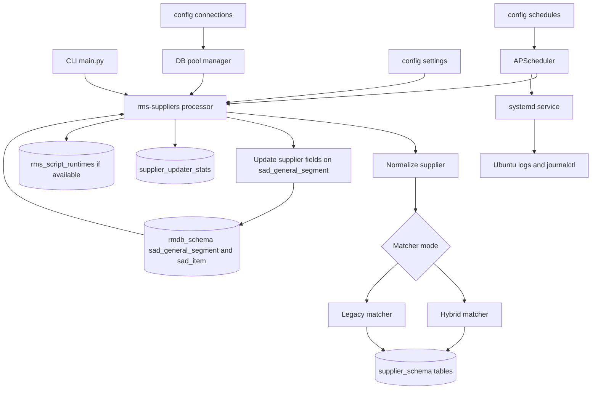

<!-- Synced from rms-suppliers/docs/documentation.md. Edit there, then re-run scripts/sync-docs.sh -->

# RMS Suppliers Documentation

## 1. Project Overview

### Executive Summary

**rms-suppliers** is the supplier-entity resolution service for import CusDec workflows in the Risk Management ecosystem. It is designed to identify and consistently assign IDs to foreign suppliers (exporters) that are manually entered by importers in CusDec declarations, where names and addresses are often inconsistent and non-unique.

The service reads import declaration data from `rmdb_schema.sad_general_segment` and `rmdb_schema.sad_item`, normalizes supplier names, matches them against existing supplier entities, and writes resolved supplier identifiers back to `sad_general_segment`. It maintains supplier grouping and matching metadata in `supplier_schema` for repeatable processing and future runs.

Operationally, this service follows the same Ubuntu/server deployment model used by `rmdb-etl`, `rmdb-analytics`, and `rms-ratings`, with target deployment on `10.2.60.146` under systemd supervision.

It also supports dual matching modes:

- default modern hybrid matcher (RapidFuzz-based),
- legacy matcher compatibility using `--legacy`.

This allows controlled migration from legacy logic while preserving continuity for production validation and comparison.

### Problem Statement

Sri Lanka Customs does not maintain a canonical registry of foreign suppliers for imports. In practice, importers type foreign supplier (exporter) details directly in CusDecs, which creates several data-quality and analytics challenges:

- the same foreign supplier appears under multiple spelling and formatting variants,
- addresses and name structures are inconsistent across declarations,
- there is no stable supplier identity key for downstream risk analytics,
- matching quality is hard to audit when processing logic is fragmented or manual.

Without consistent supplier entity resolution, risk-management analysis on import declarations becomes unreliable: repeated suppliers cannot be tracked accurately, history is fragmented across aliases, and supplier-based risk signals are weakened.

The core problem is therefore to transform noisy, user-entered supplier text into stable supplier entities that can be consistently reused across CusDecs and across time.

### Core Objectives

The **rms-suppliers** service is designed to achieve the following:

- assign stable supplier IDs to foreign suppliers in import CusDec workflows,
- resolve repeated supplier variants to existing entities whenever confidence is sufficient,
- create new supplier entities only when no acceptable existing match is found,
- keep matching logic configurable and auditable (thresholds, weights, confidence bands),
- support both modern and legacy matching modes for controlled rollout,
- run reliably in scheduled and manual backfill modes on the shared Ubuntu production environment.

## 2. Technical Architecture

The **rms-suppliers** service is a configuration-driven matching pipeline that reads candidate import declarations, normalizes supplier text, resolves supplier identity using a selectable matcher (new or legacy), persists entity relationships in `supplier_schema`, and updates supplier fields on `rmdb_schema.sad_general_segment`.

### System Diagram



### Technology Stack

**Language and runtime**

- Python 3.x
- Virtual environment (`venv`)

**Core application components**

- `main.py` - CLI entry point (`setup`, `migrate`, `full`, `incremental`, `backfill`, `test`)
- `scheduler.py` - APScheduler-based cron orchestration via `config/schedules.yaml`
- `core/processor.py` - end-to-end orchestration and chunk handling
- `core/normalizer.py` - supplier name normalization and keyword extraction
- `core/matcher.py` - legacy Jaro-based matching logic
- `core/matcher_new.py` - default RapidFuzz hybrid matcher
- `database/connection.py` - pooled PostgreSQL connections
- `database/queries.py` - extraction, matching, update, and stats SQL
- `database/schema.py` - DDL and migration definitions

**Databases**

- Source (read): PostgreSQL `rmdb_schema` (`sad_general_segment`, `sad_item`)
- Target (write): PostgreSQL `supplier_schema` and supplier columns on `rmdb_schema.sad_general_segment`

**Orchestration and operations**

- APScheduler (`BlockingScheduler` with cron triggers)
- systemd service deployment model on Ubuntu
- target deployment host: `10.2.60.146`

**Configuration and secrets**

- YAML config files in `config/`:
  - `settings.yaml`
  - `schedules.yaml`
  - `connections.yaml` (fallback)
- Shared connection preference:
  - `../rmdb-etl/rmdb-etl/config/connections.yaml` when present
- Environment variable substitution for secrets (e.g. `RMDB_PASSWORD`)

### Database Schema (Application Metadata Tables)

Scheduling is file-based (`config/schedules.yaml`) rather than table-driven. The service persists operational metadata and matching state in PostgreSQL.

#### `supplier_schema.supplier_updater_stats`

Tracks per-run aggregate processing outcomes.

Typical fields:

- `record_date` - run timestamp key
- `record_count` - number of extracted declaration rows in the run
- `process_sec` - total elapsed processing seconds
- `grouped_records` - current count of master supplier records
- `total_records` - current count of supplier detail records

Purpose:

- run-level observability for incremental/full/backfill execution
- trend monitoring for entity growth and processing duration

#### `rmdb_schema.rms_script_runtimes` (if present)

Optional shared runtime log table used across RMS services. `rms-suppliers` writes here when the table exists.

Typical fields used:

- `script_name`
- `run_time`
- `records_updated`
- `run_result`
- `error_message`

Purpose:

- cross-service execution audit trail
- centralized operational visibility in the shared RMDB environment

#### Supplier entity state tables (`supplier_schema`)

Although not scheduler metadata tables, these are the core application state used by matching:

- `supplier_master` - master supplier entities (includes `confidence_level`)
- `supplier_details` - normalized supplier name and country variants
- `supplier_connector` - detail-to-master mappings with optional `match_score`
- `supplier_keywords` - keywords used for candidate blocking
- `supplier_banned_keywords` - normalization exclusions

These tables allow repeatable matching behavior across runs and make supplier identity resolution cumulative over time.

## 3. Installation & Configuration

### Prerequisites

#### System requirements

- Ubuntu Linux server (CLI-based operations)
- Target production host: `10.2.60.146`
- Network connectivity from host to RMDB PostgreSQL instance
- Git access to the `rms-suppliers` repository
- Python virtual environment support (`python3-venv`)

#### Python version

- Python 3.10+ recommended

Check:

```bash
python3 --version
```

#### Required libraries

Install from `requirements.txt`:

```bash
python3 -m venv .venv
source .venv/bin/activate
pip install --upgrade pip
pip install -r requirements.txt
```

Important libraries include:

- `psycopg2-binary`
- `SQLAlchemy`
- `APScheduler`
- `PyYAML`
- `rapidfuzz`

#### Required environment variables

Minimum required:

- `RMDB_PASSWORD`

Optional:

- `RMS_SUPPLIERS_SCHEDULER_TZ` (defaults to `Asia/Colombo`)

### Environment Setup

#### 1) Clone project

```bash
cd /opt
git clone <repo-url> rms-suppliers
cd /opt/rms-suppliers
```

#### 2) Create and activate virtual environment

```bash
python3 -m venv .venv
source .venv/bin/activate
pip install --upgrade pip
pip install -r requirements.txt
```

#### 3) Configure environment variables

```bash
cp .env.example .env
```

Set at least:

```env
RMDB_PASSWORD=<your_password>
RMS_SUPPLIERS_SCHEDULER_TZ=Asia/Colombo
```

For manual shell runs:

```bash
set -a
source .env
set +a
```

#### 4) Connection config behavior

At runtime, the service prefers shared RMDB credentials from:

- `../rmdb-etl/rmdb-etl/config/connections.yaml`

If that file is not present, fallback is:

- `config/connections.yaml`

#### 5) Initialize schema and migrations

```bash
python3 main.py setup
```

Or, if schema already exists:

```bash
python3 main.py migrate
```

#### 6) Smoke test commands

```bash
python3 main.py incremental --date 2020-01-01
python3 main.py incremental --date 2020-01-01 --legacy
```

Chunked backfill example:

```bash
python3 main.py backfill --start 2020-01-01 --chunk-days 15 --end 2020-12-31
```

### Deployment Guide (Production)

This service follows the same Ubuntu + systemd deployment model used by other RMDB Python services.

#### 1) Deploy code to `10.2.60.146`

- Clone repository to `/opt/rms-suppliers`
- Create `.venv` and install dependencies
- Configure `.env` with production values

#### 2) Apply schema changes

Run once per deployment update:

```bash
cd /opt/rms-suppliers
source .venv/bin/activate
set -a && source .env && set +a
python3 main.py migrate
```

#### 3) systemd service setup

Template file:

- `deployment/rms-suppliers-scheduler.service`

Set placeholders:

- `{{USER}}` -> runtime user (for example `rmd`)
- `{{PROJECT_ROOT}}` -> `/opt/rms-suppliers`
- `{{VENV_PYTHON}}` -> `/opt/rms-suppliers/.venv/bin/python`

Install and start:

```bash
sudo cp deployment/rms-suppliers-scheduler.service /etc/systemd/system/rms-suppliers-scheduler.service
sudo systemctl daemon-reload
sudo systemctl enable rms-suppliers-scheduler
sudo systemctl start rms-suppliers-scheduler
sudo systemctl status rms-suppliers-scheduler --no-pager
```

#### 4) Runtime verification

Manual validation:

```bash
python3 main.py test
python3 main.py incremental --date 2020-01-01
```

Monitor service logs:

```bash
journalctl -u rms-suppliers-scheduler -f
```

#### 5) Operational recommendations

- Keep scheduler single-instance (`max_instances=1`) to avoid parallel matching races
- Use chunked `backfill` for historical loads instead of very large single windows
- Retain `--legacy` mode during transition periods for behavior comparison and controlled rollback

## 4. Functional Modules

### Logical component map

The service is organized into focused modules that map directly to the supplier-resolution workflow:

- `main.py`
  - CLI command routing (`setup`, `migrate`, `seed-missing-ratings`, `full`, `incremental`, `backfill`, `test`)
  - argument parsing and execution mode selection (`new` vs `--legacy`)
- `scheduler.py`
  - APScheduler cron execution based on `config/schedules.yaml`
  - job wrapper for scheduled `full` / `incremental` runs
- `core/processor.py`
  - orchestration layer for extraction, normalization, matching, write-back, and runtime stats
  - supports single-day, ranged incremental, bounded full, and chunked backfill execution
- `core/normalizer.py`
  - supplier text cleanup and keyword extraction
  - banned-keyword handling and minimum token logic
- `core/matcher.py`
  - legacy Jaro-based matching strategy
- `core/matcher_new.py`
  - default RapidFuzz hybrid matching strategy
  - confidence labeling logic for links/new masters
- `database/queries.py`
  - SQL definitions for extraction, candidate lookup, inserts, updates, and statistics writes
- `database/connection.py`
  - pooled PostgreSQL access and transaction-scoped cursor handling
- `database/schema.py`
  - DDL definitions and migration statements for `supplier_schema` and `sad_general_segment` supplier columns

### Data ingestion (how the app pulls data)

Supplier ingestion is read-driven from RMDB source tables and write-driven into supplier state tables:

1. **Extraction query**
   - source: `rmdb_schema.sad_general_segment` joined to `rmdb_schema.sad_item`
   - primary filters:
     - import declarations (`ide_typ_sad = 'IM'`)
     - CPC-like condition (`RIGHT(COALESCE(si.tar_prc_ext, ''), 2) = '00'`)
     - supplier name present (`cmp_exp_nam IS NOT NULL`)
     - export country not domestic (`gen_cty_ept_cod NOT IN ('LK', 'LM')`)
     - supplier IDs not yet fully assigned
     - optional date and office filters from settings/runtime arguments
2. **Normalization**
   - `cmp_exp_nam` is normalized (special character cleanup, banned keyword removal, token normalization)
   - exporter country is normalized and used with name for supplier detail identity
3. **Detail upsert**
   - normalized `(supplier_name, co)` is upserted to `supplier_schema.supplier_details`
4. **Master resolution**
   - if detail is already connected, existing master is reused
   - otherwise:
     - candidate masters are found via `supplier_keywords`
     - selected matcher strategy computes best match
     - either connect to existing master or create a new master + keywords + connector
     - when a new master is created, a default 50.0 `sup_c` rating row is seeded in `rmdb_schema.rms_risk_ratings` (`ON CONFLICT DO NOTHING`)
5. **Write-back to declarations**
   - `rmdb_schema.sad_general_segment` is updated by `instanceid` with:
     - `supplier_name`
     - `supplier_master_id`
     - `supplier_details_id`
6. **Run metadata**
   - run aggregates -> `supplier_schema.supplier_updater_stats`
   - optional cross-service log -> `rmdb_schema.rms_script_runtimes` (when available)

### API documentation (command-line interface)

The CLI is file-based and command-driven (no HTTP API). Commands:

- `python main.py setup`
  - creates required schema tables and indexes
  - applies migrations
  - seeds banned keywords when configured
- `python main.py migrate`
  - applies migration statements only
- `python main.py seed-missing-ratings`
  - inserts default 50.0 `sup_c` ratings into `rmdb_schema.rms_risk_ratings` for supplier masters that have no rating row
  - existing scored ratings are left unchanged (`ON CONFLICT DO NOTHING`)
  - use to remediate suppliers created before default seeding was added
- `python main.py full`
  - full processing from configured `initial_start_date`
  - options:
    - `--days N`
    - `--end-date YYYY-MM-DD`
    - `--legacy`
    - `--no-progress`
- `python main.py incremental`
  - default: yesterday and today (registration date window)
  - options:
    - `--date YYYY-MM-DD` (single day)
    - `--start YYYY-MM-DD --days N` (bounded range)
    - `--legacy`
- `python main.py backfill`
  - chunked historical processing
  - required:
    - `--start YYYY-MM-DD`
    - `--chunk-days N`
  - optional:
    - `--end YYYY-MM-DD` (default today)
    - `--legacy`
    - `--no-progress`
- `python main.py test`
  - executes local unit tests

CLI usage notes:

- default matcher mode is the new RapidFuzz hybrid flow
- add `--legacy` to force the old Jaro path
- for large historical ranges, prefer `backfill` with moderate chunk size (for example 10-30 days)

## 5. Security & Compliance

### Secrets and configuration hygiene

The service is designed to keep credentials out of source code and route sensitive values through environment variables.

Current hygiene model:

- Database credentials are sourced from YAML config with environment substitution (for example `RMDB_PASSWORD`).
- Runtime can prefer shared connection config from `rmdb-etl` to avoid duplicate credential files across services.
- `.env.example` is committed for structure; `.env` should remain environment-specific and uncommitted.
- Production deployment should load environment values via systemd `EnvironmentFile` or protected shell environment, not inline command history.

Recommended operational controls:

- Restrict file permissions on `/opt/rms-suppliers/.env` to service user and admins only.
- Avoid printing secrets in logs, shell scripts, or troubleshooting snippets.
- Rotate DB credentials periodically and on role changes.
- Use separate DB roles for:
  - migration/setup operations,
  - regular scheduler runtime,
  with least-privilege grants.
- Keep repository private and protect release branches.

### Audit logs — what the application records

The application records operational metadata at multiple layers.

1. **Application runtime logs**
   - Python logging outputs command/job lifecycle, extraction counts, chunk completion logs, and failures.
   - In production, these are typically collected through systemd journal (`journalctl`) and/or file handlers if configured.

2. **Supplier run statistics**
   - `supplier_schema.supplier_updater_stats` captures per-run aggregates:
     - run timestamp,
     - extracted row count,
     - processing time,
     - current master/detail totals.

3. **Shared RMS runtime table (optional)**
   - When available, writes to `rmdb_schema.rms_script_runtimes` include:
     - `script_name`,
     - `run_time`,
     - `records_updated`,
     - `run_result`,
     - `error_message`.

4. **Entity-level matching traceability**
   - `supplier_connector.match_score` stores numeric confidence for linked matches.
   - `supplier_master.confidence_level` stores confidence metadata at master creation.

These artifacts provide an auditable trail of when the service ran, what was changed, and how matching decisions were scored.

### Compliance gaps and optional hardening

The current implementation is production-capable, but the following controls are recommended to strengthen security/compliance posture.

#### Identified gaps

- No built-in secret manager integration (depends on env/yaml hygiene).
- Logging does not currently include a formal immutable audit-event schema (it is operational logging + DB runtime metadata).
- No explicit role-based access matrix documented for table-level write permissions.
- No native signed release artifact process documented.

#### Optional hardening actions

- **Secrets management**
  - Move sensitive values to a vault/secret store and inject at runtime.
  - Enforce periodic credential rotation and break-glass procedures.

- **Database access hardening**
  - Use dedicated service role with minimum required permissions.
  - Limit DDL rights to deployment/migration role only.
  - Enforce TLS for DB connectivity where available.

- **Audit and governance**
  - Add structured audit events for key actions (run start/end, chunk boundaries, migration events).
  - Persist operator-triggered manual runs with user/session context.
  - Define retention policy for runtime/audit tables and system logs.

- **Operational controls**
  - Add health checks and alerting on run failures, prolonged duration, and abnormal update counts.
  - Add controlled change-management for matcher thresholds and confidence bands.
  - Document rollback procedures for schema and matching-mode changes.

- **Code and release controls**
  - Enforce branch protection + required reviews.
  - Run CI checks (tests + static checks) before deployment.
  - Version tagged releases and maintain deployment changelog.

## 6. Maintenance & Troubleshooting

### Routine maintenance

Recommended recurring maintenance for `rms-suppliers`:

- **Service health checks**
  - verify scheduler status: `systemctl status rms-suppliers-scheduler`
  - review recent runs: `journalctl -u rms-suppliers-scheduler --since "24 hours ago"`
- **Runtime table checks**
  - review `supplier_schema.supplier_updater_stats` for missing runs, low/high anomalies, and run-time spikes
  - review `rmdb_schema.rms_script_runtimes` (if enabled) for failures and error trends
- **Data quality checks**
  - monitor growth of `supplier_master` vs `supplier_details`
  - sample `supplier_connector.match_score` distribution and `confidence_level` patterns
  - verify `sad_general_segment` supplier fields are being updated for expected declaration windows
- **Housekeeping**
  - keep virtual environment dependencies updated during planned maintenance windows
  - rotate and validate credentials (`RMDB_PASSWORD`) per policy
  - verify disk usage and journal retention on `10.2.60.146`

### Common errors

#### 1) Database authentication failure

Typical message:

- `psycopg2.OperationalError: password authentication failed for user ...`

Checks:

- confirm `RMDB_PASSWORD` is present in environment
- verify active connection file path (shared `rmdb-etl` config vs local fallback)
- test with `psql` using the same host/user/database values

#### 2) No records extracted / no updates applied

Common causes:

- date window mismatch (`--date`, `--start/--days`, `--end`)
- office code filter excludes target declarations
- declarations already populated with supplier IDs
- CPC/type filters do not match expected source records

Checks:

- compare filtered count vs base declaration count in SQL
- validate extraction conditions in `database/queries.py`

#### 3) Lock waits or long-running reset scripts

Common during manual truncate/update/reset:

- another session holds locks (`idle in transaction` or active job)
- transaction aborted state after first SQL error (`25P02`)

Remediation:

- `ROLLBACK` failed transaction
- inspect blocking sessions in `pg_stat_activity`
- terminate/clear blockers and rerun with `ON_ERROR_STOP`

#### 4) Matching behavior drift

Symptoms:

- unusually high `new_master_*` rates
- sudden drop in existing-master matches

Checks:

- review recent changes to `config/settings.yaml` (`matching`, `matching_new`, confidence bands)
- compare results between default and `--legacy` mode on same date window

#### 5) Suppliers missing risk ratings

Symptoms:

- supplier masters exist in `supplier_schema.supplier_master` with no corresponding `sup_c` row in `rmdb_schema.rms_risk_ratings`
- downstream analytics (for example `dat_valuation_analysis_sup`, `dat_cusdecs.sup_rating`) show NULL supplier ratings

Common causes:

- master was created before default 50.0 `sup_c` seeding was added to `_create_master`
- `rms_risk_ratings` row was deleted or never inserted due to an earlier run failure

Remediation:

- run `python main.py seed-missing-ratings` to backfill default 50.0 `sup_c` ratings for all masters that have none (insert-only; existing scored ratings are left unchanged)

### Updating rules (change behavior without core code)

The service supports behavior tuning through configuration, minimizing core-code changes.

Primary file:

- `config/settings.yaml`

Rule categories:

- **Normalization controls**
  - banned words seed list
  - minimum word limit
- **Legacy matcher controls**
  - `minimum_keyword_hits`
  - `match_threshold`
  - `shortcut_threshold`
- **New matcher controls**
  - feature weights (`token_set`, `token_sort`, `char_ratio`)
  - `link_threshold`
  - confidence bands (`high`, `medium`) and new-master ambiguity margin
- **Processing controls**
  - default initial start date
  - office filter list
  - batch/chunk strategy via CLI (`incremental`, `backfill`, `full`)

Safe change process:

1. update config in version control
2. run local tests (`python main.py test`)
3. run a limited date-window comparison (new vs `--legacy`)
4. validate sample outputs
5. deploy and monitor first production cycles

### Logging

Logging surfaces:

- **Application logs**
  - emitted via Python logging from CLI/scheduler/processor modules
- **systemd journal**
  - primary production log stream:
    - `journalctl -u rms-suppliers-scheduler -f`
- **Database run metadata**
  - `supplier_schema.supplier_updater_stats`
  - `rmdb_schema.rms_script_runtimes` (when available)

Useful operational patterns:

- monitor chunk boundaries during backfill (`backfill` logs chunk start/end summaries)
- alert on:
  - run failures,
  - extracted count = 0 for expected windows,
  - unusually high `new_masters`,
  - processing duration regressions

Recommended improvement backlog:

- add structured log fields (mode, date window, chunk id, model)
- centralize logs in an aggregator (if available in environment)
- define explicit retention for journal and runtime metadata tables

---

## Attribution

*Administrative context — separate from the operational sections above.*

> **Developer** — **Uvindu Perera**, Superintendent of Customs, **Risk Management Directorate**.
>
> **Modernization context** — **rms-suppliers** is part of a broader program to retire legacy **Java** components built for the **Automated Risk Management System (ARMS)** in favor of **service-oriented Python** applications. This service standardizes foreign supplier entity resolution for import declarations in **RMDB** (maintaining supplier state in **`supplier_schema`** and writing resolved supplier fields to **`rmdb_schema.sad_general_segment`**), with **scheduled and on-demand** runs on institutional production hosts (for example **`10.2.60.146`**, under **systemd** as **`rms-suppliers-scheduler`**), replacing legacy batch logic and aligning supplier identification workflows with modern, maintainable tooling.
