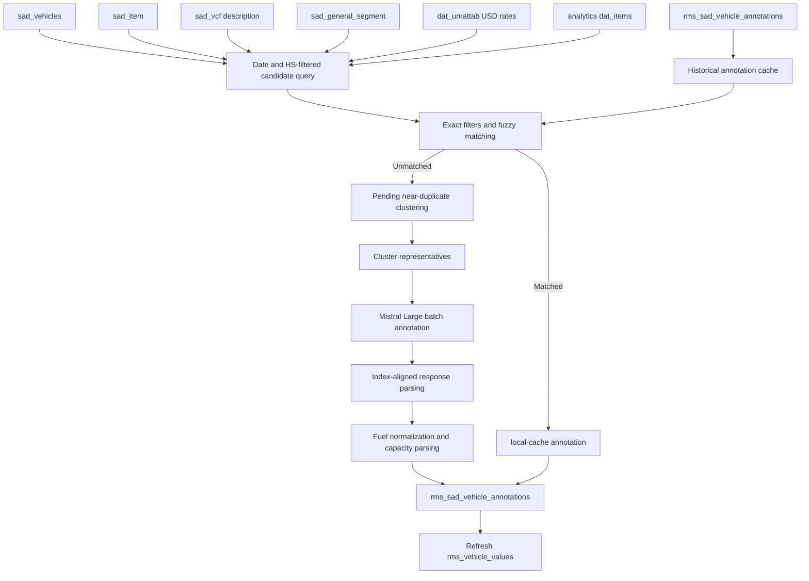

<!-- Synced from rms-vehicle-annotate/docs/documentation.md. Edit there, then re-run scripts/sync-docs.sh -->

# RMS Vehicle Annotate Documentation

This document describes the purpose, architecture, annotation logic, Mistral
prompting, local matching, value-band generation, deployment, and operation of
`rms-vehicle-annotate`.

## 1. Project Overview

### Executive Summary

RMS Vehicle Annotate converts inconsistent vehicle information from Sri Lankan
customs declarations into standardized vehicle attributes. It reads raw vehicle
and item records, uses historical matches whenever possible, and sends only
unresolved vehicle groups to Mistral Large.

The service writes:

- normalized vehicle make;
- normalized vehicle model;
- declared model year;
- canonical fuel type;
- parsed engine capacity;
- per-vehicle declared value and taxes in USD;
- annotation provenance.

It also rebuilds `rmdb_schema.rms_vehicle_values`, a historical peer-value table
used by downstream vehicle review.

### Problem Statement

Vehicle fields in customs declarations are not consistently standardized.
Common data-quality problems include:

- misspelled or abbreviated manufacturers;
- make and model values entered in different orders;
- generic model values such as `MOTOR VEHICLE`, `SUV`, or `CAR`;
- useful model details present only in the Valuation Data Form description;
- non-standard fuel descriptions;
- capacity expressed as litres, cc, or text;
- repeated near-identical records that would waste LLM calls.

These inconsistencies prevent reliable grouping and historical comparison.

### Core Objectives

- Standardize make, model, and fuel type.
- Preserve the declared year rather than asking an LLM to invent it.
- Minimize cloud LLM usage through historical matching and in-run clustering.
- Maintain alignment between batch inputs and model outputs.
- Store clear annotation provenance.
- Process a safe overlapping rolling window every day.
- Build robust peer-value ranges for downstream review.
- Make backfills and retries idempotent.

### Non-Objectives and Limitations

The service does not:

- determine whether a declaration is fraudulent;
- determine the legally correct customs value;
- infer vehicle year from model knowledge;
- decode a VIN through an authoritative manufacturer database;
- guarantee that an LLM-produced make/model is correct;
- replace human validation for incomplete or ambiguous descriptions.

Mistral uses textual declaration evidence and general model knowledge. Its
output is a normalization aid, not authoritative vehicle certification.

## 2. Technical Architecture

### System Diagram



### Data Flow

1. Resolve an inclusive registration-date range.
2. Filter source records by configured HS-code prefixes.
3. Skip records with an existing successful annotation unless `--reprocess` is
   used.
4. Load successful historical Mistral mappings into memory.
5. Match new source records against that cache.
6. Cluster still-unmatched near-duplicates in memory.
7. Send only cluster representatives to Mistral.
8. Add successful Mistral results to the in-memory cache.
9. Re-match remaining records after every Mistral batch.
10. Normalize fuel and parse capacity.
11. Upsert each completed group of annotations.
12. Rebuild historical vehicle-value bands.

### Technology Stack

**Language and runtime**

- Python 3.10+
- Python virtual environment

**Database**

- PostgreSQL RMDB
- `psycopg2-binary`
- parameterized SQL
- threaded connection pool

**External AI**

- Mistral chat-completions API
- default model: `mistral-large-latest`
- deterministic temperature: `0.0`

**Matching**

- `rapidfuzz` token-set similarity
- standard-library fallback when RapidFuzz is unavailable

**Configuration**

- YAML settings
- `.env` secrets
- environment-variable substitution

**Orchestration**

- RMS Central Command
- nightly `off_peak_package`

### Logical Components

- `main.py`: CLI commands and argument validation.
- `config/config_loader.py`: YAML, `.env`, and database configuration.
- `core/date_window.py`: rolling completed-day window.
- `core/processor.py`: end-to-end orchestration.
- `core/annotator.py`: Mistral prompt, request, response parsing, and alignment.
- `core/local_matcher.py`: historical matching and pending clustering.
- `core/fuel.py`: canonical fuel mapping.
- `core/capacity.py`: capacity parsing and banding.
- `core/values_refresher.py`: USD backfill and peer-value refresh.
- `database/queries.py`: source queries, upserts, and value aggregation.
- `database/connection.py`: PostgreSQL pool.
- `deployment/create_tables.sql`: tables, migrations, and indexes.

## 3. Source Data

### `sad_vehicles`

Provides the vehicle-level declaration:

- declaration identity;
- item number and vehicle rank;
- chassis;
- source make and model;
- model year;
- engine capacity;
- fuel type.

### `sad_item`

Provides:

- tariff HS code;
- declared item value;
- origin country;
- the item-level relationship to the vehicle.

### `sad_vcf`

Provides the Valuation Data Form description and specification. The first VCF
line for the declaration item is combined into `vdf_description`.

This is often the richest vehicle-identification text and is explicitly treated
as the primary signal in the Mistral prompt.

### `sad_general_segment`

Provides the registration date used for:

- rolling-window filtering;
- joining the applicable USD exchange rate.

### `analytics_schema.dat_unrattab`

Provides the USD exchange rate for the declaration registration date.

### `analytics_schema.dat_items`

Provides item-level tax totals by payment method:

- cash;
- bank;
- deferred.

## 4. Rolling Date Window

### Default Behavior

`python main.py run` processes the latest three completed registration days.

For example, if the current date is 17 July 2026, the inclusive default range
is:

```text
from_date: 2026-07-14
to_date:   2026-07-16
```

The current partial day is excluded.

### Why the Window Overlaps

Late source extraction, delayed registration, or an interrupted prior run can
cause records to appear after their expected daily run. Looking back three days
allows the service to recover them automatically.

Overlap does not normally repeat successful work because
`skip_already_annotated: true` excludes rows with a valid annotation.

### Explicit Date Options

Explicit CLI dates override the rolling default:

```bash
# One registration date
python main.py run --date 2026-07-15

# Inclusive range
python main.py run --from-date 2026-07-01 --to-date 2026-07-15
```

`--reprocess` disables successful-annotation skipping for the selected range.

## 5. Candidate Selection and Idempotency

### HS-Code Filtering

Configured HS entries are SQL prefixes:

- `8703` matches all tariff lines beginning with 8703;
- a complete national tariff code also matches itself and longer extensions;
- `all` disables the HS filter.

The current configuration processes HS heading `8703`.

### Successful-Annotation Skip

Unless reprocessing is requested, a source row is skipped when the same
`instanceid`, `key_itm_nbr`, and `key_rnk` already has:

- `annotation_source` other than `failed`;
- non-empty normalized make;
- non-empty normalized model;
- non-null normalized fuel type.

Failed or incomplete rows remain eligible on a later overlapping run.

### Upsert Identity

The annotation primary key is:

```text
(instanceid, key_itm_nbr, key_rnk)
```

Reprocessing updates the existing row rather than inserting a duplicate.

## 6. Historical Local Annotation Cache

### Purpose

The local cache avoids sending vehicles to Mistral when a sufficiently similar
successful mapping already exists.

Only rows whose `annotation_source` is `mistral-large` seed the historical
cache. This ensures that copied results do not recursively become independent
authoritative cache origins across runs.

### Hard Match Conditions

Candidates must have:

- the same HS code;
- the same vehicle year;
- the same normalized fuel type;
- capacity within the configured percentage tolerance (default 5%).

If these hard conditions fail, textual similarity cannot create a match.

### Specific Source Make/Model Path

For meaningful source values, the cache compares:

- source make;
- source model.

Text is uppercased, punctuation is removed, and whitespace is normalized.
RapidFuzz `token_set_ratio` provides order-independent similarity.

Both make and model must meet the threshold because the final score uses the
lower of the two similarities.

Default threshold:

```text
0.90 (90%)
```

This allows variations such as word order or corporate suffixes while still
requiring close agreement.

### Generic Source Path

Source values such as `MOTOR VEHICLE`, `CAR`, `SUV`, `TRUCK`, or `BUS` do not
identify a model. For these records, source-field fuzzy matching is skipped.

The matcher instead searches the VDF description for the cached normalized make
and model using case-insensitive word boundaries.

- make and model found: score 1.0;
- make only found: score 0.5;
- neither found: score 0.

The normal 0.90 threshold means a make-only match is not accepted.

### Cache Growth During a Run

Every successful Mistral result is immediately added to the in-memory cache.
After each Mistral batch, remaining records are matched again.

This feedback loop lets one API result resolve later similar records during the
same run.

### Annotation Provenance

Records resolved through historical or newly expanded cache matching use:

```text
annotation_source = local-cache
```

## 7. Pending-Batch Deduplication

### Purpose

Historical matching cannot help when a model has never been annotated before.
A large shipment may nevertheless contain many near-identical declarations.

Pending deduplication clusters these records before the first Mistral request.

### Cluster Conditions

Records are first bucketed by:

- HS code;
- year;
- normalized fuel.

Capacity must also be within the configured tolerance.

Records then require either:

- close fuzzy source make/model similarity; or
- direct VDF-description similarity above the configured threshold.

### Representative and Members

Only the first record in a cluster is sent to Mistral. Its successful result is
copied to the other members as `local-cache`.

If the representative fails annotation, its members are also marked failed so
they can be retried in a future run.

### Scope

Pending clusters exist only in memory for the current run. They are not stored
as a separate model or table.

## 8. Mistral Annotation Logic

### Role of Mistral

Mistral standardizes:

- vehicle make;
- specific vehicle model;
- fuel type.

Mistral does not determine:

- model year;
- engine capacity;
- declared value;
- taxes.

Those values come from declarations or deterministic calculations.

### Evidence Sent to Mistral

Each input record contains:

- `idx`: temporary position identifier;
- `make_hint`: declared make;
- `model_hint`: declared model;
- `engine_capacity`: declared capacity text;
- `fuel_type`: declared fuel text;
- `origin_country`: declaration origin-country code;
- `vdf_description`: combined VDF text.

No database credentials are sent.

### Prompt Priorities

The prompt tells Mistral:

- VDF description is usually the most precise and should be the primary signal;
- source make may be abbreviated or misspelled;
- generic source model categories should be ignored when better VDF evidence
  exists;
- a specific model is required;
- null is safer than a vague category;
- year must not be inferred.

### Supported Vehicle Categories

The system prompt contains guidance for:

- 8701 tractors;
- 8702 buses;
- 8703 motor cars;
- 8704 trucks;
- 8705 special-purpose vehicles.

The active HS filter determines which categories are actually fetched.

### Required Output

Mistral must return one JSON object per input:

```json
[
  {
    "idx": 0,
    "make": "Toyota",
    "model": "Land Cruiser 200",
    "fuel_type": "Diesel"
  }
]
```

Make should use an official brand name. Model should be specific, not a generic
vehicle category.

Fuel must resolve to one of:

- `Petrol`
- `Diesel`
- `Electric`
- `Petrol/Electric`
- `PHEV`

### Batch Alignment Safety

Every input has an integer `idx`. The model must echo it.

Responses are mapped by `idx`, not array position. Therefore:

- output order may differ safely;
- one omitted object does not shift later annotations onto the wrong vehicles;
- a missing index affects only that record.

### Generation Configuration

Default Mistral configuration:

- model: `mistral-large-latest`;
- API batch size: 20;
- temperature: 0.0;
- timeout: 120 seconds;
- output budget: 250 tokens per vehicle, with a minimum batch budget of 512.

### Response Parsing

The parser first attempts normal JSON parsing. It also tolerates:

- markdown code fences;
- an outer JSON array embedded in surrounding text;
- accidental nested arrays;
- a truncated array containing complete result objects.

Complete objects may be salvaged from a truncated response. Missing `idx`
values are marked failed.

### Failure Behavior

An HTTP error, timeout, invalid top-level response, or missing item result
produces:

```text
annotation_source = failed
make = null
model = null
```

Failed rows remain eligible on a later rolling-window run.

There is no fabricated fallback make/model.

## 9. Deterministic Normalization

### Model Year

`vehicle_year` is copied from `sad_vehicles.year_` and parsed as an integer.
Mistral is explicitly instructed not to return a year.

### Fuel Type

LLM output is normalized to the five allowed categories. If it is missing or
invalid, declared fuel text is mapped deterministically.

Examples:

- gasoline or unleaded → `Petrol`;
- diesel → `Diesel`;
- EV or BEV → `Electric`;
- hybrid or HEV → `Petrol/Electric`;
- plug-in or PHEV → `PHEV`.

### Engine Capacity

The first numeric value is extracted after removing commas.

- values of 20 or more are treated as cc;
- values below 20 are treated as litres and multiplied by 1000;
- the result is rounded to an integer.

Examples:

```text
"1800CC" -> 1800
"1.8 L"  -> 1800
"2.0"    -> 2000
```

## 10. USD Value and Tax Calculation

### Per-Vehicle Declared Value

```text
value_usd =
    (sad_item.vit_stv / vehicles_on_declaration_item)
    / applicable_usd_exchange_rate
```

The value is rounded to two decimal places.

### Per-Vehicle Taxes

Cash, bank, and deferred tax totals are:

1. read from `analytics_schema.dat_items`;
2. divided by the number of vehicles on the declaration item;
3. converted using the same USD rate;
4. rounded to two decimal places.

### Missing Rate or Value

If no valid exchange rate or positive source value is available, USD fields may
remain null.

The `backfill-values` command can recalculate these columns for existing
annotations.

## 11. Vehicle Peer-Value Table

### Purpose

`rms_vehicle_values` provides historical comparison ranges for downstream
vehicle review.

### Grouping Grain

- HS code;
- canonical fuel type;
- normalized make;
- normalized model;
- rounded capacity band;
- vehicle year.

### Capacity Band

Default band size is 100 cc.

For example, nearby capacities such as 1196 and 1204 are grouped at 1200.

### Percentile Trimming

For each sufficiently large group, the service calculates the 5th and 95th
percentile bounds, retains values inside those bounds, then stores:

- minimum retained value;
- maximum retained value;
- average retained value;
- retained vehicle count.

Default minimum source sample size is five.

This removes extreme tails before creating the range. It does not establish an
official customs value.

## 12. Database Tables

### `rms_sad_vehicle_annotations`

Primary key:

```text
(instanceid, key_itm_nbr, key_rnk)
```

Major output fields:

- chassis;
- source and normalized make/model;
- declared year;
- source and normalized fuel;
- raw and parsed capacity;
- HS code;
- USD value and taxes;
- annotation source;
- annotation timestamp.

### Annotation Sources

`mistral-large`

- Direct successful Mistral result.

`local-cache`

- Historical match, post-batch re-match, or copied cluster-representative
  result.

`failed`

- API or response failure requiring retry.

### `rms_vehicle_values`

Stores the peer-value range at the grouping grain described above.

## 13. Installation and Configuration

### Prerequisites

- Ubuntu Linux
- Python 3.10+
- RMDB PostgreSQL connectivity
- outbound HTTPS access to Mistral
- valid Mistral API key
- upstream SAD and analytics tables

### Installation

```bash
cd /opt
git clone https://github.com/uvindu-perera/rms-vehicle-annotate.git
cd rms-vehicle-annotate

python3 -m venv venv
./venv/bin/pip install -r requirements.txt

cp .env.example .env
nano .env
chmod 600 .env

./venv/bin/python main.py setup
```

### Required Environment Variables

- `RMDB_HOST`
- `RMDB_PORT`
- `RMDB_USER`
- `RMDB_PASSWORD`
- `RMDB_DATABASE`
- `MISTRAL_API_KEY`

Optional:

- `RMS_VEHICLE_ANNOTATE_ENV_FILE`

### Settings

`rolling_days`

- Number of completed registration days in the default run.
- Default: 3.

`hs_codes`

- `all` or HS prefixes.

`skip_already_annotated`

- Makes rolling overlap idempotent.

`mistral`

- endpoint, key, model, timeout, batch size, and output budget.

`local_match`

- enablement, similarity thresholds, capacity tolerance, clustering, and
  generic source values.

`vehicle_values`

- minimum sample size, percentile bounds, and capacity band.

## 14. Command-Line Interface

### Setup Tables

```bash
python main.py setup
```

### Default Rolling Run

```bash
python main.py run
```

Processes the latest three completed days and skips successful existing rows.

### Specific Date

```bash
python main.py run --date 2026-07-15
```

### Date Range

```bash
python main.py run \
  --from-date 2026-07-01 \
  --to-date 2026-07-15
```

### Force Reprocessing

```bash
python main.py run \
  --from-date 2026-07-01 \
  --to-date 2026-07-15 \
  --reprocess
```

Use reprocessing carefully because it can replace existing annotations and
consume additional API tokens.

### Refresh Peer Values

```bash
python main.py refresh-values
```

### Backfill USD Fields

```bash
python main.py backfill-values
```

## 15. RMS Central Command Integration

The service is registered as:

```text
rms-vehicle-annotate
```

Production central-command environment:

```bash
RMS_CC_RMS_VEHICLE_ANNOTATE_ROOT=/opt/rms-vehicle-annotate
```

The nightly `off_peak_package` invokes:

```text
python main.py run
```

Because no explicit date is supplied, the configured three-day rolling window
is used.

Validate:

```bash
cd /opt/rms-central-command
./venv/bin/python src/main.py list-packages
```

Run the complete off-peak package manually:

```bash
./venv/bin/python src/main.py run-package off_peak_package
```

Restart the central-command scheduler after package configuration changes.

## 16. Security, Privacy, and Governance

### Cloud Processing

Unlike the downstream local review model, Mistral annotation uses an external
cloud API. The following declaration evidence is transmitted:

- source make and model;
- capacity;
- fuel;
- origin-country code;
- VDF description.

This data flow should be approved under the organization's data-handling policy.
Changing the prompt or adding fields should receive security/privacy review.

### Secrets

- Mistral and database credentials belong only in `.env`.
- `.env` must not be committed.
- Recommended permissions: `chmod 600 .env`.
- API keys are sent only in the HTTPS authorization header.

### Auditability

Every row stores annotation provenance and timestamp. Source fields are retained
alongside normalized fields, allowing an officer to compare input and output.

### Human Validation

For important cases, reviewers should inspect:

- original make/model;
- VDF description;
- normalized output;
- annotation source;
- chassis and source documents.

## 17. Operations and Monitoring

### Run Summary

The CLI reports:

- date range;
- total vehicles in range;
- already-annotated rows skipped;
- rows requiring work;
- historical local matches;
- pending-cluster matches;
- direct Mistral annotations;
- failures;
- runtime;
- vehicle-value groups rebuilt.

### Annotation Source Counts

```sql
SELECT annotation_source, COUNT(*)
FROM rmdb_schema.rms_sad_vehicle_annotations
GROUP BY annotation_source
ORDER BY annotation_source;
```

### Recent Failures

```sql
SELECT *
FROM rmdb_schema.rms_sad_vehicle_annotations
WHERE annotation_source = 'failed'
ORDER BY annotated_at DESC;
```

### Rolling-Window Coverage

```sql
SELECT
    annotated_at::date AS annotation_date,
    annotation_source,
    COUNT(*)
FROM rmdb_schema.rms_sad_vehicle_annotations
WHERE annotated_at >= CURRENT_DATE - INTERVAL '7 days'
GROUP BY annotated_at::date, annotation_source
ORDER BY annotation_date DESC, annotation_source;
```

### Peer-Group Coverage

```sql
SELECT
    COUNT(*) AS peer_groups,
    SUM(vehicle_count) AS retained_vehicles
FROM rmdb_schema.rms_vehicle_values;
```

## 18. Troubleshooting

### Missing Mistral API Key

Error:

```text
MISTRAL_API_KEY is not configured
```

Set the key in `.env`, then restart the process.

### Missing Database Password

Ensure `.env` contains a real `RMDB_PASSWORD`.

### Mistral Batch Failures

Check:

- outbound HTTPS connectivity;
- API key validity;
- timeout;
- service availability;
- response logs.

Failed rows are retried by later overlapping runs.

### High Mistral Usage

Review:

- local cache enablement;
- similarity threshold;
- capacity tolerance;
- dedup enablement;
- generic source list;
- VDF-description availability.

Do not lower similarity thresholds without evaluating false matches.

### No Vehicles Found

Confirm:

- source ETL completed;
- registration dates fall within the selected window;
- configured HS prefix matches source codes.

### All Vehicles Skipped

This is normal when all rows in the rolling window already have successful
annotations.

### Slow Value Refresh

The value table is fully truncated and rebuilt after each annotation run.
Runtime grows with annotation history and grouping cardinality.

## 19. Testing

Run:

```bash
python -m unittest discover -s tests -v
python -m compileall -q .
```

Date-window tests verify:

- a three-day window ends yesterday;
- a one-day window equals yesterday;
- non-positive windows are rejected.

## 20. Maintenance Guidance

### Changing the Rolling Window

Increase `rolling_days` when upstream data commonly arrives late. A larger
window increases source-query work but not necessarily Mistral usage because
successful rows are skipped.

### Changing Similarity Thresholds

Before changing thresholds:

1. collect known matching and non-matching examples;
2. test make and model similarity separately;
3. inspect generic-source VDF behavior;
4. measure false matches;
5. document the reason for the change.

False local matches are more dangerous than additional API calls.

### Changing the Mistral Model

Use a fixed representative sample to compare:

- specific-model accuracy;
- null behavior when evidence is weak;
- canonical fuel compliance;
- JSON/index compliance;
- latency and token usage.

Keep the model name in configuration and document operational changes.

### Reviewing Quality

Recommended quality measures:

- percentage resolved by historical cache;
- percentage absorbed by pending clustering;
- direct Mistral success rate;
- failed-response rate;
- sampled make/model precision;
- fuel normalization accuracy;
- false local-match rate;
- API calls and tokens per annotated vehicle.

---

## Attribution

*Administrative context — separate from the operational sections above.*

> **Developer** — **Uvindu Perera**, Superintendent of Customs, **Risk Management Directorate**.
>
> **Modernization context** — **rms-vehicle-annotate** is part of the program to retire legacy **ARMS** components in favor of service-oriented Python applications. This service enriches SAD vehicle import declarations with canonical make, model, fuel type, engine capacity, and valuation data through a combination of **historical local annotation**, **pending-batch deduplication**, and **Mistral API** for novel names. It writes annotations to **rmdb_schema.rms_sad_vehicle_annotations** on RMDB PostgreSQL, with scheduled and on-demand runs on institutional production hosts, integrated through **rms-central-command** in the `off_peak_package` with a rolling three-day processing window.
