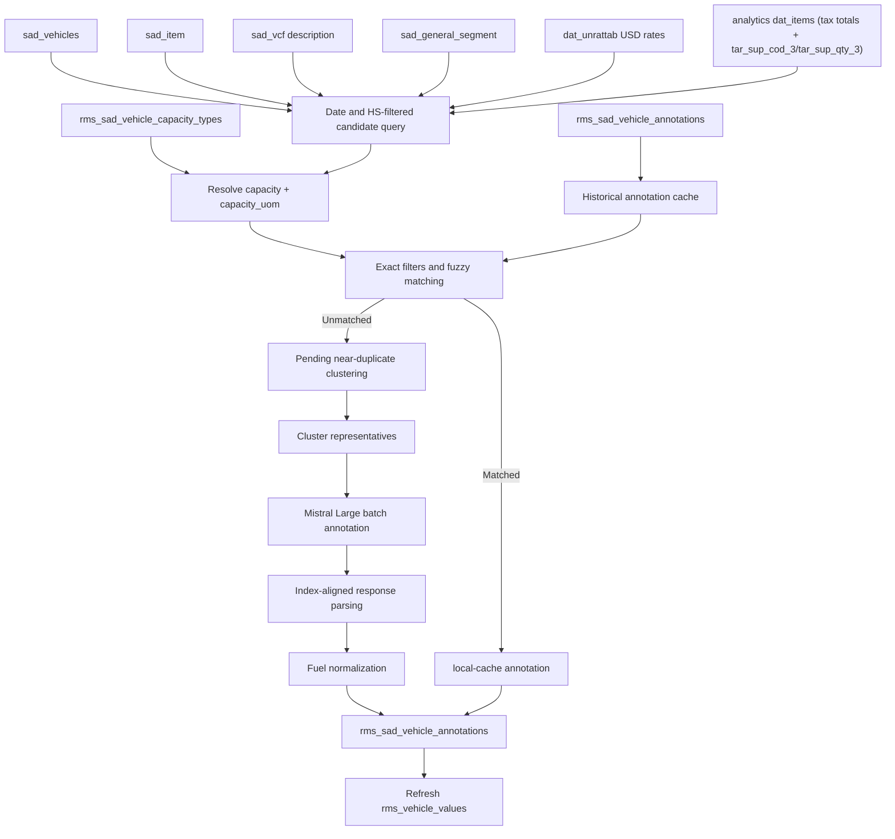

<!-- Synced from rms-vehicle-annotate/docs/documentation.md. Edit there, then re-run scripts/sync-docs.sh -->

# RMS Vehicle Annotate Documentation

This document describes the purpose, architecture, annotation logic, multi-provider
LLM prompting, local matching, value-band generation, deployment, and operation of
`rms-vehicle-annotate`.

## 1. Project Overview

### Executive Summary

RMS Vehicle Annotate converts inconsistent vehicle information from Sri Lankan
customs declarations into standardized vehicle attributes. It reads raw vehicle
and item records, uses historical matches whenever possible (including **partial**
make/model/fuel candidates), and sends only incomplete vehicle groups to a
configurable **primary** OpenAI-compatible LLM (default Mistral Large), with an
optional **fallback** provider (default ClinePass Qwen3.7 Max).

The service writes:

- normalized vehicle make;
- normalized vehicle model;
- declared model year;
- canonical fuel type;
- resolved engine capacity, with an explicit unit (`CC`, `KWH`, or `UNKNOWN`);
- per-vehicle declared value and taxes in USD;
- annotation provenance.

It also rebuilds `rmdb_schema.rms_vehicle_values`, a historical peer-value table
used by downstream vehicle review.

### Problem Statement

Vehicle fields in customs declarations are not consistently standardized.
Common data-quality problems include:

- misspelled or abbreviated manufacturers;
- make and model values entered in different orders;
- generic model values such as `MOTOR VEHICLE`, `SUV`, or `CAR`;
- useful model details present only in the Valuation Data Form description;
- non-standard fuel descriptions;
- capacity expressed as litres, cc, kWh, or plain text with no recorded unit
  (`sad_vehicles.engine_capacity` is free text and is not always reliable);
- repeated near-identical records that would waste LLM calls.

These inconsistencies prevent reliable grouping and historical comparison.

### Core Objectives

- Standardize make, model, and fuel type.
- Preserve the declared year rather than asking an LLM to invent it.
- Minimize cloud LLM usage through historical matching and in-run clustering.
- Maintain alignment between batch inputs and model outputs.
- Store clear annotation provenance.
- Process a safe overlapping rolling window every day.
- Build robust peer-value ranges for downstream review.
- Make backfills and retries idempotent.

### Non-Objectives and Limitations

The service does not:

- determine whether a declaration is fraudulent;
- determine the legally correct customs value;
- infer vehicle year from model knowledge;
- decode a VIN through an authoritative manufacturer database;
- guarantee that an LLM-produced make/model is correct;
- replace human validation for incomplete or ambiguous descriptions.

Mistral uses textual declaration evidence and general model knowledge. Its
output is a normalization aid, not authoritative vehicle certification.

## 2. Technical Architecture

### System Diagram



### Data Flow

1. Resolve an inclusive registration-date range.
2. Filter source records by configured HS-code prefixes.
3. Skip records with an existing successful annotation unless `--reprocess` is
   used.
4. Load the historical annotation cache and the capacity-type registry
   (`rms_sad_vehicle_capacity_types`) into memory.
5. Auto-register any HS code seen in the fetched batch that is not yet in the
   capacity-type registry.
6. Resolve `(capacity, capacity_uom)` for each fetched record — preferring
   `sad_supplementary_unit` (via `dat_items.tar_sup_cod_3`/`tar_sup_qty_3`)
   over `sad_vehicles.engine_capacity` — and attach it to the record.
7. Match new source records against the historical cache.
8. Cluster still-unmatched near-duplicates in memory.
9. Send only cluster representatives to Mistral.
10. Add successful Mistral results to the in-memory cache.
11. Re-match remaining records after every Mistral batch.
12. Normalize fuel.
13. Upsert each completed group of annotations.
14. Rebuild historical vehicle-value bands.

### Technology Stack

**Language and runtime**

- Python 3.10+
- Python virtual environment

**Database**

- PostgreSQL RMDB
- `psycopg2-binary`
- parameterized SQL
- threaded connection pool

**External AI**

- Mistral chat-completions API
- default model: `mistral-large-latest`
- deterministic temperature: `0.0`

**Matching**

- `rapidfuzz` token-set similarity
- standard-library fallback when RapidFuzz is unavailable

**Configuration**

- YAML settings
- `.env` secrets
- environment-variable substitution

**Orchestration**

- RMS Central Command
- nightly `off_peak_package`

### Logical Components

- `main.py`: CLI commands and argument validation.
- `config/config_loader.py`: YAML, `.env`, and database configuration.
- `core/date_window.py`: rolling completed-day window.
- `core/processor.py`: end-to-end orchestration.
- `core/annotator.py`: Mistral prompt, request, response parsing, and alignment.
- `core/local_matcher.py`: historical matching and pending clustering.
- `core/fuel.py`: canonical fuel mapping.
- `core/capacity.py`: capacity resolution (supplementary unit first, `sad_vehicles` fallback) and banding.
- `core/capacity_types.py`: `rms_sad_vehicle_capacity_types` registry — load and auto-discover.
- `core/vehicle_classification_annotator.py`: one-off Mistral call deriving `vehicle_type` / `fuel_type` / `usage_type` from `untartab` tariff text.
- `core/json_utils.py`: shared tolerant JSON-response parsing used by every LLM-consuming module (fence/`<think>`-block stripping, truncation salvage).
- `core/vehicle_paring_clustering.py`: local (non-LLM) near-duplicate make/model text clustering for the on-demand review table.
- `core/vehicle_paring_reviewer.py`: on-demand `rms_sad_vehicle_parings` rebuild — LLM plausibility checks and correction-SQL generation.
- `core/values_refresher.py`: USD/capacity backfill and peer-value refresh.
- `database/queries.py`: source queries, upserts, and value aggregation.
- `database/connection.py`: PostgreSQL pool.
- `deployment/create_tables.sql`: tables, migrations, and indexes.

## 3. Source Data

### `sad_vehicles`

Provides the vehicle-level declaration:

- declaration identity;
- item number and vehicle rank;
- chassis;
- source make and model;
- model year;
- engine capacity;
- fuel type.

### `sad_item`

Provides:

- tariff HS code;
- declared item value;
- origin country;
- the item-level relationship to the vehicle.

### `sad_vcf`

Provides the Valuation Data Form description and specification. The first VCF
line for the declaration item is combined into `vdf_description`.

This is often the richest vehicle-identification text and is explicitly treated
as the primary signal in the Mistral prompt.

### `sad_general_segment`

Provides the registration date used for:

- rolling-window filtering;
- joining the applicable USD exchange rate.

### `analytics_schema.dat_unrattab`

Provides the USD exchange rate for the declaration registration date.

### `analytics_schema.dat_items`

Provides item-level tax totals by payment method:

- cash;
- bank;
- deferred.

It also carries `tar_sup_cod_3` and `tar_sup_qty_3` — the supplementary-unit
code and quantity pivoted from `sad_supplementary_unit` at `key_sup_rnk = 3`.
This is the authoritative engine-capacity source (the base customs uses for
tax calculation), preferred over `sad_vehicles.engine_capacity`. See
[Section 9a, Capacity Resolution](#9a-capacity-resolution).

### `rms_sad_vehicle_capacity_types`

A per-HS-code registry mapping `tar_hsc_nb1` to the expected supplementary-unit
code (`tar_sup_cod`, e.g. `CCE`, `KWE`) and the resulting `capacity_uom` (`CC`,
`KWH`, or `UNKNOWN`), with a `verified_flag` distinguishing manually confirmed
rows (`1`) from auto-discovered rows pending review (`0`). It also carries
three independent classification columns — `vehicle_type`, `fuel_type`, and
`usage_type` (each with its own `_verified_flag`) — populated on demand. See
[Section 9b, Vehicle Classification](#9b-vehicle-classification).

### `rmdb_schema.untartab`

The tariff master table (loaded by `rmdb-etl`). Provides, per 8-digit HS code:

- `tar_dsc`: short official tariff description;
- `tar_all`: full official tariff description — the authoritative wording,
  which for Chapter 87/8711 vehicle lines typically states the classification
  basis in words (cc range, gross vehicle weight, engine/motor power, seating
  capacity, engine/fuel type, or new/used status).

Used only by the one-off `populate-vehicle-classification` command, not by
the daily `run` pipeline.

## 4. Rolling Date Window

### Default Behavior

`python main.py run` processes the latest three completed registration days.

For example, if the current date is 17 July 2026, the inclusive default range
is:

```text
from_date: 2026-07-14
to_date:   2026-07-16
```

The current partial day is excluded.

### Why the Window Overlaps

Late source extraction, delayed registration, or an interrupted prior run can
cause records to appear after their expected daily run. Looking back three days
allows the service to recover them automatically.

Overlap does not normally repeat successful work because
`skip_already_annotated: true` excludes rows with a valid annotation.

### Explicit Date Options

Explicit CLI dates override the rolling default:

```bash
# One registration date
python main.py run --date 2026-07-15

# Inclusive range
python main.py run --from-date 2026-07-01 --to-date 2026-07-15
```

`--reprocess` disables successful-annotation skipping for the selected range.

## 5. Candidate Selection and Idempotency

### HS-Code Filtering

Configured HS entries are SQL prefixes:

- `8703` matches all tariff lines beginning with 8703;
- a complete national tariff code also matches itself and longer extensions;
- `all` disables the HS filter.

The current configuration processes HS heading `8703`.

### Successful-Annotation Skip

Unless reprocessing is requested, a source row is skipped when the same
`instanceid`, `key_itm_nbr`, and `key_rnk` already has:

- `annotation_source` other than `failed`;
- non-empty normalized make;
- non-empty normalized model;
- non-null normalized fuel type.

Failed or incomplete rows remain eligible on a later overlapping run.

### Upsert Identity

The annotation primary key is:

```text
(instanceid, key_itm_nbr, key_rnk)
```

Reprocessing updates the existing row rather than inserting a duplicate.

## 6. Historical Local Annotation Cache

### Purpose

The local cache avoids sending vehicles to an LLM when a sufficiently similar
successful mapping already exists.

Rows whose `annotation_source` is `mistral-large`, `clinepass`, or `llm-merged`
and that have **at least one** usable target field (make, model, or fuel) seed
the historical cache. Complete candidates skip the LLM; partial candidates are
retained and merged with LLM results (see [Section 8a](#8a-field-level-merge-and-multi-provider-llm)).

### Hard Match Conditions

Candidates must have:

- the same HS code;
- the same vehicle year;
- the same `capacity_uom` (a `CC` value never matches `KWH` or `UNKNOWN`,
  regardless of how close the numbers are);
- capacity within the configured percentage tolerance (default 5%) of the
  cached value, once `capacity_uom` matches;
- the same normalized fuel type **only when the cache entry itself has a
  non-null standardized `fuel_type`** (partial cache rows without fuel still
  match on HS/year/capacity + similarity).

If these hard conditions fail, textual similarity cannot create a match.
`capacity`/`capacity_uom` are resolved once per fetched vehicle before
matching begins — see [Section 9a, Capacity Resolution](#9a-capacity-resolution).

### Specific Source Make/Model Path

For meaningful source values, the cache compares:

- source make;
- source model.

Text is uppercased, punctuation is removed, and whitespace is normalized.
RapidFuzz `token_set_ratio` provides order-independent similarity.

Both make and model must meet the threshold because the final score uses the
lower of the two similarities.

Default threshold:

```text
0.90 (90%)
```

This allows variations such as word order or corporate suffixes while still
requiring close agreement.

### Generic Source Path

Source values such as `MOTOR VEHICLE`, `CAR`, `SUV`, `TRUCK`, or `BUS` do not
identify a model. For these records, source-field fuzzy matching is skipped.

The matcher instead searches the VDF description for the cached normalized make
and model using case-insensitive word boundaries.

- make and model found: score 1.0;
- make only found: score 0.5;
- neither found: score 0.

The normal 0.90 threshold means a make-only match is not accepted.

### Cache Growth During a Run

Every successful Mistral result is immediately added to the in-memory cache.
After each Mistral batch, remaining records are matched again.

This feedback loop lets one API result resolve later similar records during the
same run.

### Annotation Provenance

Records resolved through historical or newly expanded cache matching use:

```text
annotation_source = local-cache
```

## 7. Pending-Batch Deduplication

### Purpose

Historical matching cannot help when a model has never been annotated before.
A large shipment may nevertheless contain many near-identical declarations.

Pending deduplication clusters these records before the first Mistral request.

### Cluster Conditions

Records are first bucketed by:

- HS code;
- year;
- normalized fuel;
- `capacity_uom`.

Capacity must also be within the configured tolerance of the bucket's
representative once bucketed.

Records then require either:

- close fuzzy source make/model similarity; or
- direct VDF-description similarity above the configured threshold.

### Representative and Members

Only the first record in a cluster is sent to Mistral. Its successful result is
copied to the other members as `local-cache`.

If the representative fails annotation, its members are also marked failed so
they can be retried in a future run.

### Scope

Pending clusters exist only in memory for the current run. They are not stored
as a separate model or table.

## 8. Mistral Annotation Logic

### Role of Mistral

Mistral standardizes:

- vehicle make;
- specific vehicle model;
- fuel type.

Mistral does not determine:

- model year;
- engine capacity;
- declared value;
- taxes.

Those values come from declarations or deterministic calculations.

### Evidence Sent to Mistral

Each input record contains:

- `idx`: temporary position identifier;
- `make_hint`: declared make;
- `model_hint`: declared model;
- `engine_capacity`: declared capacity text;
- `fuel_type`: declared fuel text;
- `origin_country`: declaration origin-country code;
- `vdf_description`: combined VDF text.

No database credentials are sent.

### Prompt Priorities

The prompt tells Mistral:

- VDF description is usually the most precise and should be the primary signal;
- source make may be abbreviated or misspelled;
- generic source model categories should be ignored when better VDF evidence
  exists;
- a specific model is required;
- null is safer than a vague category;
- year must not be inferred.

### Supported Vehicle Categories

The system prompt contains guidance for:

- 8701 tractors;
- 8702 buses;
- 8703 motor cars;
- 8704 trucks;
- 8705 special-purpose vehicles.

The active HS filter determines which categories are actually fetched.

### Required Output

Mistral must return one JSON object per input:

```json
[
  {
    "idx": 0,
    "make": "Toyota",
    "model": "Land Cruiser 200",
    "fuel_type": "Diesel"
  }
]
```

Make should use an official brand name. Model should be specific, not a generic
vehicle category.

Fuel must resolve to one of:

- `Petrol`
- `Diesel`
- `Electric`
- `Petrol/Electric`
- `PHEV`

### Batch Alignment Safety

Every input has an integer `idx`. The model must echo it.

Responses are mapped by `idx`, not array position. Therefore:

- output order may differ safely;
- one omitted object does not shift later annotations onto the wrong vehicles;
- a missing index affects only that record.

### Generation Configuration

Default provider stack (`config/settings.yaml`):

- `llm.primary_provider`: `mistral` → `mistral-large-latest`
- `llm.fallback_provider`: `clinepass` → `cline-pass/qwen3.7-max`
- API batch size: 20;
- temperature: 0.0;
- timeout: 120 seconds;
- output budget: 250 tokens per vehicle, with a minimum batch budget of 512.

Override via CLI (`--provider`, `--model`, `--fallback-provider`,
`--fallback-model`, `--no-fallback`) without putting API keys on the command
line. Keys come from `${MISTRAL_API_KEY}` and `${CLINE_API_KEY}`.

### Response Parsing

The parser first attempts normal JSON parsing. It also tolerates:

- markdown code fences;
- an outer JSON array embedded in surrounding text;
- accidental nested arrays;
- a truncated array containing complete result objects.

Complete objects may be salvaged from a truncated response. Missing `idx`
values are marked failed. Partial field responses (e.g. make without model)
are accepted and merged with local/existing values.

### Failure Behavior

An HTTP error, timeout, invalid top-level response, or missing item result
produces empty LLM fields for that attempt. After primary (+ optional
fallback) merge, a row is marked `failed` only when **all three** target
fields (make, model, fuel) remain empty.

HTTP 429/503 responses are retried with exponential backoff (up to 4 retries).

## 8a. Field-Level Merge and Multi-Provider LLM

### Precedence

```text
primary LLM  >  fallback LLM  >  local cache / existing stored values
```

1. Start from existing stored annotation fields (retry path), fill gaps from
   the local cache.
2. If make + model + fuel are all present → skip LLM; `annotation_source =
   local-cache`.
3. Otherwise call the primary provider with the whole vehicle record; prefer
   every non-empty primary field over local/existing.
4. If enabled and fields remain missing (or primary failed), call the fallback
   provider; fallback fills only fields still empty after primary.
5. Preserve local/existing wherever neither LLM returns a value.
6. After merge, apply the authoritative HS-registry fuel rule in
   `_build_annotation_row()` (unchanged).

### `annotation_source` semantics (VARCHAR ≤ 20)

| Value | Meaning |
|---|---|
| `mistral-large` | Only the Mistral primary (or sole) LLM contributed fields |
| `clinepass` | Only the ClinePass provider contributed fields |
| `llm-merged` | Both primary and fallback contributed at least one field |
| `local-cache` | Only local/existing values survived (no LLM contribution) |
| `failed` | All three target fields empty after all attempts |

### Small provider comparison before a large retry

```bash
# Dry-run counts for a narrow annotated_at window
python main.py retry-missing --from-date 2026-07-01 --to-date 2026-07-02 --dry-run

# Primary Mistral, fallback disabled (baseline)
python main.py retry-missing --from-date 2026-07-01 --to-date 2026-07-02 \
  --mode llm --provider mistral --no-fallback

# Same window with ClinePass Qwen as primary (compare fill rate / cost)
python main.py retry-missing --from-date 2026-07-01 --to-date 2026-07-02 \
  --mode llm --provider clinepass --model cline-pass/qwen3.7-max --no-fallback

# Production-like: Mistral primary + ClinePass fallback
python main.py retry-missing --from-date 2026-07-01 --to-date 2026-07-02 --mode both
```

Prefer Qwen3.7 Max on ClinePass when accuracy of structured extraction matters;
try `cline-pass/deepseek-v4-flash` only for cheaper high-volume experiments.

There is no fabricated fallback make/model.

## 9. Deterministic Normalization

### Model Year

`vehicle_year` is copied from `sad_vehicles.year_` and parsed as an integer.
Mistral is explicitly instructed not to return a year.

### Fuel Type

LLM output is normalized to the five allowed categories. If it is missing or
invalid, declared fuel text is mapped deterministically.

Examples:

- gasoline or unleaded → `Petrol`;
- diesel → `Diesel`;
- EV or BEV → `Electric`;
- hybrid or HEV → `Petrol/Electric`;
- plug-in or PHEV → `PHEV`.

### 9a. Capacity Resolution

Each fetched record resolves to a `(capacity, capacity_uom)` pair before any
matching happens, so local-cache matching, pending-batch dedup, and the final
annotation row all use the same values.

**Primary source — `sad_supplementary_unit`** (surfaced via
`analytics_schema.dat_items.tar_sup_cod_3`/`tar_sup_qty_3`, at
`key_sup_rnk = 3`). This is the customs tax-calculation base and is more
reliable than `sad_vehicles.engine_capacity`. Used only when all of the
following hold:

- the vehicle's `tar_hsc_nb1` is registered in `rms_sad_vehicle_capacity_types`
  with a known unit (`CC` or `KWH`);
- the registry has a recorded `tar_sup_cod` for that HS code;
- the record's observed `tar_sup_cod_3` matches the registry's recorded code
  for that HS code;
- `tar_sup_qty_3` is present.

When these hold: `capacity = tar_sup_qty_3`, `capacity_uom` = the registry's
unit.

**Secondary fallback — `sad_vehicles.engine_capacity` with registry UOM**.
When the registry has a known unit (`CC` or `KWH`) for the HS code but
`tar_sup_cod` is missing, or the observed `tar_sup_cod_3` does not match, or
`tar_sup_qty_3` is absent, the engine capacity is parsed from
`sad_vehicles.engine_capacity` and tagged with the registry's `capacity_uom`.
The registry's unit is treated as authoritative even when the tax-based
capacity source is unavailable.

**Final fallback — `sad_vehicles.engine_capacity` with `UNKNOWN` UOM**.
When the HS code is not yet in `rms_sad_vehicle_capacity_types`, or the
registry's `capacity_uom` is `UNKNOWN`, the engine capacity is parsed from
`sad_vehicles.engine_capacity` and tagged `capacity_uom = 'UNKNOWN'`.

Parsing rules for `sad_vehicles.engine_capacity`:

- the first numeric value is extracted after removing commas;
- values of 20 or more are kept as-is;
- values below 20 are treated as litres and multiplied by 1000.

Examples:

```text
"1800CC" -> 1800
"1.8 L"  -> 1800
"2.0"    -> 2000
```

The unit is never guessed from `fuel_type` or elsewhere when it cannot be
confirmed via the registry.

### Auto-Discovery of Capacity Types

Any HS code encountered that is not yet in `rms_sad_vehicle_capacity_types` is
auto-registered: the first observed `tar_sup_cod_3` in the batch is mapped to a
unit (`CCE` -> `CC`, `KWE` -> `KWH`, otherwise `UNKNOWN`), inserted with
`verified_flag = 0`. Auto-discovery only inserts — it never overwrites an
existing row, verified or not. Rows with `verified_flag = 0` should be
periodically reviewed and corrected; this is an operational task and is not
automated further.

### 9b. Vehicle Classification

`rms_sad_vehicle_capacity_types` also carries three independent per-HS-code
classification columns — `vehicle_type`, `fuel_type`, `usage_type` — each with
its own `_verified_flag`. Unlike capacity resolution, none of these are
computed during the daily `run`.

**Authoritative seed.** `load-vehicle-classification` upserts curated rows
from a CSV (`motor_vehicle.csv` by default; columns `tar_hsc_nb1`,
`vehicle_type`, `fuel_type`, `usage_type`) and sets all three classification
verified flags to `1`. New HS codes are inserted with `capacity_uom =
'UNKNOWN'` (capacity `verified_flag` remains `0`); existing
`tar_sup_cod` / `capacity_uom` / `verified_flag` values are never overwritten.

**LLM gap fill.** `populate-vehicle-classification`
(`core/vehicle_classification_annotator.py`) only selects rows where any of
the three classification columns is still `NULL`, left-joined against
`rmdb_schema.untartab` for `tar_dsc`/`tar_all`. A dedicated Mistral call
returns all three fields; each is validated independently. Updates use
`COALESCE` so existing (CSV-seeded or previously filled) values are never
overwritten, and only newly filled columns get `_verified_flag = 0`.

**Idempotency.** Re-running the CSV load overwrites classification columns
with the curated values (flags stay `1`). Re-running the LLM command only
fills remaining `NULL`s. To force LLM re-derivation of one column, manually
set that column to `NULL` first.

Note the scope difference from Section 9a: auto-discovery of capacity types is
a distinct, always-on part of every `run`; classification seed/fill is a
separate, manually-triggered maintenance command, not automated further.

### 9c. Vehicle Paring Review

`review-vehicle-parings` (`core/vehicle_paring_reviewer.py`) is a third
on-demand command, run by hand whenever a data-quality audit of recognized
make/model/fuel_type/vehicle_type combinations is wanted. It is not part of
the daily `run` pipeline and never writes back to `rms_sad_vehicle_annotations`.

**Source data.** The distinct `(vehicle_make, vehicle_model, fuel_type,
vehicle_type)` summary is built by joining
`rms_sad_vehicle_annotations` to `rms_sad_vehicle_capacity_types` on
`tar_hsc_nb1`, preferring the registry's verified `fuel_type` over the
per-vehicle declared one when it is set and not `'Other'`, restricted to rows
with a non-null `vehicle_make`, with a `record_count` (how many customs
records share that exact combination) added for later canonical-spelling
selection.

**Local clustering (no LLM).** Before any LLM call, every distinct
`(vehicle_make, vehicle_model)` text pair is clustered in memory
(`core/vehicle_paring_clustering.py`):

1. Each pair is squash-normalized — uppercased, with every non-alphanumeric
   character removed — so `"E220 d AMG Line"` and `"E220d AMG Line"` collapse
   to the identical key `E220DAMGLINE`, and `"RANOMOTO"`/`"Ranomoto"` collapse
   to `RANOMOTO`.
2. Comparisons are blocked by squashed make, then sub-blocked by the first
   four characters of the squashed model, bounding the pairwise cost within a
   make instead of comparing every pair in the whole dataset.
3. Within a sub-block, an exact squashed-model match clusters instantly;
   otherwise a `rapidfuzz.fuzz.ratio` similarity above the configured
   threshold (default `0.93`) clusters two spellings together — this catches
   near-misses like `"E200 Sport"` vs `"E200 Sports"`.
4. Fuel_type/vehicle_type are ignored for clustering purposes — two rows with
   identical make/model text but different fuel_type (e.g. a petrol and a
   diesel variant of the same model) are never treated as a spelling issue.
5. The cluster's canonical spelling is the raw text variant with the highest
   aggregated `record_count`; every other variant in the cluster is flagged
   `is_duplicate_variant = true`.

Because this clustering runs once over the *entire* distinct set rather than
per LLM batch, it cannot miss a pair merely because two spellings happened to
land in different batches — the scenario an LLM-only approach is vulnerable
to at scale.

**LLM plausibility checks.** Only one representative per cluster (the row
matching the canonical spelling) is sent to the configured LLM, in batches,
asking two independent judgements per record:

- `make_plausible` — is the make a real manufacturer/brand, considering both
  the global market and vehicles/brands common in the Sri Lankan
  import/reconditioned market (JDM re-badges, three-wheeler/e-bike brands,
  agricultural/commercial brands)? A confident `suggested_make` correction is
  returned only when the LLM believes the value is a typo/garbled brand.
- `record_plausible` — do make, model, fuel_type, and vehicle_type cohere as
  a whole (e.g. an EV-only model marked `Diesel`)?

The verdict for a cluster's representative is then copied to every row
sharing that cluster — so all spelling variants of the same vehicle get a
consistent answer, and the number of LLM calls scales with the number of
*distinct vehicles*, not the number of *spelling variants*.

By default this command uses its own accuracy-first LLM stack, independent
of the daily pipeline's speed-oriented default (`vehicle_paring_review.llm`
in `config/settings.yaml`): primary `mistral` / `mistral-large-latest`,
fallback `clinepass` / `cline-pass/qwen3.7-max`. If a batch fails on the
primary provider, only the unchecked items are retried via the fallback
provider (not the whole run); if both fail, `make_plausible`/
`record_plausible` are left `NULL` (distinct from `false` — a `NULL` means
"not checked yet", not "looks fine").

**Correction SQL.** Every row with at least one flagged issue gets a
`suggested_correction_sql` string — one or more semicolon-terminated
statements, `\n`-joined when multiple issues apply to the same row:

- Duplicate-spelling variant → an `UPDATE` rewriting that exact
  `(vehicle_make, vehicle_model)` pair to the cluster's canonical spelling.
- Implausible make with a confident `suggested_make` → an `UPDATE` to that
  corrected make.
- Implausible make without a confident suggestion, or an implausible whole
  record → a `SELECT ... LIMIT 20` scoped to that exact make/model pair, with
  the LLM's explanation appended as a SQL comment, for manual investigation.

None of these statements are ever executed automatically — they are stored
for a human to review and run.

**Output.** `rms_sad_vehicle_parings` is fully truncated and rebuilt on
every run (never upserted), ordered by `vehicle_make, vehicle_model`. See
[Section 12](#12-database-tables) for the column list.

## 10. USD Value and Tax Calculation

### Per-Vehicle Declared Value

```text
value_usd =
    (sad_item.vit_stv / vehicles_on_declaration_item)
    / applicable_usd_exchange_rate
```

The value is rounded to two decimal places.

### Per-Vehicle Taxes

Cash, bank, and deferred tax totals are:

1. read from `analytics_schema.dat_items`;
2. divided by the number of vehicles on the declaration item;
3. converted using the same USD rate;
4. rounded to two decimal places.

### Missing Rate or Value

If no valid exchange rate or positive source value is available, USD fields may
remain null.

The `backfill-values` command can recalculate these columns for existing
annotations.

## 11. Vehicle Peer-Value Table

### Purpose

`rms_vehicle_values` provides historical comparison ranges for downstream
vehicle review.

### Grouping Grain

- HS code;
- canonical fuel type;
- normalized make;
- normalized model;
- `capacity_uom`;
- rounded capacity band;
- vehicle year.

### Capacity Band

Capacity is banded separately by unit:

- `capacity_uom = 'CC'` (and `'UNKNOWN'` fallback rows) — default band size
  100 cc. For example, nearby capacities such as 1196 and 1204 are grouped at
  1200.
- `capacity_uom = 'KWH'` — default band size 5 kWh, since a 100 cc-sized band
  would be far too coarse for battery capacities.

### Percentile Trimming

For each sufficiently large group, the service calculates the 5th and 95th
percentile bounds, retains values inside those bounds, then stores:

- minimum retained value;
- maximum retained value;
- average retained value;
- retained vehicle count.

Default minimum source sample size is five.

This removes extreme tails before creating the range. It does not establish an
official customs value.

## 12. Database Tables

### `rms_sad_vehicle_annotations`

Primary key:

```text
(instanceid, key_itm_nbr, key_rnk)
```

Major output fields:

- chassis;
- source and normalized make/model;
- declared year;
- source and normalized fuel;
- raw declared capacity text, plus resolved `capacity` and `capacity_uom`;
- HS code;
- USD value and taxes;
- annotation source;
- annotation timestamp.

### `rms_sad_vehicle_capacity_types`

Primary key:

```text
(tar_hsc_nb1)
```

Fields:

- `tar_sup_cod`: observed `sad_supplementary_unit` code at `key_sup_rnk = 3`
  (e.g. `CCE`, `KWE`), or null;
- `capacity_uom`: `CC`, `KWH`, or `UNKNOWN`;
- `verified_flag`: `1` if manually confirmed, `0` if auto-discovered and
  pending review;
- `vehicle_type`: broad category + qualifier label (e.g.
  `"Motor Car (Below 1000 CC)"`), or null until populated by
  `populate-vehicle-classification`;
- `vehicle_type_verified_flag`: `1` if manually confirmed, `0` if
  LLM-populated and pending review;
- `fuel_type`: tariff-line-declared engine type (e.g. `"Diesel - Hybrid"`),
  or null if undifferentiated / not yet populated;
- `fuel_type_verified_flag`: `1` if manually confirmed, `0` if LLM-populated
  and pending review;
- `usage_type`: tariff-line-declared New/Used classification (e.g.
  `"Used - Less than 5 Years"`), or null if undifferentiated / not yet
  populated;
- `usage_type_verified_flag`: `1` if manually confirmed, `0` if LLM-populated
  and pending review;
- `discovered_at`, `updated_at`.

### Annotation Sources

`mistral-large` / `clinepass`

- Direct successful result from that provider only.

`llm-merged`

- Both primary and fallback providers contributed at least one field.

`local-cache`

- Historical match, post-batch re-match of a **complete** candidate, or copied
  cluster-representative merged result when no LLM fields were needed.

`failed`

- All of make, model, and fuel remain empty after local + primary + fallback.

### `rms_vehicle_values`

Stores the peer-value range at the grouping grain described above.

### `rms_sad_vehicle_parings`

Fully truncated and rebuilt by the on-demand `review-vehicle-parings`
command (see [Section 9c](#9c-vehicle-paring-review)); never upserted, and
never used by any other command. Surrogate `BIGSERIAL` primary key. Fields:

- `vehicle_make`, `vehicle_model`, `fuel_type`, `vehicle_type`: the distinct
  combination being reported on;
- `record_count`: number of `rms_sad_vehicle_annotations` rows sharing this
  exact combination;
- `cluster_id`, `cluster_size`: near-duplicate spelling cluster identity and
  the number of distinct raw make/model text variants in it;
- `canonical_make`, `canonical_model`: the cluster's most-represented raw
  spelling;
- `is_duplicate_variant`: true when this row's raw text differs from the
  cluster's canonical spelling;
- `make_plausible`, `make_issue_notes`: LLM verdict (and explanation when
  `false`) on whether `vehicle_make` is a real manufacturer/brand — `NULL`
  means the check could not be completed, not "plausible";
- `record_plausible`, `record_issue_notes`: LLM verdict (and explanation when
  `false`) on whether the whole record coheres;
- `has_any_issue`: convenience flag, true when any of the above issues apply;
- `suggested_correction_sql`: ready-to-review (never auto-applied) SQL
  against `rms_sad_vehicle_annotations`;
- `checked_at`: when this row was last (re)computed.

## 13. Installation and Configuration

### Prerequisites

- Ubuntu Linux
- Python 3.10+
- RMDB PostgreSQL connectivity
- outbound HTTPS access to configured LLM providers (Mistral, ClinePass, …)
- valid API keys in `.env` (`MISTRAL_API_KEY`, `CLINE_API_KEY` as needed)
- upstream SAD and analytics tables

### Installation

```bash
cd /opt
git clone https://github.com/uvindu-perera/rms-vehicle-annotate.git
cd rms-vehicle-annotate

python3 -m venv venv
./venv/bin/pip install -r requirements.txt

cp .env.example .env
nano .env
chmod 600 .env

./venv/bin/python main.py setup
```

### Required Environment Variables

- `RMDB_HOST`
- `RMDB_PORT`
- `RMDB_USER`
- `RMDB_PASSWORD`
- `RMDB_DATABASE`
- `MISTRAL_API_KEY`

Optional:

- `RMS_VEHICLE_ANNOTATE_ENV_FILE`

### Settings

`rolling_days`

- Number of completed registration days in the default run.
- Default: 3.

`hs_codes`

- `all` or HS prefixes.

`skip_already_annotated`

- Makes rolling overlap idempotent.

`mistral`

- endpoint, key, model, timeout, batch size, and output budget.

`local_match`

- enablement, similarity thresholds, capacity tolerance, clustering, and
  generic source values.

`vehicle_values`

- minimum sample size, percentile bounds, and capacity band (`capacity_band_cc`
  for `CC`/`UNKNOWN` rows, `capacity_band_kwh` for `KWH` rows).

`vehicle_paring_review`

- its own `llm` provider stack (default primary `mistral`, fallback
  `clinepass`/`cline-pass/qwen3.7-max`), `batch_size`, and
  `clustering.similarity_threshold` — see
  [Section 9c, Vehicle Paring Review](#9c-vehicle-paring-review).

## 14. Command-Line Interface

### Setup Tables

```bash
python main.py setup
```

### Default Rolling Run

```bash
python main.py run
```

Processes the latest three completed days and skips successful existing rows.

### Specific Date

```bash
python main.py run --date 2026-07-15
```

### Date Range

```bash
python main.py run \
  --from-date 2026-07-01 \
  --to-date 2026-07-15
```

### Force Reprocessing

```bash
python main.py run \
  --from-date 2026-07-01 \
  --to-date 2026-07-15 \
  --reprocess
```

Use reprocessing carefully because it can replace existing annotations and
consume additional API tokens.

### Refresh Peer Values

```bash
python main.py refresh-values
```

### Backfill USD Fields

```bash
python main.py backfill-values
```

### Backfill Capacity/Capacity Unit

```bash
python main.py backfill-capacity
```

Re-derives `capacity`/`capacity_uom` on already-annotated rows from
`sad_supplementary_unit` (via `dat_items`) or `sad_vehicles`, with no Mistral
calls. Auto-registers any newly seen HS code in
`rms_sad_vehicle_capacity_types` along the way. Needed once after upgrading
from the old `capacity_cc` column, and safe to re-run at any time (e.g. after
correcting/verifying capacity-type rows).

### Populate Vehicle Classification

```bash
python main.py load-vehicle-classification
python main.py load-vehicle-classification --file /path/to/motor_vehicle.csv
```

Upserts curated `vehicle_type` / `fuel_type` / `usage_type` from CSV into
`rms_sad_vehicle_capacity_types` with all three classification verified
flags = `1`. Default file is `motor_vehicle.csv` beside `main.py`.

```bash
python main.py populate-vehicle-classification
```

One-off LLM gap fill (see
[Section 9b, Vehicle Classification](#9b-vehicle-classification)): derives
`vehicle_type` / `fuel_type` / `usage_type` for every row where any is
`NULL`. Only fills currently-`NULL` columns with verified flags = `0`, so
CSV-seeded values are never overwritten.

### Review Vehicle Parings

```bash
python main.py review-vehicle-parings
python main.py review-vehicle-parings --dry-run
python main.py review-vehicle-parings --similarity-threshold 0.90
python main.py review-vehicle-parings --provider mistral --fallback-provider clinepass
```

On-demand (see [Section 9c, Vehicle Paring Review](#9c-vehicle-paring-review)):
truncates and rebuilds `rms_sad_vehicle_parings` with near-duplicate
make/model spelling detection and LLM plausibility checks. `--dry-run`
computes and prints the summary without touching the table.
`--similarity-threshold` overrides the clustering sensitivity for one run.
The usual `--provider` / `--model` / `--fallback-provider` / `--fallback-model`
/ `--no-fallback` flags apply, resolved against this command's own
`vehicle_paring_review.llm` settings rather than the daily pipeline's.

## 15. RMS Central Command Integration

The service is registered as:

```text
rms-vehicle-annotate
```

Production central-command environment:

```bash
RMS_CC_RMS_VEHICLE_ANNOTATE_ROOT=/opt/rms-vehicle-annotate
```

The nightly `off_peak_package` invokes:

```text
python main.py run
```

Because no explicit date is supplied, the configured three-day rolling window
is used.

Validate:

```bash
cd /opt/rms-central-command
./venv/bin/python src/main.py list-packages
```

Run the complete off-peak package manually:

```bash
./venv/bin/python src/main.py run-package off_peak_package
```

Restart the central-command scheduler after package configuration changes.

## 16. Security, Privacy, and Governance

### Cloud Processing

Unlike the downstream local review model, Mistral annotation uses an external
cloud API. The following declaration evidence is transmitted:

- source make and model;
- declared capacity text (`engine_capacity`) — the resolved `capacity`/
  `capacity_uom` are not sent to Mistral, only the raw declared text;
- fuel;
- origin-country code;
- VDF description.

This data flow should be approved under the organization's data-handling policy.
Changing the prompt or adding fields should receive security/privacy review.

### Secrets

- Mistral and database credentials belong only in `.env`.
- `.env` must not be committed.
- Recommended permissions: `chmod 600 .env`.
- API keys are sent only in the HTTPS authorization header.

### Auditability

Every row stores annotation provenance and timestamp. Source fields are retained
alongside normalized fields, allowing an officer to compare input and output.

### Human Validation

For important cases, reviewers should inspect:

- original make/model;
- VDF description;
- normalized output;
- annotation source;
- chassis and source documents.

## 17. Operations and Monitoring

### Run Summary

The CLI reports:

- date range;
- total vehicles in range;
- already-annotated rows skipped;
- rows requiring work;
- historical local matches;
- pending-cluster matches;
- direct Mistral annotations;
- failures;
- runtime;
- vehicle-value groups rebuilt.

### Annotation Source Counts

```sql
SELECT annotation_source, COUNT(*)
FROM rmdb_schema.rms_sad_vehicle_annotations
GROUP BY annotation_source
ORDER BY annotation_source;
```

### Recent Failures

```sql
SELECT *
FROM rmdb_schema.rms_sad_vehicle_annotations
WHERE annotation_source = 'failed'
ORDER BY annotated_at DESC;
```

### Rolling-Window Coverage

```sql
SELECT
    annotated_at::date AS annotation_date,
    annotation_source,
    COUNT(*)
FROM rmdb_schema.rms_sad_vehicle_annotations
WHERE annotated_at >= CURRENT_DATE - INTERVAL '7 days'
GROUP BY annotated_at::date, annotation_source
ORDER BY annotation_date DESC, annotation_source;
```

### Peer-Group Coverage

```sql
SELECT
    COUNT(*) AS peer_groups,
    SUM(vehicle_count) AS retained_vehicles
FROM rmdb_schema.rms_vehicle_values;
```

## 18. Troubleshooting

### Missing Mistral API Key

Error:

```text
MISTRAL_API_KEY is not configured
```

Set the key in `.env`, then restart the process.

### Missing Database Password

Ensure `.env` contains a real `RMDB_PASSWORD`.

### Mistral Batch Failures

Check:

- outbound HTTPS connectivity;
- API key validity;
- timeout;
- service availability;
- response logs.

Failed rows are retried by later overlapping runs.

### High Mistral Usage

Review:

- local cache enablement;
- similarity threshold;
- capacity tolerance;
- dedup enablement;
- generic source list;
- VDF-description availability.

Do not lower similarity thresholds without evaluating false matches.

### No Vehicles Found

Confirm:

- source ETL completed;
- registration dates fall within the selected window;
- configured HS prefix matches source codes.

### All Vehicles Skipped

This is normal when all rows in the rolling window already have successful
annotations.

### Slow Value Refresh

The value table is fully truncated and rebuilt after each annotation run.
Runtime grows with annotation history and grouping cardinality.

## 19. Testing

Run:

```bash
python -m unittest discover -s tests -v
python -m compileall -q .
```

Date-window tests verify:

- a three-day window ends yesterday;
- a one-day window equals yesterday;
- non-positive windows are rejected.

## 20. Maintenance Guidance

### Changing the Rolling Window

Increase `rolling_days` when upstream data commonly arrives late. A larger
window increases source-query work but not necessarily Mistral usage because
successful rows are skipped.

### Changing Similarity Thresholds

Before changing thresholds:

1. collect known matching and non-matching examples;
2. test make and model similarity separately;
3. inspect generic-source VDF behavior;
4. measure false matches;
5. document the reason for the change.

False local matches are more dangerous than additional API calls.

### Changing the Mistral Model

Use a fixed representative sample to compare:

- specific-model accuracy;
- null behavior when evidence is weak;
- canonical fuel compliance;
- JSON/index compliance;
- latency and token usage.

Keep the model name in configuration and document operational changes.

### Reviewing Capacity Types

Periodically review auto-discovered rows in `rms_sad_vehicle_capacity_types`:

```sql
SELECT *
FROM rmdb_schema.rms_sad_vehicle_capacity_types
WHERE verified_flag = 0
ORDER BY discovered_at DESC;
```

Correct `tar_sup_cod`/`capacity_uom` if needed, then set `verified_flag = 1`.
After correcting rows, run `backfill-capacity` to re-derive `capacity`/
`capacity_uom` on already-annotated rows for that HS code, then
`refresh-values` to rebuild `rms_vehicle_values`.

### Reviewing Vehicle Classification

After running `populate-vehicle-classification`, review LLM-populated rows:

```sql
SELECT tar_hsc_nb1, capacity_uom,
       vehicle_type, vehicle_type_verified_flag,
       fuel_type, fuel_type_verified_flag,
       usage_type, usage_type_verified_flag
FROM rmdb_schema.rms_sad_vehicle_capacity_types
WHERE vehicle_type_verified_flag = 0
   OR fuel_type_verified_flag = 0
   OR usage_type_verified_flag = 0
ORDER BY tar_hsc_nb1;
```

Correct `vehicle_type` / `fuel_type` / `usage_type` directly if needed, then
set the corresponding `_verified_flag` to `1`. Since
`populate-vehicle-classification` only ever fills currently-`NULL` columns,
a corrected (non-null) column is never touched by a later re-run — even if
the same row still has another column left to fill. To force a
re-derivation of a column you are not happy with (regardless of its
verified flag), manually `NULL` that specific column first:

```sql
UPDATE rmdb_schema.rms_sad_vehicle_capacity_types
SET vehicle_type = NULL   -- or fuel_type / usage_type
WHERE tar_hsc_nb1 = '87032010';
```

then re-run `populate-vehicle-classification` — only that column is
refilled. HS codes/columns left `NULL` (failed, unclassified, or no
`untartab` match) are picked up automatically the next time the command
runs.

### Reviewing Quality

Recommended quality measures:

- percentage resolved by historical cache;
- percentage absorbed by pending clustering;
- direct Mistral success rate;
- failed-response rate;
- sampled make/model precision;
- fuel normalization accuracy;
- false local-match rate;
- API calls and tokens per annotated vehicle.

---

## Attribution

*Administrative context — separate from the operational sections above.*

> **Developer** — **Uvindu Perera**, Superintendent of Customs, **Risk Management Directorate**.
>
> **Modernization context** — **rms-vehicle-annotate** is part of the program to retire legacy **ARMS** components in favor of service-oriented Python applications. This service enriches SAD vehicle import declarations with canonical make, model, fuel type, engine capacity, and valuation data through a combination of **historical local annotation**, **pending-batch deduplication**, and **Mistral API** for novel names. It writes annotations to **rmdb_schema.rms_sad_vehicle_annotations** on RMDB PostgreSQL, with scheduled and on-demand runs on institutional production hosts, integrated through **rms-central-command** in the `off_peak_package` with a rolling three-day processing window.
