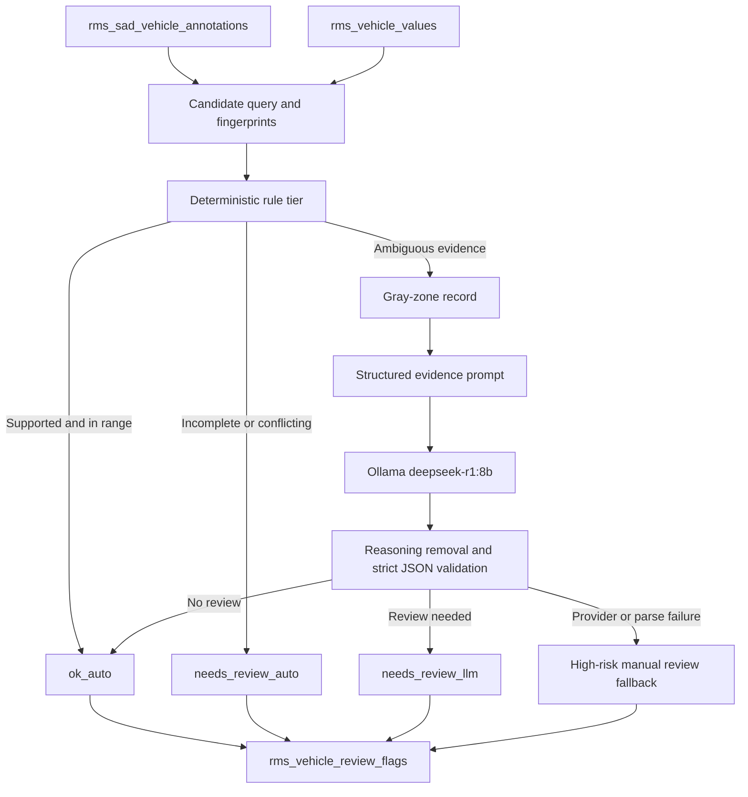

<!-- Synced from rms-vehicle-review/docs/documentation.md. Edit there, then re-run scripts/sync-docs.sh -->

# RMS Vehicle Review Documentation

This document describes the purpose, architecture, decision logic, local LLM
reasoning, deployment, and operation of `rms-vehicle-review`.

## 1. Project Overview

### Executive Summary

RMS Vehicle Review is a decision-support service for vehicle import
declarations already normalized by `rms-vehicle-annotate`. It compares each
annotated vehicle with historical peer-value bands and repeated-chassis
evidence, automatically clears well-supported records, and identifies records
that should be examined by a human officer.

The service deliberately uses two decision tiers:

1. Deterministic rules handle clear cases without an LLM.
2. A local Ollama model reasons only about records for which the statistical
   evidence is incomplete, thin, or outside the established range.

The application does not alter the source annotation. It writes a separate,
auditable decision to `rmdb_schema.rms_vehicle_review_flags`.

### Problem Statement

Vehicle declarations are processed daily, but a human reviewer cannot
efficiently inspect every record. Declared values can also vary for legitimate
reasons, so a simple rule such as “flag every value below average” would create
too many false positives.

The service addresses this by:

- grouping vehicles by normalized characteristics;
- using observed peer-value ranges rather than an invented market price;
- automatically clearing records supported by enough similar declarations;
- automatically flagging incomplete or internally conflicting data;
- using local LLM reasoning for ambiguous records;
- recording the evidence and reason for every decision;
- processing the backlog in small, immediately committed batches.

### Core Objectives

- Reduce the number of records requiring human inspection.
- Preserve conservative behavior when evidence or LLM output is unreliable.
- Keep all LLM inference local through Ollama.
- Make decisions explainable through stored reasons and peer statistics.
- Avoid repeatedly processing unchanged records.
- Preserve completed work when a long-running job stops or fails.
- Provide a bounded off-peak runtime suitable for scheduled operation.

### Non-Objectives and Important Limitations

The system is not:

- a customs valuation determination;
- an external vehicle market-price database;
- a legal finding of fraud or misdeclaration;
- a replacement for an officer's decision;
- a model that learns automatically from reviewer outcomes;
- a source of facts beyond the supplied declaration and peer statistics.

An LLM confidence value is the model's self-reported confidence. It is not a
calibrated probability and must not be interpreted as the probability of fraud.

## 2. Technical Architecture

### System Diagram



### Data Flow

1. `rms-vehicle-annotate` writes normalized records to
   `rmdb_schema.rms_sad_vehicle_annotations`.
2. The same upstream application maintains `rmdb_schema.rms_vehicle_values`,
   containing peer-value bands by HS code, fuel, make, model, capacity band,
   and vehicle year.
3. RMS Vehicle Review selects records that have never been reviewed or whose
   relevant source/peer evidence has changed.
4. The candidate query enriches each record with:
   - matching peer-value statistics;
   - repeated-chassis counts;
   - variation in make, model, and value for the chassis.
5. Deterministic rules classify clear records.
6. Only gray-zone records are sent to the local LLM.
7. Results are committed to `rms_vehicle_review_flags` after every batch.
8. The worker repeats until the backlog is empty or its runtime expires.

### Technology Stack

**Language and runtime**

- Python 3.10+
- Python virtual environment

**Database**

- PostgreSQL
- `psycopg2-binary`
- Raw parameterized SQL

**Local inference**

- Ollama HTTP API
- Default model: `deepseek-r1:8b`
- No cloud LLM fallback

**Configuration**

- YAML settings
- `.env` database credentials
- Environment-variable substitution

**Scheduling**

- `rms-central-command`
- Package: `ai_off_peak`
- Daily schedule: 23:00 Asia/Colombo

### Logical Components

- `main.py`: command-line interface and logging setup.
- `config/config_loader.py`: YAML, `.env`, and database configuration.
- `core/processor.py`: runtime deadline, repeated batches, rule and LLM
  orchestration, progress logs, and cumulative totals.
- `core/peer_lookup.py`: candidate query execution and peer-stat construction.
- `core/rules.py`: deterministic first-tier decisions.
- `core/llm_review.py`: evidence prompt and conservative review behavior.
- `core/providers.py`: Ollama transport, retry handling, reasoning removal, and
  strict verdict parsing.
- `database/queries.py`: candidate selection and review upsert SQL.
- `database/connection.py`: PostgreSQL connection pool.
- `database/schema.py`: table setup.
- `deployment/create_tables.sql`: output table, constraints, and indexes.

## 3. Data Model

### Source: `rms_sad_vehicle_annotations`

The service consumes the processed annotation rather than raw SAD tables.
Important fields include:

- `instanceid`, `key_itm_nbr`, `key_rnk`: unique vehicle record identity.
- `chassis`: declared chassis or VIN.
- `source_make`, `source_model`: original declaration text.
- `vehicle_make`, `vehicle_model`: normalized annotation.
- `vehicle_year`: declared/model year.
- `tar_hsc_nb1`: tariff HS code.
- `source_fuel_type`, `fuel_type`: raw and normalized fuel.
- `engine_capacity`, `capacity_cc`: raw and parsed capacity.
- `value_usd`: per-vehicle declared value in USD.
- `annotation_source`: annotation method or failure marker.
- `annotated_at`: source annotation timestamp.

### Peer Source: `rms_vehicle_values`

Peer groups use the following grain:

- tariff HS code;
- normalized fuel type;
- normalized make;
- normalized model;
- rounded capacity band;
- vehicle year.

The matching row supplies:

- minimum observed peer value;
- average observed peer value;
- maximum observed peer value;
- peer vehicle count.

These bands are historical summaries created upstream. The LLM does not search
the internet and does not independently estimate a market value.

### Output: `rms_vehicle_review_flags`

The output has the same composite identity as the annotation:

- `instanceid`
- `key_itm_nbr`
- `key_rnk`

Decision fields:

- `review_status`: `ok_auto`, `needs_review_auto`,
  `needs_review_llm`, or `reviewed`.
- `risk_level`: `low`, `medium`, `high`, or null.
- `reasons`: JSON array of concise evidence-based explanations.
- `peer_stats`: JSON snapshot of the peer/chassis evidence used.
- `decision_method`: `stat_rule` or `llm:<model>`.
- `llm_confidence`: 0–100 for LLM decisions; null for deterministic decisions.

Audit and workflow fields:

- `source_annotated_at`
- `source_fingerprint`
- `annotation_fingerprint`
- `created_at`, `updated_at`
- `reviewed_by`, `reviewed_at`, `reviewer_notes`

### Fingerprints and Reprocessing

The candidate query calculates two MD5 fingerprints:

1. `annotation_fingerprint` covers the relevant annotation fields.
2. `source_fingerprint` covers those fields plus the peer-value evidence.

A record is eligible when its current source fingerprint differs from the last
stored fingerprint. This includes:

- records never processed before;
- changed annotation values;
- changed peer ranges or peer counts.

Human-reviewed rows are protected from peer-only updates. They are reopened
only when the underlying annotation fingerprint changes.

## 4. Decision Logic

### Why the System Uses Two Tiers

An LLM is unnecessary and undesirable for obvious cases. Deterministic rules
are faster, repeatable, and easier to audit. The LLM is therefore restricted to
records where a contextual judgment is needed.

This separation also reduces:

- local compute usage;
- inference time;
- exposure to inconsistent model output;
- the number of decisions dependent on generative reasoning.

### Tier 1: Deterministic Automatic Review

#### Incomplete annotation

A record is immediately marked `needs_review_auto`, risk `high`, if:

- `annotation_source` is `failed`; or
- any required field is missing or blank.

Required fields are:

- annotation source;
- HS code;
- normalized make;
- normalized model;
- vehicle year;
- normalized fuel type;
- parsed capacity;
- declared USD value.

#### Invalid numeric data

The record is marked `needs_review_auto`, risk `high`, when year, capacity, or
value is zero or negative.

#### Repeated-chassis conflict

The record is marked `needs_review_auto`, risk `high`, when the same normalized
chassis appears more than once and at least one of these conditions applies:

- more than one normalized make is associated with the chassis;
- more than one normalized model is associated with the chassis;
- the percentage spread between minimum and maximum declared values reaches
  `chassis_value_difference_pct` (default 25%).

Repeated use by itself is not automatically treated as a conflict. The
associated vehicle attributes or value spread must be materially different.

#### Supported in-band record

A record is marked `ok_auto` when:

- a matching peer group exists;
- peer count is at least `min_peer_count` (default 5);
- the declared value is between peer minimum and peer maximum;
- no earlier automatic-review condition applies.

#### Gray-zone routing

All remaining records are routed to the LLM. Typical reasons are:

- no matching peer group;
- fewer than the required number of peers;
- value below the peer minimum;
- value above the peer maximum;
- insufficient evidence for an automatic determination.

The deterministic layer calculates the percentage outside the peer band and
passes that signal to the model.

### Decision Status Meaning

`ok_auto`

- No human review requested by this service.
- May originate from a deterministic in-band decision or an LLM gray-zone
  decision.
- `decision_method` distinguishes the source.

`needs_review_auto`

- Human review requested by a deterministic condition.
- Used for incomplete, invalid, or conflicting records.

`needs_review_llm`

- Human review requested by the local LLM.
- Also used conservatively when LLM generation or response parsing fails.

`reviewed`

- A human has completed review.
- Reviewer identity, timestamp, and notes may be recorded.

## 5. Local LLM Reasoning

### Role of the LLM

The LLM is not asked to annotate the vehicle or calculate a customs value. Its
task is narrower:

> Given this declared vehicle, its historical peer statistics, and the reasons
> deterministic rules could not decide, should a human officer inspect it?

The model is instructed to reason across:

- identity consistency;
- make and model;
- engine capacity;
- model year;
- fuel type;
- HS code;
- peer sample size;
- declared-value deviation.

### Evidence Sent to the Model

The prompt contains three structured sections.

#### Declaration

- record identity;
- chassis;
- HS code;
- source and normalized make/model;
- vehicle year;
- source and normalized fuel;
- raw and parsed engine capacity;
- declared value in USD;
- annotation source.

#### Peer statistics

- peer count;
- matched capacity band;
- minimum peer value;
- average peer value;
- maximum peer value;
- chassis occurrence count;
- number of makes and models associated with the chassis;
- chassis minimum and maximum declared values.

#### Gray-zone signals

These are generated by deterministic code, for example:

- `No established peer group for this vehicle combination`
- `Peer group is thin (3 records; 5 required)`
- `Declared value is 28.4% below the peer minimum`

### Evidence Not Sent to the Model

The current implementation does not provide:

- importer or declarant identity;
- entity risk ratings;
- inspection or fraud history;
- external market prices;
- internet search results;
- raw VDF descriptions;
- tax calculations;
- country-of-origin context;
- reviewer outcomes from previous cases.

The model must not claim knowledge of these facts.

### Prompt Constraints

The system prompt explicitly tells the model:

- use only supplied evidence;
- do not invent market prices or facts;
- determine whether human review is justified;
- return exactly one JSON object;
- provide short, evidence-based reasons;
- keep hidden reasoning out of the reasons.

An abbreviated conceptual prompt is:

```text
You are a customs vehicle declaration review assistant.
Use only the supplied declaration and peer statistics.
Do not invent market prices or facts.
Decide whether a human officer should inspect this record.

Return:
{
  "needs_review": true,
  "risk_level": "low|medium|high",
  "reasons": ["short evidence-based reason"],
  "confidence": 0
}
```

### Example Evidence and Verdict

Example input evidence:

```json
{
  "declaration": {
    "tar_hsc_nb1": "87034035",
    "vehicle_make": "TOYOTA",
    "vehicle_model": "PRIUS",
    "vehicle_year": 2022,
    "fuel_type": "Petrol/Electric",
    "capacity_cc": 1800,
    "value_usd": 7000
  },
  "peer_statistics": {
    "peer_count": 8,
    "min_value_usd": 9000,
    "average_value_usd": 10500,
    "max_value_usd": 12000
  },
  "gray_zone_signals": [
    "Declared value is 22.2% below the peer minimum"
  ]
}
```

Example valid output:

```json
{
  "needs_review": true,
  "risk_level": "high",
  "reasons": [
    "The declared value is 22.2% below the minimum observed among eight matching peers."
  ],
  "confidence": 90
}
```

### Ollama Request

The provider sends a non-streaming request to:

```text
http://127.0.0.1:11434/api/generate
```

The request specifies:

- configured model (`deepseek-r1:8b`);
- system prompt;
- record evidence prompt;
- `format: json`;
- configured temperature (default 0.1);
- configured HTTP timeout (default 180 seconds).

Low temperature is used to reduce unnecessary response variation.

### DeepSeek Reasoning Handling

Reasoning models may return internal reasoning inside `<think>...</think>`.
The application removes this content before parsing and never stores it in the
review table.

If a `<think>` block is truncated and never closed, the remainder beginning at
`<think>` is discarded conservatively.

Only the final structured verdict is eligible for persistence.

### Strict Response Validation

The final response must be one JSON object containing exactly:

- `needs_review`: boolean;
- `risk_level`: `low`, `medium`, or `high`;
- `reasons`: non-empty array of strings;
- `confidence`: numeric value from 0 through 100.

The parser rejects:

- prose before or after JSON;
- unexpected fields;
- missing fields;
- empty reasons;
- non-string reasons;
- invalid risk levels;
- non-boolean review decisions;
- confidence outside 0–100.

At most five reasons are retained.

### Retry and Conservative Failure Behavior

Transport/provider failures use exponential retry:

- initial attempt;
- retry after 1 second;
- retry after 2 seconds;
- total attempts with the default `max_retries: 2`: three.

If a response reaches Ollama but fails schema validation, the application asks
the model again once.

If a per-record generation or parsing failure remains, the record is not
silently cleared. It is stored as:

- `review_status`: `needs_review_llm`;
- `risk_level`: `high`;
- `llm_confidence`: `0`;
- reason indicating that LLM review failed and manual review is required.

This is a fail-safe operational decision, not evidence that the declaration is
high-risk.

Before the first gray-zone record, the processor checks that Ollama is
reachable and the configured model is installed. A failed preflight aborts the
run rather than manufacturing record-level decisions. Batches committed before
that failure remain saved; the failed batch can be retried after Ollama is
restored.

### Interpretation of LLM Confidence

Confidence is useful as supporting metadata, but it must be interpreted
carefully:

- it is generated by the same model making the decision;
- it has not been calibrated against confirmed review outcomes;
- confidence can vary between model versions;
- high confidence does not prove misdeclaration;
- low confidence does not prove the record is safe.

The evidence in `reasons` and `peer_stats` should be considered more important
than the numeric confidence value.

## 6. Batch Processing and Runtime Control

### Repeated Batch Model

Default processing settings are:

- runtime: 8 hours;
- batch size: 25 records;
- break after each LLM-reviewed record: 5 seconds.

The worker:

1. fetches up to 25 eligible records;
2. evaluates and processes them sequentially;
3. commits all completed records from that batch;
4. fetches the next batch;
5. repeats until complete or time-limited.

Each batch is committed independently. A later process failure does not remove
already committed batches.

### Runtime Deadline

The deadline uses a monotonic clock and starts when the command begins.

The application checks the deadline:

- before fetching another batch;
- after preparing a batch;
- before starting each record;
- after finishing each record.

If an LLM call crosses the deadline, the current record is allowed to finish.
The completed partial batch is then committed and the process exits with
`stop_reason: time_limit`.

### Break After LLM Review

After each LLM-reviewed record, the process waits for the configured `breaks`
seconds. Rule-only decisions skip the pause because they do not load the local
model.

The pause is shortened when less time remains before the deadline.

### Candidate Date Behavior

`--date` is a priority hint, not a filter.

Without `--date`, yesterday's annotations are prioritized. After those, the
worker continues through all older eligible backlog records.

With `--date`, records annotated on that date are prioritized first, followed
by the remaining eligible backlog.

## 7. Installation and Configuration

### Prerequisites

- Ubuntu Linux server
- Python 3.10+
- PostgreSQL connectivity to RMDB
- Ollama installed and running
- `deepseek-r1:8b` available locally
- upstream `rms-vehicle-annotate` tables populated

### Install

```bash
cd /opt
git clone https://github.com/uvindu-perera/rms-vehicle-review.git
cd rms-vehicle-review

python3 -m venv .venv
source .venv/bin/activate
pip install -r requirements.txt

cp .env.example .env
nano .env
chmod 600 .env

ollama pull deepseek-r1:8b
python main.py setup
```

### Required Environment Variables

- `RMDB_HOST`
- `RMDB_PORT`
- `RMDB_USER`
- `RMDB_PASSWORD`
- `RMDB_DATABASE`
- `RMDB_SCHEMA`

Optional:

- `RMS_VEHICLE_REVIEW_ENV_FILE`: alternate `.env` path.

### Settings

`config/settings.yaml` controls:

- `hours`: default maximum runtime.
- `breaks`: pause in seconds after each LLM-reviewed record.
- `batch_size`: records loaded and committed per batch.
- `min_peer_count`: minimum support for deterministic clearance.
- `capacity_band_cc`: peer capacity rounding band.
- `value_band_tolerance_pct`: labels small outside-band deviations as
  borderline evidence for the LLM.
- `chassis_value_difference_pct`: repeated-chassis value-spread threshold.
- `ollama.endpoint`: local Ollama base URL.
- `ollama.model`: inference model.
- `ollama.timeout`: request timeout in seconds.
- `ollama.temperature`: generation temperature.
- `ollama.max_retries`: retries after the initial transport attempt.

## 8. Command-Line Interface

### Create or Update Tables

```bash
python main.py setup
```

The DDL is idempotent and also creates supporting indexes.

### Standard Off-Peak Run

```bash
python main.py run
```

This drains all eligible records for up to the configured eight hours.

### Override Runtime

```bash
python main.py run --hours 2
```

`--hours` overrides settings for that invocation. Zero is valid and causes the
worker to stop without starting a batch.

### Prioritize a Date

```bash
python main.py run --date 2026-07-15
```

This does not restrict processing to that date.

### Combine Options

```bash
python main.py run --date 2026-07-15 --hours 2
```

### Final Summary

The command reports:

- configured runtime;
- stop reason (`complete` or `time_limit`);
- number of batches;
- candidates fetched;
- records processed;
- gray-zone records;
- each decision-status count;
- rows written;
- total duration.

## 9. Scheduling with RMS Central Command

The service is registered as `rms-vehicle-review`.

The `ai_off_peak` package runs:

```text
cron: 0 23 * * *
timezone: Asia/Colombo
command: python main.py run
```

Add the production path to `/opt/rms-central-command/.env`:

```bash
RMS_CC_RMS_VEHICLE_REVIEW_ROOT=/opt/rms-vehicle-review
```

Validate registration:

```bash
cd /opt/rms-central-command
./venv/bin/python src/main.py list-packages
```

Run manually through the orchestrator:

```bash
./venv/bin/python src/main.py run-package ai_off_peak
```

The central-command scheduler must be restarted after configuration changes so
it reloads the package registry.

## 10. Security, Privacy, and Governance

### Local Inference

The configured endpoint is localhost, so prompts remain on the application
server when Ollama is deployed locally. Changing the endpoint to another host
changes this security property and should require review.

### Secrets

- Database passwords belong only in `.env`.
- `.env` is excluded from git.
- Recommended permissions: `chmod 600 .env`.
- Prompts do not require database credentials.

### Data Minimization

The prompt contains only vehicle declaration fields and aggregated peer
evidence required for the decision. It does not intentionally include importer
identity or unrelated customs data.

### Explainability and Auditability

Persisted evidence includes:

- decision method;
- concise reasons;
- peer-stat snapshot;
- model identity;
- confidence;
- source fingerprints;
- timestamps.

Internal chain-of-thought is intentionally not persisted. Auditability is based
on inputs, explicit rule behavior, final reasons, and decision metadata.

### Human Oversight

The system produces a review queue. Officers should:

- inspect the supplied evidence;
- verify relevant source records;
- record reviewer identity and notes;
- avoid treating an LLM flag as proof of misconduct.

## 11. Operations and Review Queries

### Queue Summary

```sql
SELECT review_status, risk_level, COUNT(*)
FROM rmdb_schema.rms_vehicle_review_flags
GROUP BY review_status, risk_level
ORDER BY review_status, risk_level;
```

### Open Review Queue

```sql
SELECT *
FROM rmdb_schema.rms_vehicle_review_flags
WHERE review_status IN ('needs_review_auto', 'needs_review_llm')
ORDER BY
    CASE risk_level
        WHEN 'high' THEN 1
        WHEN 'medium' THEN 2
        ELSE 3
    END,
    updated_at;
```

### LLM Decisions

```sql
SELECT
    instanceid,
    key_itm_nbr,
    key_rnk,
    review_status,
    risk_level,
    llm_confidence,
    reasons,
    peer_stats,
    updated_at
FROM rmdb_schema.rms_vehicle_review_flags
WHERE decision_method LIKE 'llm:%'
ORDER BY updated_at DESC;
```

### Conservative LLM Failures

```sql
SELECT *
FROM rmdb_schema.rms_vehicle_review_flags
WHERE review_status = 'needs_review_llm'
  AND llm_confidence = 0
ORDER BY updated_at DESC;
```

### Complete a Human Review

```sql
UPDATE rmdb_schema.rms_vehicle_review_flags
SET
    review_status = 'reviewed',
    reviewed_by = 'officer-id',
    reviewed_at = CURRENT_TIMESTAMP,
    reviewer_notes = 'Review outcome and supporting observations'
WHERE instanceid = :instanceid
  AND key_itm_nbr = :key_itm_nbr
  AND key_rnk = :key_rnk;
```

## 12. Logging and Troubleshooting

### Normal Progress Logs

The application logs:

- run date and runtime settings;
- batch number and remaining runtime;
- candidate-fetch duration;
- gray-zone count;
- each LLM record and verdict duration;
- per-record progress;
- LLM-review pauses;
- batch commits;
- stop reason.

### Missing Database Password

Error:

```text
ValueError: Missing DB config fields for 'rmdb': ['password']
```

Fix:

```bash
cd /opt/rms-vehicle-review
cp .env.example .env
nano .env
chmod 600 .env
```

Ensure `RMDB_PASSWORD` contains the real password.

### Ollama Unavailable

Check:

```bash
curl http://127.0.0.1:11434/api/tags
ollama list
ollama ps
```

If the model is missing:

```bash
ollama pull deepseek-r1:8b
```

### Slow First Run

The first run may contain the full historical backlog. Runtime depends on:

- number of candidates;
- percentage routed to the LLM;
- CPU/GPU availability;
- model response time;
- configured five-second LLM cooldown.

Completed batches are retained, so the next scheduled run resumes from the
remaining records.

### No Candidates

`No remaining candidates; backlog is complete` means all current source and
peer fingerprints already match their persisted review records.

### Time-Limit Stop

`stop_reason: time_limit` is a normal successful outcome. It means work remains
for the next run; completed batches have already been committed.

### Invalid Model Response

The service retries one schema-invalid response. Continued failures are written
as conservative manual-review flags with confidence zero.

## 13. Testing

Run:

```bash
python -m unittest discover -s tests -v
python -m compileall -q .
```

Tests cover:

- deterministic review rules;
- DeepSeek reasoning removal;
- strict JSON response validation;
- malformed-response retries;
- conservative LLM fallback;
- repeated batch draining;
- batch-level persistence;
- runtime deadline behavior;
- partial-batch saving;
- LLM-review breaks;
- runtime override precedence;
- fingerprint protections for human-reviewed rows.

## 14. Maintenance Guidance

### Changing Thresholds

Change one setting at a time, document why it changed, and compare:

- auto-clear rate;
- automatic-review rate;
- LLM-review rate;
- reviewer-confirmed outcomes;
- LLM failure count.

### Changing the LLM

Before changing `ollama.model`:

1. run the test suite;
2. test a fixed representative record sample;
3. compare decisions and reasons with the current model;
4. verify strict JSON compliance;
5. confirm latency fits the eight-hour window;
6. record the model change operationally.

Historical rows retain `decision_method`, which identifies the model used.

### Model Evaluation Recommendation

To assess usefulness formally, collect human outcomes separately and measure:

- precision of `needs_review_llm`;
- false-clear rate among sampled `ok_auto` LLM decisions;
- agreement by evidence category;
- parse/provider failure rate;
- decision stability across repeated prompts;
- processing time per record.

Do not optimize only for the number of flags. The intended outcome is a
manageable, evidence-rich review queue.

---

## Attribution

*Administrative context — separate from the operational sections above.*

> **Developer** — **Uvindu Perera**, Superintendent of Customs, **Risk Management Directorate**.
>
> **Modernization context** — **rms-vehicle-review** is part of the program to retire legacy **ARMS** components in favor of service-oriented Python applications. This service applies a two-tier review pipeline to SAD vehicle import annotations — deterministic rule-based checks for auto-clear or auto-flag, followed by local **LLM reasoning (deepseek-r1:8b via Ollama)** for gray-zone records — to produce a prioritized review queue with evidence-rich reasons and risk levels. It writes to **rmdb_schema.rms_vehicle_review_flags** on RMDB PostgreSQL, with scheduled and on-demand runs on institutional production hosts, integrated through **rms-central-command** in the `ai_off_peak` package daily at 23:00.
